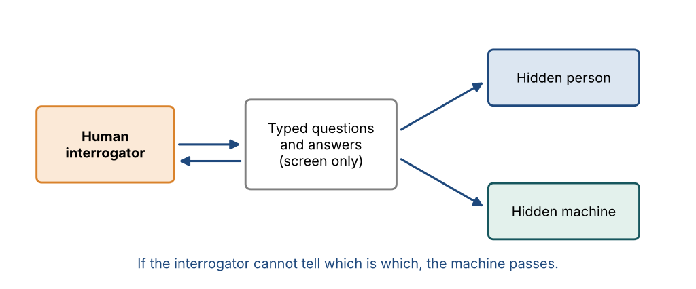
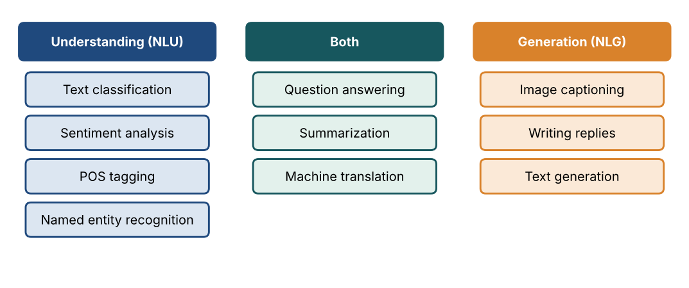
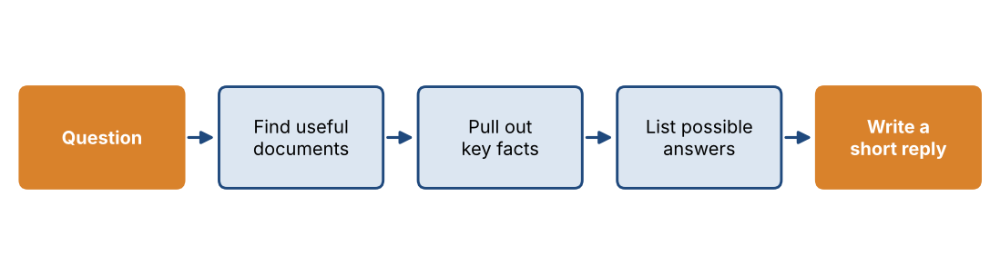

# Chapter 1 — AI Foundations & Text Processing: Pattern Recognition and NLP Tasks

**Part I — Foundations** · [](https://colab.research.google.com/github/winnertechserv/aimlgybs/blob/main/part1_foundations/ch01_ai_foundations_text_processing/ch01_notebook.ipynb)

Companion code for Chapter 1 of *AI-Machine Learning: Get Your Base Strong*. The book explains the ideas; this folder lets you run them.

## Key ideas

- AI can be defined as acting humanly (the Turing Test), thinking rationally, or automating tasks that need intelligence.
- Machine learning is pattern recognition from examples. The goal is good generalization to unseen data.
- NLP tasks are NLU (understanding), NLG (generating), or both: question answering, summarization and translation.
- Sentiment analysis needs context: word order and negation can flip the meaning of the same words.
- POS tagging labels grammar; NER labels real-world things such as people, places, organizations and dates.
- Extractive summaries pick original sentences; abstractive summaries write new ones.
- Translation is hard because languages differ in word forms, grammar and word order.

## Examples

| # | Program | What it shows |
|---|---|---|
| 1 | [`ex1_pattern_recognition_predicting_the_next_numbe.py`](ex1_pattern_recognition_predicting_the_next_numbe.py) | This tiny 'learner' looks at a sequence and tries several kinds of rule: multiply by a constant, add up the previous terms, or a polynomial found by taking differences until they become constant. |
| 2 | [`ex2_sentiment_analysis_with_tf_idf_and_logistic_r.py`](ex2_sentiment_analysis_with_tf_idf_and_logistic_r.py) | TF-IDF turns each review into a vector of word weights, and logistic regression learns which words point to 'positive' and which to 'negative'. |
| 3 | [`ex3_extractive_summarization.py`](ex3_extractive_summarization.py) | This is the simplest extractive summarizer. |

Run any example from this folder:

```bash
cd part1_foundations/ch01_ai_foundations_text_processing
python ex1_pattern_recognition_predicting_the_next_numbe.py
```

The exact output printed in the book is in [`expected_output/`](expected_output). The notebook [`ch01_notebook.ipynb`](ch01_notebook.ipynb) has all three examples with explanations.

### Example 1: Pattern Recognition — Predicting the Next Number

This tiny 'learner' looks at a sequence and tries several kinds of rule: multiply by a constant, add up the previous terms, or a polynomial found by taking differences until they become constant. It keeps whichever rule fits and uses it to predict the next number. Look at the last one: 3, 5, 12, 24, 41 has differences 2, 7, 12, 17, which grow by 5 each time, so the next term is 63.

<details><summary>Expected output</summary>

```text
[1, 2, 3, 4, 5]          rule: polynomial of degree 1     next -> 6
[1, 3, 5, 7, 9]          rule: polynomial of degree 1     next -> 11
[2, 3, 5, 7, 11]         rule: next prime number          next -> 13
[1, 4, 9, 16, 25]        rule: polynomial of degree 2     next -> 36
[1, 2, 4, 8, 16, 32]     rule: multiply by 2              next -> 64
[1, 1, 2, 3, 5, 8]       rule: sum of previous 2 terms    next -> 13
[1, 1, 2, 4, 7, 13]      rule: sum of previous 3 terms    next -> 24
[3, 5, 12, 24, 41]       rule: polynomial of degree 2     next -> 63
```

</details>

### Example 2: Sentiment Analysis with TF-IDF and Logistic Regression

TF-IDF turns each review into a vector of word weights, and logistic regression learns which words point to 'positive' and which to 'negative'. We also include word pairs (ngram_range=(1, 2)). That lets the model learn 'not good' and 'not bad' as separate clues, so it correctly separates the two tricky sentences from the overview. The last lines show the strongest signals the model learned for each class.

<details><summary>Expected output</summary>

```text
Vocabulary size (words + word pairs): 98
The food was good, not bad at all      -> pos  (P(pos) = 0.73)
The food was bad, not good at all      -> neg  (P(pos) = 0.27)
friendly staff and delicious pizza     -> pos  (P(pos) = 0.72)
rude staff and cold pizza              -> neg  (P(pos) = 0.27)

Strongest NEGATIVE signals: ['bad', 'was bad', 'was burnt', 'burnt', 'not good']
Strongest POSITIVE signals: ['good', 'was good', 'delicious', 'was delicious', 'quite good']
```

</details>

### Example 3: Extractive Summarization

This is the simplest extractive summarizer. It counts how often each meaningful word appears (ignoring filler words such as 'the'), scores each sentence by the average importance of its words, and keeps the top three in their original order. Notice that the off-topic sentence about the weather gets a low score and is left out.

<details><summary>Expected output</summary>

```text
Most important words: ['translation', 'text', 'systems', 'sentence', 'machine', 'converts']

Sentence scores:
  0.50  Machine translation converts text from one language into anoth
  0.33  It is hard because languages differ in word order and grammar.
  0.33  German, for example, usually puts the verb in a different plac
  0.50  Modern translation systems learn from millions of translated s
  0.33  The weather was pleasant on the day the first system was demon
  0.41  These systems use neural networks that read the whole sentence
  0.48  Good translation must keep both the meaning and the style of t

Summary (3 of 7 sentences):
 - Machine translation converts text from one language into another.
 - Modern translation systems learn from millions of translated sentence pairs.
 - Good translation must keep both the meaning and the style of the original text.
```

</details>

## Figures from this chapter

**Figure 1.1.** The Turing Test: a person types questions to two hidden partners and must decide which one is the machine.



**Figure 1.2.** A map of NLP tasks: some read language, some write it, and some must do both.



**Figure 1.3.** The steps of a question-answering system.



The code that draws these figures is in [`figures/src`](../../figures/src).

---

[All chapters](../../README.md#chapters) · [Chapter 2 →](../../part1_foundations/ch02_ai_applications)
