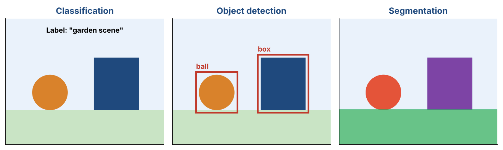
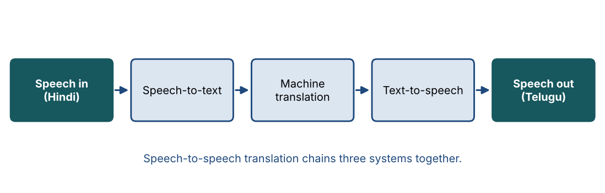
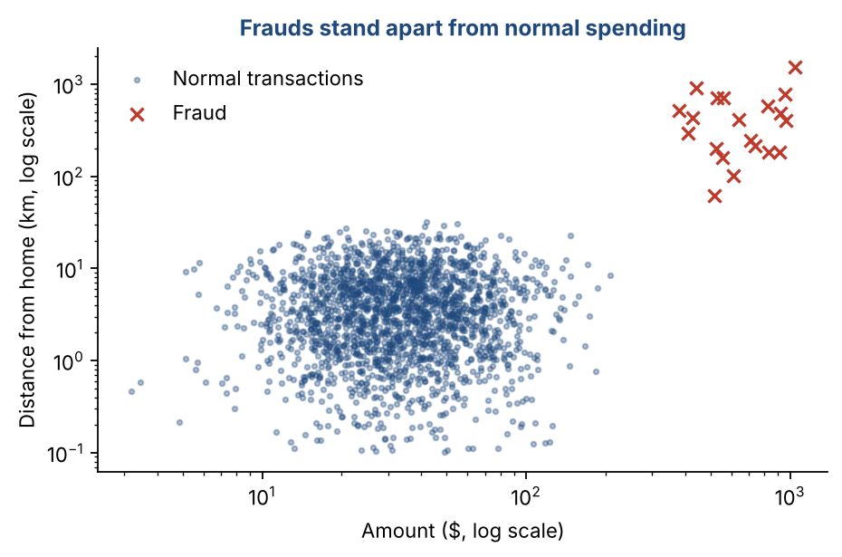

# Chapter 2 — AI Applications: Image, Video, Speech & Real-World Domains

**Part I — Foundations** · [](https://colab.research.google.com/github/winnertechserv/aimlgybs/blob/main/part1_foundations/ch02_ai_applications/ch02_notebook.ipynb)

Companion code for Chapter 2 of *AI-Machine Learning: Get Your Base Strong*. The book explains the ideas; this folder lets you run them.

## Key ideas

- Image tasks include classification, clustering, segmentation, retrieval, captioning, VQA and generation.
- Image retrieval can work by example (needs a similarity measure) or by keyword (needs annotated images).
- Video is multimodal: frames, audio and text all carry information.
- Speech tasks cover recognizing words, speakers, languages and emotions, plus synthesis and translation.
- Recognizing who or what is in audio should not depend on the words spoken, the language or the channel.
- Banking and healthcare are major users of AI: fraud detection, credit scoring, diagnosis and personalized treatment.

## Examples

| # | Program | What it shows |
|---|---|---|
| 1 | [`ex1_image_classification_on_handwritten_digits.py`](ex1_image_classification_on_handwritten_digits.py) | Scikit-learn includes 1,797 tiny 8x8 images of handwritten digits. |
| 2 | [`ex2_image_retrieval_by_example.py`](ex2_image_retrieval_by_example.py) | This is query-by-example. |
| 3 | [`ex3_fraud_detection_in_banking.py`](ex3_fraud_detection_in_banking.py) | Banks see millions of normal transactions and very few frauds, often with no fraud labels at all. |

Run any example from this folder:

```bash
cd part1_foundations/ch02_ai_applications
python ex1_image_classification_on_handwritten_digits.py
```

The exact output printed in the book is in [`expected_output/`](expected_output). The notebook [`ch02_notebook.ipynb`](ch02_notebook.ipynb) has all three examples with explanations.

### Example 1: Image Classification on Handwritten Digits

Scikit-learn includes 1,797 tiny 8x8 images of handwritten digits. Each image is 64 pixel values, so to the computer an image is just a list of 64 numbers. The program draws one digit as text so you can see it, trains a support vector machine (you will meet SVMs in Chapters 11 and 12) on 70% of the images, and tests on the rest. It reaches 99.4% accuracy and reports which digits it confused.

<details><summary>Expected output</summary>

```text
Images: 1797 | pixels per image: 64 | classes: [0, 1, 2, 3, 4, 5, 6, 7, 8, 9]

Image 0 (label 0):
  ..+##...
  ..####+.
  ..#..#+.
  .+#..++.
  .++..#+.
  .+#..#+.
  ..#+##..
  ..+##...

Test accuracy: 0.994 on 540 unseen images
Most common mistake: true 3 predicted as 7 (1 time(s))
Per-digit accuracy: {0: 1.0, 1: 1.0, 2: 1.0, 3: 0.98, 4: 1.0, 5: 1.0, 6: 1.0, 7: 1.0, 8: 0.98, 9: 0.98}
```

</details>

### Example 2: Image Retrieval by Example

This is query-by-example. We pick eight images as queries and ask the system for the five most similar images in the collection, using cosine similarity between pixel vectors. Precision@5 is the share of those five with the same digit as the query. Most queries score a perfect 1.0. One messy '3' brings back two '8's, which shows that similar-looking digits are the hard cases. The last line shows query-by-semantics: because every image is labeled, we can ask for 'sevens' by keyword.

<details><summary>Expected output</summary>

```text
Query digit 5 -> top-5 labels [5, 5, 5, 5, 5]  similarity [0.966, 0.922, 0.906, 0.875, 0.873]  precision@5 = 1.0
Query digit 0 -> top-5 labels [0, 0, 0, 0, 0]  similarity [0.981, 0.979, 0.973, 0.973, 0.973]  precision@5 = 1.0
Query digit 4 -> top-5 labels [4, 4, 4, 4, 4]  similarity [0.987, 0.968, 0.963, 0.949, 0.948]  precision@5 = 1.0
Query digit 3 -> top-5 labels [3, 8, 3, 8, 3]  similarity [0.931, 0.913, 0.907, 0.897, 0.895]  precision@5 = 0.6
Query digit 0 -> top-5 labels [0, 0, 0, 0, 0]  similarity [0.944, 0.943, 0.933, 0.932, 0.928]  precision@5 = 1.0
Query digit 3 -> top-5 labels [3, 3, 3, 3, 3]  similarity [0.974, 0.966, 0.958, 0.955, 0.953]  precision@5 = 1.0
Query digit 3 -> top-5 labels [3, 3, 3, 3, 3]  similarity [0.962, 0.949, 0.947, 0.938, 0.933]  precision@5 = 1.0
Query digit 3 -> top-5 labels [3, 3, 3, 3, 3]  similarity [0.935, 0.92, 0.908, 0.903, 0.903]  precision@5 = 1.0

Mean precision@5 over 8 queries: 0.95

QBS 'show me sevens': 179 annotated images match the keyword '7'
```

</details>

### Example 3: Fraud Detection in Banking

Banks see millions of normal transactions and very few frauds, often with no fraud labels at all. An Isolation Forest learns what normal looks like and flags anything unusual. Here, 20 frauds (large amounts, at night, far from home, many purchases in an hour) are hidden among 2,000 normal transactions. The model flags 21 transactions and catches all 20 frauds, with only one false alarm. We use the true labels only at the end, to check the result.

<details><summary>Expected output</summary>

```text
Transactions: 2020  (true frauds hidden inside: 20)
Flagged as suspicious: 21
Precision: 0.95   Recall: 1.00

Top 5 most unusual transactions:
  amount($)  hour  distance(km)  buys/hr  truly fraud?
        959     5           775        7  yes
       1041     3          1536        5  yes
        557     3           711       10  yes
        918     4           482        8  yes
        822     4           576        6  yes
```

</details>

## Figures from this chapter

**Figure 2.1.** One picture, three tasks: classification gives one label, detection draws a box round each object, and segmentation colors every pixel by what it belongs to.



**Figure 2.2.** Spoken translation: recognize the words, translate the text, then speak it in the new language.



**Figure 2.3.** The data behind Example 3: fraudulent transactions (red) are large and far from home, so an anomaly detector can find them without labels.



The code that draws these figures is in [`figures/src`](../../figures/src).

---

[← Chapter 1](../../part1_foundations/ch01_ai_foundations_text_processing) · [All chapters](../../README.md#chapters) · [Chapter 3 →](../../part1_foundations/ch03_paradigms_of_machine_learning_i)
