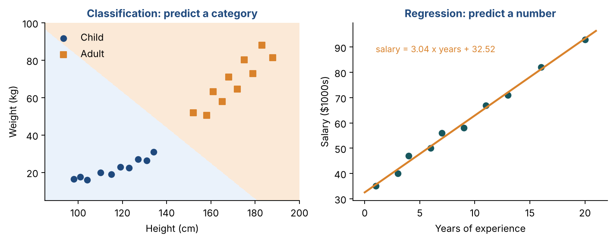
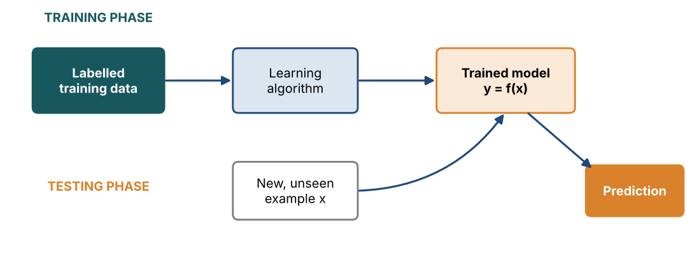
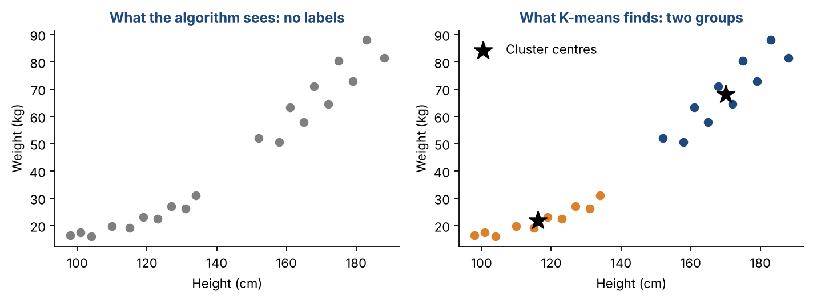

# Chapter 3 — Paradigms of Machine Learning I: Supervised & Unsupervised Learning

**Part I — Foundations** · [](https://colab.research.google.com/github/winnertechserv/aimlgybs/blob/main/part1_foundations/ch03_paradigms_of_machine_learning_i/ch03_notebook.ipynb)

Companion code for Chapter 3 of *AI-Machine Learning: Get Your Base Strong*. The book explains the ideas; this folder lets you run them.

## Key ideas

- Machine learning learns patterns from examples. Success is measured by generalisation to unseen data.
- Supervised learning uses labelled data to learn y = f(x).
- Classification predicts categories; regression predicts continuous numbers.
- Every supervised model is built in a training phase and judged in a testing phase.
- Unsupervised learning finds structure in unlabelled data: clusters of similar items, or rules about what goes together.
- Association rules are judged by support, confidence and lift. Lift above 1 means a real link.

## Examples

| # | Program | What it shows |
|---|---|---|
| 1 | [`ex1_supervised_learning_classification_and_regres.py`](ex1_supervised_learning_classification_and_regres.py) | Three short supervised tasks, each learned from labelled data. |
| 2 | [`ex2_unsupervised_learning_clustering_people.py`](ex2_unsupervised_learning_clustering_people.py) | Here K-means gets the same 20 people but no labels at all. |
| 3 | [`ex3_unsupervised_learning_association_rules.py`](ex3_unsupervised_learning_association_rules.py) | Ten shopping baskets, no labels. |

Run any example from this folder:

```bash
cd part1_foundations/ch03_paradigms_of_machine_learning_i
python ex1_supervised_learning_classification_and_regres.py
```

The exact output printed in the book is in [`expected_output/`](expected_output). The notebook [`ch03_notebook.ipynb`](ch03_notebook.ipynb) has all three examples with explanations.

### Example 1: Supervised Learning — Classification and Regression

Three short supervised tasks, each learned from labelled data. First, a classifier learns to tell children from adults using 20 example people, then labels two new people. Second, a K-NN classifier learns the three Iris species and is tested on flowers it never saw: the test accuracy is what measures generalisation. Third, a regression line predicts salary from experience. The answer, salary = 3.04 x years + 32.52, is the same line you will derive by hand in Chapter 7.

<details><summary>Expected output</summary>

```text
Height 150 cm, weight 47.0 kg -> Adult (P(adult) = 0.96)
Height 110 cm, weight 20.0 kg -> Child (P(adult) = 0.00)

Iris: trained on 105 flowers, tested on 45 unseen flowers
Train accuracy 0.981 | Test accuracy 0.978  <- the test score measures GENERALISATION

Salary line: salary = 3.04 x years + 32.52
Predicted salary for 10 years: 62.94 thousand
```

</details>

### Example 2: Unsupervised Learning — Clustering People

Here K-means gets the same 20 people but no labels at all. The table shows compactness (inertia) for 1 to 5 clusters. The big drop from 1 to 2 clusters is the 'elbow', so two groups is a natural choice. The two cluster centres come out at exactly the average child (116.2 cm, 21.85 kg) and the average adult (170.1 cm, 68.16 kg). The model found children and adults without ever being told they exist.

<details><summary>Expected output</summary>

```text
 k   compactness (inertia)
 1      29581.3
 2       4332.2
 3       2463.4
 4       1170.9
 5        773.5
Compactness drops sharply from k=1 to k=2, then flattens (the 'elbow').

Cluster centres (height, weight):
  (170.1 cm, 68.16 kg)
  (116.2 cm, 21.85 kg)

Agreement with the hidden child/adult labels: 100%
New person (130 cm, 30 kg) joins cluster with centre [116.2  21.8]
```

</details>

### Example 3: Unsupervised Learning — Association Rules

Ten shopping baskets, no labels. The program counts how often items appear together and turns each pair into rules with support, confidence and lift. 'banana → cereal' has confidence 1.00 and lift 2.50: everyone who bought bananas also bought cereal. 'milk → bread' has a lift below 1, so those two items are not really linked, even though both are popular.

<details><summary>Expected output</summary>

```text
Item supports: {'banana': 0.2, 'bread': 0.7, 'butter': 0.4, 'cereal': 0.4, 'jam': 0.2, 'milk': 0.6}

Rules with support >= 20% (sorted by lift):
  rule                    support  confidence  lift
   banana -> cereal         0.20      1.00     2.50
   cereal -> banana         0.20      0.50     2.50
   butter -> bread          0.40      1.00     1.43
      jam -> bread          0.20      1.00     1.43
    bread -> butter         0.40      0.57     1.43
    bread -> jam            0.20      0.29     1.43
     milk -> cereal         0.30      0.50     1.25
   cereal -> milk           0.30      0.75     1.25
     milk -> bread          0.40      0.67     0.95
    bread -> milk           0.40      0.57     0.95
   butter -> milk           0.20      0.50     0.83
     milk -> butter         0.20      0.33     0.83
```

</details>

## Figures from this chapter

**Figure 3.1.** The two supervised tasks. Left: a classifier splits the space into a child region and an adult region. Right: a regression line predicts salary.



**Figure 3.2.** Every supervised model is built in a training phase and judged in a testing phase on data it has never seen.



**Figure 3.3.** Unsupervised learning: with no labels at all, K-means still discovers the two natural groups (children and adults).



The code that draws these figures is in [`figures/src`](../../figures/src).

---

[← Chapter 2](../../part1_foundations/ch02_ai_applications) · [All chapters](../../README.md#chapters) · [Chapter 4 →](../../part1_foundations/ch04_paradigms_of_machine_learning_ii)
