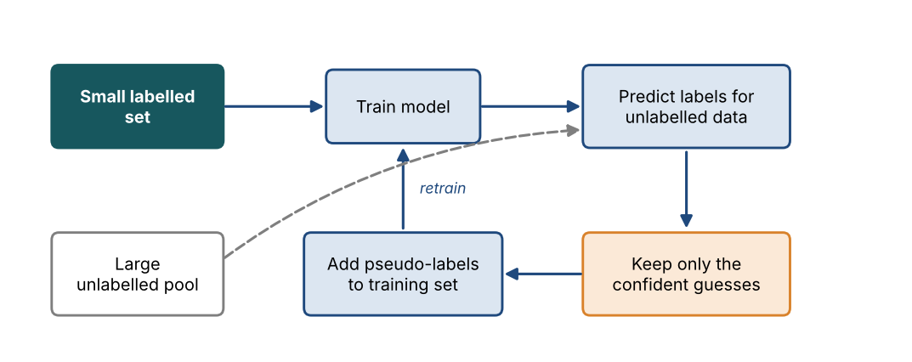
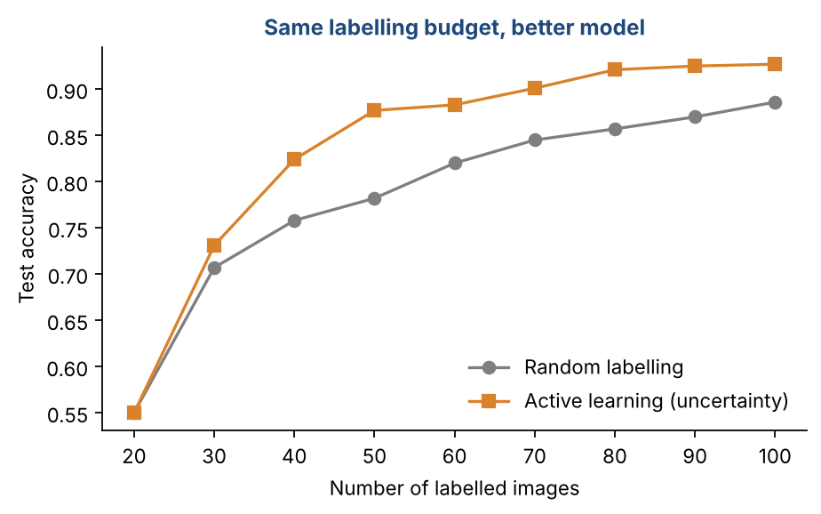
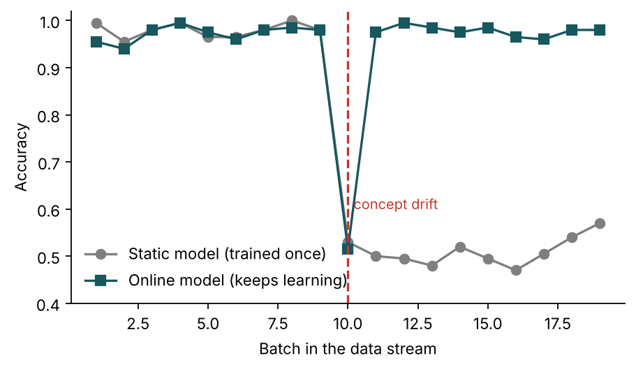
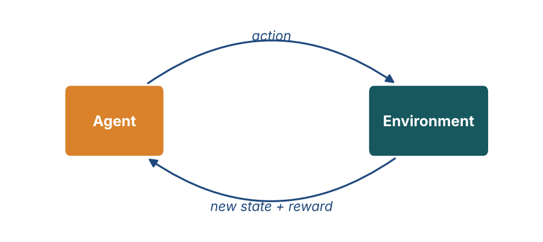

# Chapter 4 — Paradigms of Machine Learning II: Semi-Supervised, Active, Self-Supervised, Online, Meta & Reinforcement Learning

**Part I — Foundations** · [](https://colab.research.google.com/github/winnertechserv/aimlgybs/blob/main/part1_foundations/ch04_paradigms_of_machine_learning_ii/ch04_notebook.ipynb)

Companion code for Chapter 4 of *AI-Machine Learning: Get Your Base Strong*. The book explains the ideas; this folder lets you run them.

## Key ideas

- Semi-supervised learning adds unlabelled data to a few labels, often through confident pseudo-labels.
- Active learning spends the labelling budget on the examples the model is least sure about.
- Self-supervised learning creates its own labels from a pretext task, then reuses what it learned downstream.
- Online learning updates continuously and can adapt when the data drifts.
- Meta-learning trains on many tasks so that new ones need only a few examples (N-way K-shot, zero-shot).
- Reinforcement learning has no labels. An agent learns a policy from rewards by trial and error.

## Examples

| # | Program | What it shows |
|---|---|---|
| 1 | [`ex1_semi_supervised_learning_with_pseudo_labels.py`](ex1_semi_supervised_learning_with_pseudo_labels.py) | Only 50 of 1,257 digit images keep their labels. |
| 2 | [`ex2_active_learning_vs_random_labelling.py`](ex2_active_learning_vs_random_labelling.py) | Both strategies start with 20 labelled images and add 10 labels per round. |
| 3 | [`ex3_online_learning_when_the_world_changes.py`](ex3_online_learning_when_the_world_changes.py) | This simulates a data stream where the rule suddenly flips at batch 10, which is concept drift. |

Run any example from this folder:

```bash
cd part1_foundations/ch04_paradigms_of_machine_learning_ii
python ex1_semi_supervised_learning_with_pseudo_labels.py
```

The exact output printed in the book is in [`expected_output/`](expected_output). The notebook [`ch04_notebook.ipynb`](ch04_notebook.ipynb) has all three examples with explanations.

### Example 1: Semi-Supervised Learning with Pseudo-Labels

Only 50 of 1,257 digit images keep their labels. A model trained on those 50 scores 82.6%. Then the self-training loop runs. Each round, the model labels the unlabelled images it is at least 90% sure about and retrains on them. Within four rounds it has pseudo-labelled over 1,000 images and test accuracy rises to 88.1%. Label spreading, a second semi-supervised method, passes labels to neighbouring images and reaches 92.8% from the same 50 labels. Compare these with the 96.3% you get when all 1,257 labels are available.

<details><summary>Expected output</summary>

```text
Labelled: 50   Unlabelled: 1207
Round 0 (labelled data only): test accuracy = 0.826
Round 1: pseudo-labelled  727 images (pseudo-label accuracy 0.961) -> test accuracy = 0.859
Round 2: pseudo-labelled 1010 images (pseudo-label accuracy 0.914) -> test accuracy = 0.872
Round 3: pseudo-labelled 1079 images (pseudo-label accuracy 0.904) -> test accuracy = 0.878
Round 4: pseudo-labelled 1091 images (pseudo-label accuracy 0.902) -> test accuracy = 0.881

Label spreading (same 50 labels): test accuracy = 0.928
For reference, with ALL 1257 true labels: 0.963
```

</details>

### Example 2: Active Learning vs Random Labelling

Both strategies start with 20 labelled images and add 10 labels per round. The random strategy labels any 10 images. The active strategy asks the 'expert' to label the 10 images where the model's top two guesses are closest, which is uncertainty sampling. Averaged over five runs, active learning pulls ahead from the first round. With 100 labels it scores 92.7% against 88.6%, so the same labelling budget buys a better model.

<details><summary>Expected output</summary>

```text
Labels used   Random sampling   Active (uncertainty)
    20           0.550             0.550
    30           0.707             0.731
    40           0.758             0.824
    50           0.782             0.877
    60           0.820             0.883
    70           0.845             0.901
    80           0.857             0.921
    90           0.870             0.925
   100           0.886             0.927

With 100 labels, active learning is 4.1 percentage points more accurate (average of 5 runs).
```

</details>

### Example 3: Online Learning When the World Changes

This simulates a data stream where the rule suddenly flips at batch 10, which is concept drift. The static model was trained once at the start and never updated, so after the drift it falls to coin-flip accuracy (about 50%). The online model is updated with partial_fit after every batch. It stumbles for one batch, then recovers to about 97%. Note the order inside the loop: each batch is first used to test, then to learn, exactly as in a live system.

<details><summary>Expected output</summary>

```text
Batch   Static model   Online model
   1      0.99          0.95
   3      0.98          0.98
   5      0.96          0.97
   7      0.98          0.98
   9      0.98          0.98
  10      0.53          0.52  <- drift happens here
  11      0.50          0.97
  13      0.48          0.98
  15      0.49          0.98
  17      0.51          0.96
  19      0.57          0.98
```

</details>

## Figures from this chapter

**Figure 4.1.** The self-training loop: the model labels the unlabelled data itself, keeps only confident guesses, and retrains.



**Figure 4.2.** Results from Example 2: asking the expert about the most uncertain images beats labelling at random at almost every budget.



**Figure 4.3.** From Example 3: when the rule changes at batch 10, the static model collapses while the online model recovers after one batch.



**Figure 4.4.** The reinforcement learning loop: the agent acts, and the environment answers with a new state and a reward.



The code that draws these figures is in [`figures/src`](../../figures/src).

---

[← Chapter 3](../../part1_foundations/ch03_paradigms_of_machine_learning_i) · [All chapters](../../README.md#chapters) · [Chapter 5 →](../../part1_foundations/ch05_exploratory_data_analysis)
