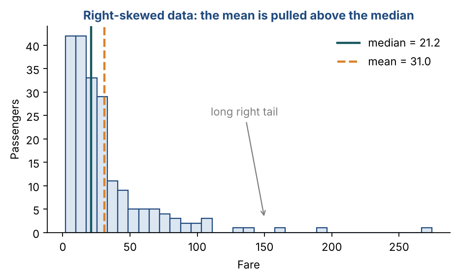
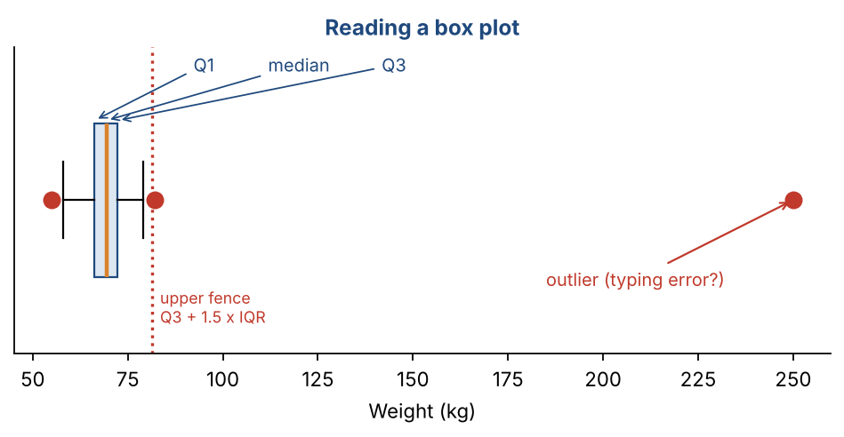
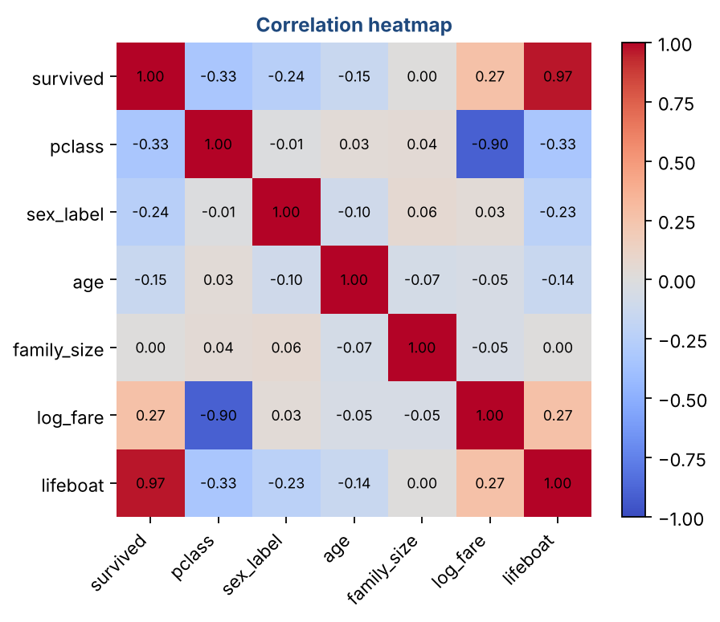

# Chapter 5 — Exploratory Data Analysis: Cleaning, Profiling & Feature Engineering

**Part I — Foundations** · [](https://colab.research.google.com/github/winnertechserv/aimlgybs/blob/main/part1_foundations/ch05_exploratory_data_analysis/ch05_notebook.ipynb)

Companion code for Chapter 5 of *AI-Machine Learning: Get Your Base Strong*. The book explains the ideas; this folder lets you run them.

## Key ideas

- EDA has four steps: collect, clean, profile and visualize. Never skip it.
- Know each column's type. It decides the statistics, the charts and the encoding you can use.
- Describe numbers by center (mean, median, mode), spread (variance, std, IQR) and shape (skewness).
- Fill missing values in a way that suits the data: mean or median, forward fill, interpolation, or KNN.
- Find outliers with the Z-score rule (|z| > 3) or the IQR rule (1.5 × IQR), then remove, cap or transform them.
- Good features are often engineered: bins, interactions, log transforms, date parts and rare-category grouping.
- A feature that predicts the target almost perfectly may be data leakage. Check it is available at prediction time.

## Examples

| # | Program | What it shows |
|---|---|---|
| 1 | [`ex1_profiling_a_dataset.py`](ex1_profiling_a_dataset.py) | This is the first thing you do with any new dataset. |
| 2 | [`ex2_cleaning_missing_values_duplicates_and_outlie.py`](ex2_cleaning_missing_values_duplicates_and_outlie.py) | We plant three kinds of problem in a clean dataset and then fix them. |
| 3 | [`ex3_advanced_eda_target_analysis_encoding_feature.py`](ex3_advanced_eda_target_analysis_encoding_feature.py) | This mirrors the classic Titanic case study, using made-up data. |

Run any example from this folder:

```bash
cd part1_foundations/ch05_exploratory_data_analysis
python ex1_profiling_a_dataset.py
```

The exact output printed in the book is in [`expected_output/`](expected_output). The notebook [`ch05_notebook.ipynb`](ch05_notebook.ipynb) has all three examples with explanations.

### Example 1: Profiling a Dataset

This is the first thing you do with any new dataset. The program builds a small passenger table, splits the columns into numbers and categories, then measures the center and spread of 'age'. Look at the skewness lines. Age is roughly symmetric, so its mean and median are close. Fare is strongly right-skewed: its mean (31) is well above its median (21) because a few people paid very high fares.

<details><summary>Expected output</summary>

```text
Numerical columns  : ['age', 'fare', 'pclass']
Categorical columns: ['sex', 'embarked']

--- Age: center and spread ---
Mean   : 29.67
Median : 29.00
Mode   : 25
Var    : 112.60
Std    : 10.61
Range  : 61

--- Five-point summary of age ---
Min    : 4.0
Q1     : 22.0
Median : 29.0
Q3     : 36.2
Max    : 65.0

Skewness of age: 0.27 -> roughly symmetric
  mean = 29.67, median = 29.00

Skewness of fare: 3.29 -> right-skewed
  mean = 31.03, median = 21.21

Passengers per class:
pclass
1     50
2     45
3    105
```

</details>

### Example 2: Cleaning — Missing Values, Duplicates and Outliers

We plant three kinds of problem in a clean dataset and then fix them. Compare the five ways of filling the four missing weights. Mean and median give every row the same value. KNN imputation uses each person's height, so a shorter person gets a lower weight, which is the most sensible result. Both the Z-score and IQR tests catch the 250 kg typing error. The IQR test also flags one genuinely light person (43.4 kg), a reminder that not every outlier is a mistake. Forward fill and interpolation appear only for comparison: these rows are people in no particular order, so neither makes sense here (see Q8). The last lines show how removing, capping or log-transforming the outliers changes the numbers.

<details><summary>Expected output</summary>

```text
Rows: 102 | missing weights: 4 | duplicates: 2
After drop_duplicates: 100 rows

Filled values for the 4 missing rows:
  Mean           [70.2 70.2 70.2 70.2]
  Median         [68.4 68.4 68.4 68.4]
  Forward fill   [68.7 70.  65.3 73. ]
  Interpolation  [66.  65.6 66.8 71.2]
  KNN (k=3)      [63.6 74.2 73.5 70.1]
  Heights of those rows: [162.9 175.6 170.9 167.1]

Z-score outliers: [250.0]
IQR fences: [49.4, 88.1]
IQR outliers: [43.4, 250.0]

Mean weight  raw: 70.20  removed: 68.64  winsorized: 68.61
Max after log transform: 5.53 (raw max 250)
```

</details>

### Example 3: Advanced EDA — Target Analysis, Encoding, Features and Leakage

This mirrors the classic Titanic case study, using made-up data. Grouping by class and sex shows who was more likely to survive. We then encode categories, engineer family size, age groups and a log fare, and rank every feature by its correlation with survival. One column, 'lifeboat_assigned', has a correlation of 0.97. It looks like a perfect predictor, but it is only known after the event. The program flags it as data leakage.

<details><summary>Expected output</summary>

```text
Survival rate by class:
pclass
1    0.73
2    0.51
3    0.31

Survival rate by sex:
sex
female    0.60
male      0.36

Median fare by outcome:
survived
0    14.10
1    26.56

One-hot columns: ['class_1', 'class_2', 'class_3']

Survival by age group:
age_group
child     0.69
teen      0.52
adult     0.44
senior    0.40

Correlation with 'survived':
lifeboat_assigned    0.97
pclass              -0.33
log_fare             0.27
sex_label           -0.24
age                 -0.15
family_size          0.00

WARNING: 'lifeboat_assigned' has r = 0.97 with the target. Is it known at prediction time? If not, it is DATA LEAKAGE - drop it.
```

</details>

## Figures from this chapter

**Figure 5.1.** The 'fare' column from Example 1. A few very large values stretch the tail, so the mean sits well above the median.



**Figure 5.2.** A box plot: the box spans Q1 to Q3, the whiskers reach the furthest normal values, and anything beyond the IQR fences is flagged as an outlier.



**Figure 5.3.** Correlations for the passenger data in Example 3. 'lifeboat' is almost perfectly correlated with survival, a warning sign of data leakage.



The code that draws these figures is in [`figures/src`](../../figures/src).

---

[← Chapter 4](../../part1_foundations/ch04_paradigms_of_machine_learning_ii) · [All chapters](../../README.md#chapters) · [Chapter 6 →](../../part1_foundations/ch06_data_normalization_feature_subset_selection)
