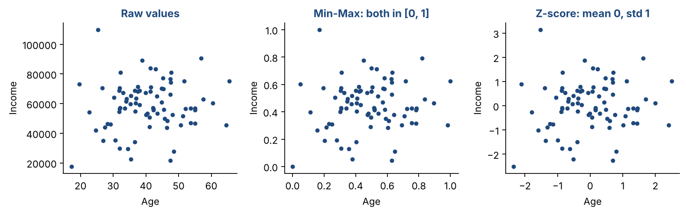
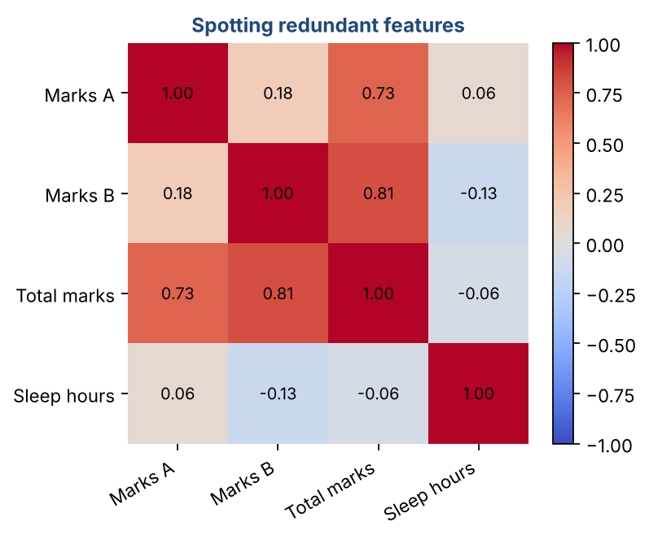

# Chapter 6 — Data Normalization & Feature Subset Selection

**Part I — Foundations** · [](https://colab.research.google.com/github/winnertechserv/aimlgybs/blob/main/part1_foundations/ch06_data_normalization_feature_subset_selection/ch06_notebook.ipynb)

Companion code for Chapter 6 of *AI-Machine Learning: Get Your Base Strong*. The book explains the ideas; this folder lets you run them.

## Key ideas

- Normalization puts every feature on a comparable scale, so one large-valued column cannot dominate a distance calculation.
- Min-Max squeezes values into [0,1]; Z-score centers them at mean 0 with standard deviation 1.
- Always compute the min, max, mean and standard deviation on the TRAINING data and reuse those same numbers at test time.
- Feature selection drops columns that tell you little about the target; Pearson correlation is the quick screening tool.
- Fewer, better features mean faster training, less overfitting and a model you can actually explain.

## Examples

| # | Program | What it shows |
|---|---|---|
| 1 | [`ex1_min_max_normalization.py`](ex1_min_max_normalization.py) | This example walks through Min-Max normalization on a small salesman dataset. |
| 2 | [`ex2_z_score_normalization_distance_comparison.py`](ex2_z_score_normalization_distance_comparison.py) | This example shows z-score normalization and — critically — shows WHY normalization matters for distance-based algorithms. |
| 3 | [`ex3_pearson_correlation_feature_selection.py`](ex3_pearson_correlation_feature_selection.py) | This example builds a synthetic weather dataset with three features (Temperature, Humidity, Pressure) and a target (Rain). |

Run any example from this folder:

```bash
cd part1_foundations/ch06_data_normalization_feature_subset_selection
python ex1_min_max_normalization.py
```

The exact output printed in the book is in [`expected_output/`](expected_output). The notebook [`ch06_notebook.ipynb`](ch06_notebook.ipynb) has all three examples with explanations.

### Example 1: Min-Max Normalization

This example walks through Min-Max normalization on a small salesman dataset. We define a simple function that takes an array, finds its minimum and maximum, then scales every value proportionally into the [0, 1] range. Notice how the raw sales values (₹2,300 to ₹73,567) and scores (2 to 8) are completely different scales — after normalization, both live in [0, 1]. The last two rows confirm that the range constraint is satisfied. Remember: you MUST save the min and max from training and apply them at test time too — never recompute from test data.

<details><summary>Expected output</summary>

```text
=== Min-Max Normalization ===
Sales  → min: 2300, max: 73567
Scores → min: 2, max: 8

ID       Sales (Rs)    Score   Norm Sales   Norm Score
-------------------------------------------------------
S001          23500        8       0.2975       1.0000
S002          23500        6       0.2975       0.6667
S003          22879        2       0.2888       0.0000
S004           2300        4       0.0000       0.3333
S005          34678        5       0.4543       0.5000
S006          15687        8       0.1878       1.0000
S007          18945        8       0.2336       1.0000
S008           8750        2       0.0905       0.0000
S009          37489        4       0.4938       0.3333
S010          73567        2       1.0000       0.0000
S011          52789        4       0.7084       0.3333
S012           2900        3       0.0084       0.1667
S013           6570        3       0.0599       0.1667
S014          21000        2       0.2624       0.0000

Norm Sales range : [0.0000, 1.0000]
Norm Score range : [0.0000, 1.0000]
```

</details>

### Example 2: Z-Score Normalization & Distance Comparison

This example shows z-score normalization and — critically — shows WHY normalization matters for distance-based algorithms. Without normalization, we ask: which salesman is closest to a query point of (23000 Rs, 6.5 score)? The Euclidean distance is dominated by the Sales column (values in thousands) making the Score column almost irrelevant. After z-score normalization, both columns are on equal footing. See how S001, S002, and S003 get completely different nearest-neighbor rankings before vs after normalization — S002 becomes the closest, which makes intuitive sense since its sales (23500) and score (6) are both close to the query (23000, 6.5).

<details><summary>Expected output</summary>

```text
=== Z-Score Normalization ===
Sales  → mean: 24611.00, std: 19150.39
Scores → mean: 4.36, std: 2.22

ID       Sales (Rs)    Score    Z-Sales    Z-Score
--------------------------------------------------
S001          23500        8      -0.06       1.64
S002          23500        6      -0.06       0.74
S003          22879        2      -0.09      -1.06
S004           2300        4      -1.17      -0.16
S005          34678        5       0.53       0.29
S006          15687        8      -0.47       1.64
S007          18945        8      -0.30       1.64
S008           8750        2      -0.83      -1.06
S009          37489        4       0.67      -0.16
S010          73567        2       2.56      -1.06
S011          52789        4       1.47      -0.16
S012           2900        3      -1.13      -0.61
S013           6570        3      -0.94      -0.61
S014          21000        2      -0.19      -1.06

After normalization: mean=0.0000, std=1.0000

--- Euclidean Distance to query (23000, 6.5) ---
Before normalization (Sales dominates):
  S001: 500.00   S002: 500.00   S003: 121.08
After Z-score normalization (both features contribute equally):
  S001: 0.6751   S002: 0.2264   S003: 2.0239

S002 is now correctly identified as nearest neighbor.
```

</details>

### Example 3: Pearson Correlation & Feature Selection

This example builds a synthetic weather dataset with three features (Temperature, Humidity, Pressure) and a target (Rain). It then computes the Pearson correlation coefficient between each feature and the target to decide which features to keep. The output confirms the intuition: Temperature and Humidity strongly predict Rain (very strong correlation), while Pressure has a weak relationship and could be dropped. The full correlation matrix also reveals that Temperature and Humidity are highly correlated with each other (ρ = -0.925), meaning they carry redundant information — an advanced practitioner might even drop one of them too.

<details><summary>Expected output</summary>

```text
=== Pearson Correlation with Target (Rain) ===

  rho(Rain, Temperature ) = -0.9476  -> Very Strong negative
  rho(Rain, Humidity    ) =  0.9169  -> Very Strong positive
  rho(Rain, Pressure    ) = -0.1530  -> Weak negative

=== Full Correlation Matrix ===
             Temperature  Humidity  Pressure   Rain
Temperature        1.000    -0.925     0.115 -0.948
Humidity          -0.925     1.000    -0.180  0.917
Pressure           0.115    -0.180     1.000 -0.153
Rain              -0.948     0.917    -0.153  1.000

=== Feature Selection Decision (drop threshold: |rho| < 0.15) ===
  Temperature   : rho = -0.9476  -> KEEP
  Humidity      : rho = +0.9169  -> KEEP
  Pressure      : rho = -0.1530  -> KEEP
```

</details>

## Figures from this chapter

**Figure 6.1.** The same 80 people before and after scaling. Raw income is in the tens of thousands while age is in tens; after scaling both features are on comparable ranges.



**Figure 6.2.** 'Total marks' is built from Marks A and Marks B, so it correlates strongly with both and adds no new information.



The code that draws these figures is in [`figures/src`](../../figures/src).

---

[← Chapter 5](../../part1_foundations/ch05_exploratory_data_analysis) · [All chapters](../../README.md#chapters) · [Chapter 7 →](../../part2_classic_ml/ch07_regression_methods_i)
