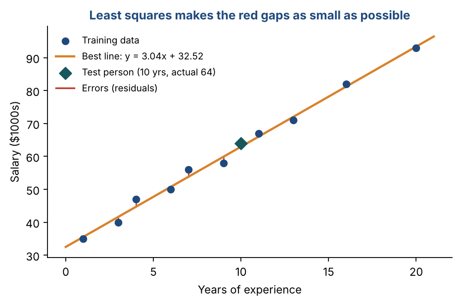
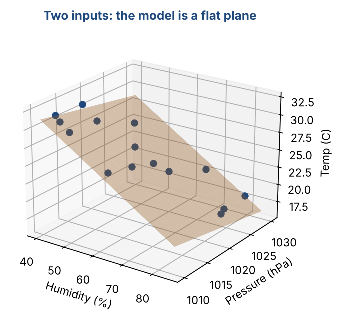
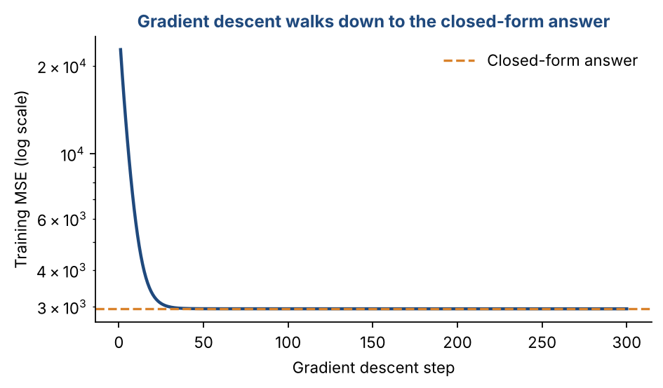

# Chapter 7 — Regression Methods I: Simple & Multiple Linear Regression

**Part II — Classic Machine Learning** · [](https://colab.research.google.com/github/winnertechserv/aimlgybs/blob/main/part2_classic_ml/ch07_regression_methods_i/ch07_notebook.ipynb)

Companion code for Chapter 7 of *AI-Machine Learning: Get Your Base Strong*. The book explains the ideas; this folder lets you run them.

## Key ideas

- Regression predicts a continuous output from one or more inputs.
- Simple linear regression fits a straight line, ŷ = w x + w₀. Multiple regression fits a plane or hyperplane, ŷ = wᵀx.
- Least squares picks the line that minimises the sum of squared errors, and it has an exact closed-form answer.
- For many inputs, w = (XᵀX)⁻¹Xᵀy, using the pseudo-inverse of the data matrix.
- Each weight is the change in output for a one-unit change in that input, holding the others fixed.
- Judge a regression model on test data with squared error and RMSE.

## Examples

| # | Program | What it shows |
|---|---|---|
| 1 | [`ex1_simple_linear_regression_from_scratch.py`](ex1_simple_linear_regression_from_scratch.py) | This program uses the exact closed-form formulas on the salaries of 10 employees. |
| 2 | [`ex2_multiple_linear_regression_with_the_pseudo_in.py`](ex2_multiple_linear_regression_with_the_pseudo_in.py) | Two inputs (humidity and pressure) predict temperature. |
| 3 | [`ex3_closed_form_vs_gradient_descent_on_real_data.py`](ex3_closed_form_vs_gradient_descent_on_real_data.py) | Scikit-learn's diabetes dataset has 442 patients and 10 measurements each. |

Run any example from this folder:

```bash
cd part2_classic_ml/ch07_regression_methods_i
python ex1_simple_linear_regression_from_scratch.py
```

The exact output printed in the book is in [`expected_output/`](expected_output). The notebook [`ch07_notebook.ipynb`](ch07_notebook.ipynb) has all three examples with explanations.

### Example 1: Simple Linear Regression from Scratch

This program uses the exact closed-form formulas on the salaries of 10 employees. It finds the averages (9.0 years, 59.9 thousand), then the slope 3.04 and intercept 32.52. The table shows each training point, the line's prediction and the error. Finally it tests a new person with 10 years' experience: predicted 62.94, actual 64, squared error 1.12.

<details><summary>Expected output</summary>

```text
Mean of x = 9.0, mean of y = 59.9
Slope w   = 3.04   (each extra year adds about $3,043)
Intercept w0 = 32.52  (predicted starting salary)

Sum-of-squares error on training data, E = 10.15
  x    y   predicted  error
   1   35     35.56    0.56
   3   40     41.64    1.64
   4   47     44.69   -2.31
   6   50     50.77    0.77
   7   56     53.81   -2.19
   9   58     59.90    1.90
  11   67     65.99   -1.01
  13   71     72.07    1.07
  16   82     81.20   -0.80
  20   93     93.37    0.37

Test: 10 years -> predicted 62.94, actual 64, squared error 1.12
```

</details>

### Example 2: Multiple Linear Regression with the Pseudo-Inverse

Two inputs (humidity and pressure) predict temperature. We build the data matrix with a column of 1s and solve w = (XᵀX)⁻¹Xᵀy. The normal equation and NumPy's pseudo-inverse give the same weights: [178.60, −0.2754, −0.1349]. The test prediction is 22.84 °C against an actual 21.7 °C. Across the training days the RMSE is 1.21 °C, under 5% of the average temperature.

<details><summary>Expected output</summary>

```text
Data matrix X has shape (15, 3) (N rows, d+1 columns)
w (normal equation) = [178.5985  -0.2754  -0.1349]
w (pseudo-inverse)  = [178.5985  -0.2754  -0.1349]

Test: humidity 66.0, pressure 1020.0 -> predicted 22.84 C (actual 21.7, squared error 1.3024)
Training RMSE = 1.212 C  (4.8% of the mean temperature)
Meaning of the weights: each extra 1% humidity changes temperature by -0.275 C, holding pressure fixed.
```

</details>

### Example 3: Closed Form vs Gradient Descent on Real Data

Scikit-learn's diabetes dataset has 442 patients and 10 measurements each. We fit linear regression two ways. The closed form gives the answer in one step. Gradient descent starts from zero and walks downhill: watch the training error fall from 23,375 to 2,804. Both reach the same test RMSE (about 55.7), and so does scikit-learn. We standardise the features first because gradient descent converges much faster when all inputs are on the same scale.

<details><summary>Expected output</summary>

```text
GD epoch     1: training MSE =   23374.7
GD epoch    10: training MSE =    5816.5
GD epoch   100: training MSE =    2812.7
GD epoch  1000: training MSE =    2805.7
GD epoch  3000: training MSE =    2804.2

Test RMSE  closed form     : 55.65
Test RMSE  gradient descent: 55.67
Test RMSE  scikit-learn    : 55.65
Largest weight difference, closed form vs GD: 1.550
Test RMSE as % of the mean target: 36.6%
```

</details>

## Figures from this chapter

**Figure 7.1.** Least squares on the salary data: the best line minimises the sum of the squared red gaps.



**Figure 7.2.** Multiple linear regression on the weather data from Example 2: with two inputs, the fitted model is a flat plane.



**Figure 7.3.** Gradient descent on the diabetes data (Example 3): the error falls step by step until it reaches the exact least-squares solution.



The code that draws these figures is in [`figures/src`](../../figures/src).

---

[← Chapter 6](../../part1_foundations/ch06_data_normalization_feature_subset_selection) · [All chapters](../../README.md#chapters) · [Chapter 8 →](../../part2_classic_ml/ch08_regression_methods_ii)
