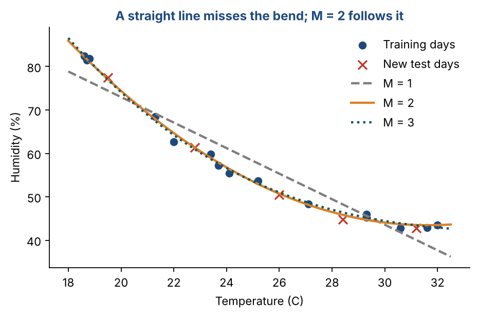
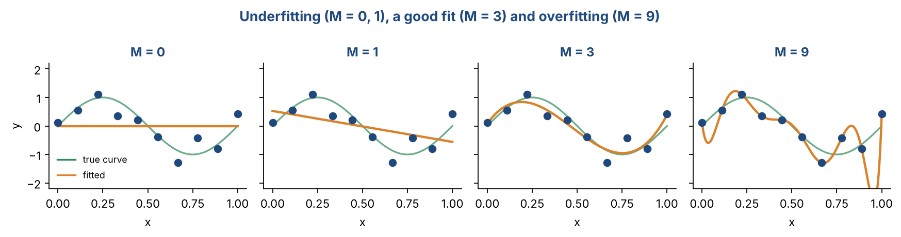
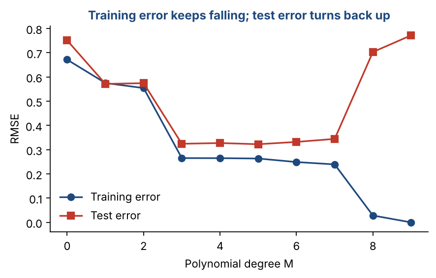
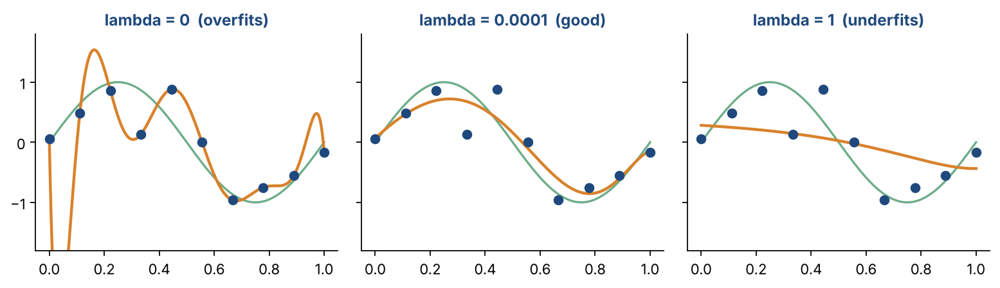

# Chapter 8 — Regression Methods II: Polynomial Regression, Overfitting & Ridge Regression

**Part II — Classic Machine Learning** · [](https://colab.research.google.com/github/winnertechserv/aimlgybs/blob/main/part2_classic_ml/ch08_regression_methods_ii/ch08_notebook.ipynb)

Companion code for Chapter 8 of *AI-Machine Learning: Get Your Base Strong*. The book explains the ideas; this folder lets you run them.

## Key ideas

- Polynomial regression fits curves but is still linear in the weights, so least squares solves it in closed form.
- The design matrix Φ holds the powers (monomials) of the inputs, and w = (ΦᵀΦ)⁻¹Φᵀy.
- Choose the degree M with a validation or test set, never with the training error.
- Overfitting means low training error, high test error and huge weights.
- More data and L2 regularization (ridge regression) both reduce overfitting.
- With many inputs the number of polynomial terms explodes: D = (d+M)!/(d!M!).

## Examples

| # | Program | What it shows |
|---|---|---|
| 1 | [`ex1_polynomial_curve_fitting_degrees_1_2_and_3.py`](ex1_polynomial_curve_fitting_degrees_1_2_and_3.py) | Humidity is predicted from temperature with polynomials of degree 1, 2 and 3, and each model is tested on five days it never saw. |
| 2 | [`ex2_watching_overfitting_happen.py`](ex2_watching_overfitting_happen.py) | We take 10 noisy points from a sine wave and fit polynomials from degree 0 to 9. |
| 3 | [`ex3_ridge_regression_and_counting_monomials.py`](ex3_ridge_regression_and_counting_monomials.py) | We keep the overfitting degree-9 model and add an L2 penalty λ. |

Run any example from this folder:

```bash
cd part2_classic_ml/ch08_regression_methods_ii
python ex1_polynomial_curve_fitting_degrees_1_2_and_3.py
```

The exact output printed in the book is in [`expected_output/`](expected_output). The notebook [`ch08_notebook.ipynb`](ch08_notebook.ipynb) has all three examples with explanations.

### Example 1: Polynomial Curve Fitting (Degrees 1, 2 and 3)

Humidity is predicted from temperature with polynomials of degree 1, 2 and 3, and each model is tested on five days it never saw. np.vander builds the design matrix (columns 1, x, x², ...) and the pseudo-inverse solves for the weights. The straight line misses the curve (test RMSE 3.56). Degree 2 follows it closely (0.60). Degree 3 fits the training days slightly better (0.76 against 0.84) but does worse on the new days (0.86). That is an early sign of overfitting, which Example 2 explores fully.

<details><summary>Expected output</summary>

```text
M = 1: Phi is 15x2, w = [131.7842  -2.9405]
       training RMSE = 4.02   test RMSE (5 new days) = 3.56
       predictions [74.4 64.7 55.3 48.3 40. ]  vs actual [77.5 61.4 50.5 44.8 42.8]

M = 2: Phi is 15x3, w = [271.97   -14.444    0.2282]
       training RMSE = 0.84   test RMSE (5 new days) = 0.60
       predictions [77.1 61.3 50.7 45.9 43.5]  vs actual [77.5 61.4 50.5 44.8 42.8]

M = 3: Phi is 15x4, w = [364.8974 -26.0419   0.7014  -0.0063]
       training RMSE = 0.76   test RMSE (5 new days) = 0.86
       predictions [77.  60.9 51.  46.4 43.4]  vs actual [77.5 61.4 50.5 44.8 42.8]

M = 2 fits the curve; M = 3 adds flexibility the data does not need.
```

</details>

### Example 2: Watching Overfitting Happen

We take 10 noisy points from a sine wave and fit polynomials from degree 0 to 9. Read the table from top to bottom. Training error keeps falling, all the way to 0 at M = 9, but test error is lowest around M = 3 and then climbs again. The largest weight explodes to about 95,000, which is the warning sign. The second table fixes the degree at 9 and adds data: with 15 or 100 points the test error drops back to about 0.32.

<details><summary>Expected output</summary>

```text
N = 10 training points
 M   train RMSE   test RMSE   largest |w|
 0     0.672          0.751            0.0
 1     0.575          0.572            1.1
 3     0.265          0.324           28.6
 6     0.249          0.332          917.3
 9     0.000          0.772        95188.5
M = 9 passes through all 10 points (train error ~0) but is much worse on new data.

More data tames the same complex model (M = 9):
  N =  10: train RMSE 0.000, test RMSE    0.772
  N =  15: train RMSE 0.108, test RMSE    0.321
  N = 100: train RMSE 0.293, test RMSE    0.324
```

</details>

### Example 3: Ridge Regression and Counting Monomials

We keep the overfitting degree-9 model and add an L2 penalty λ. With λ = 0 the test RMSE is 0.97 (not the 0.77 of Example 2, because this example draws a fresh set of noisy points with a different random seed) and the weights are in the millions. A tiny λ of 0.0001 cuts the test error to 0.35 and the weight size to about 20. A large λ of 1 overshoots and underfits. The second part checks the formula D = (d+M)!/(d!M!), including the 364 terms for 11 inputs at degree 3, and builds φ([2, 10]).

<details><summary>Expected output</summary>

```text
Degree M = 9, N = 10 points. Ridge: w = (Phi^T Phi + lambda I)^-1 Phi^T y
 lambda      train RMSE  test RMSE  size of w (||w||)
 0           0.000         0.965      1219209.9
 1e-06       0.254         0.362          117.4
 0.0001      0.267         0.350           19.5
 0.01        0.326         0.440            4.1
 1           0.471         0.620            0.6
A small lambda shrinks the weights and fixes overfitting; too large underfits.

Number of monomials D = (d+M)!/(d! M!):
  d =  2 inputs, degree M = 2: D = 6
  d =  2 inputs, degree M = 3: D = 10
  d =  3 inputs, degree M = 2: D = 10
  d = 11 inputs, degree M = 3: D = 364

phi([2, 10]) for M = 2: [1, 2, 10, 4, 100, 20]
```

</details>

## Figures from this chapter

**Figure 8.1.** Example 1: polynomials of degree 1, 2 and 3 fitted to humidity vs temperature, with five new test days.



**Figure 8.2.** Ten noisy points from a sine wave. M = 9 passes through every point but swings wildly between them: that is overfitting.



**Figure 8.3.** Choosing M: always judge on test (or validation) data, because training error falls no matter what.



**Figure 8.4.** Ridge regression on the same degree-9 model (Example 3): a small penalty tames the wiggles, a large one flattens the curve.



The code that draws these figures is in [`figures/src`](../../figures/src).

---

[← Chapter 7](../../part2_classic_ml/ch07_regression_methods_i) · [All chapters](../../README.md#chapters) · [Chapter 9 →](../../part2_classic_ml/ch09_probabilistic_models_for_classification_i)
