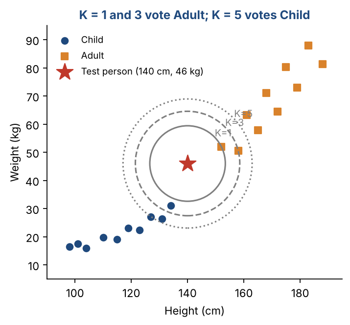
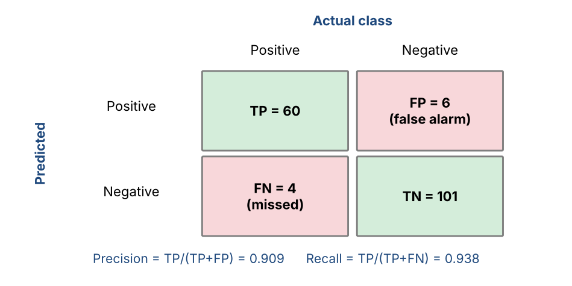
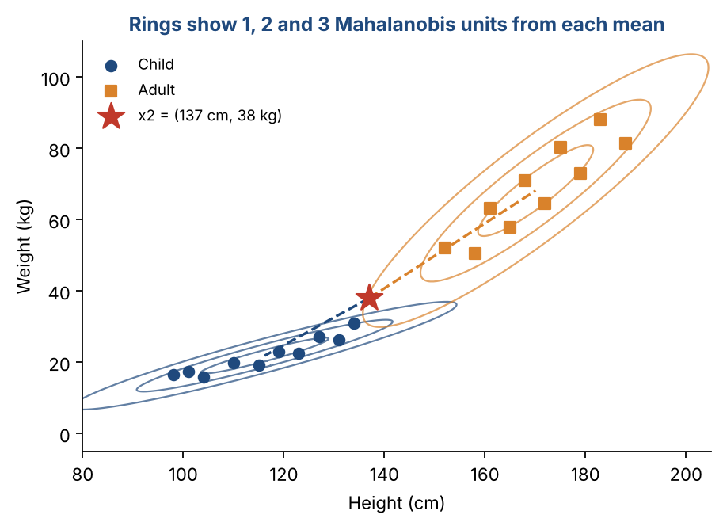

# Chapter 9 — Probabilistic Models for Classification I: K-NN, Evaluation Metrics & Reference Templates

**Part II — Classic Machine Learning** · [](https://colab.research.google.com/github/winnertechserv/aimlgybs/blob/main/part2_classic_ml/ch09_probabilistic_models_for_classification_i/ch09_notebook.ipynb)

Companion code for Chapter 9 of *AI-Machine Learning: Get Your Base Strong*. The book explains the ideas; this folder lets you run them.

## Key ideas

- Split data into training, validation and test sets. With imbalanced classes, split with stratification first, then balance only the training set.
- K-NN labels a point by a majority vote of its K nearest training examples. Choose K on validation data.
- K-NN is a lazy learner: training is instant, but every prediction compares against all stored examples.
- The confusion matrix gives TP, TN, FP and FN. From these come accuracy, precision, recall and F1.
- Favor precision when false alarms are costly, and recall when misses are costly.
- Reference templates compare a point with each class mean. Mahalanobis distance also accounts for each class's spread.

## Examples

| # | Program | What it shows |
|---|---|---|
| 1 | [`ex1_nearest_neighbor_and_k_nn_from_scratch.py`](ex1_nearest_neighbor_and_k_nn_from_scratch.py) | This follows the four steps: compute distances, sort, take the first K, then vote. |
| 2 | [`ex2_confusion_matrix_precision_recall_and_f1.py`](ex2_confusion_matrix_precision_recall_and_f1.py) | We classify breast tumors as malignant (positive) or benign, using K-NN on a stratified 70/30 split. |
| 3 | [`ex3_reference_templates_euclidean_vs_mahalanobis.py`](ex3_reference_templates_euclidean_vs_mahalanobis.py) | Training is just computing each class's mean and covariance: the child mean is [116.2, 21.85] and the adult mean is [170.1, 68.16]. |

Run any example from this folder:

```bash
cd part2_classic_ml/ch09_probabilistic_models_for_classification_i
python ex1_nearest_neighbor_and_k_nn_from_scratch.py
```

The exact output printed in the book is in [`expected_output/`](expected_output). The notebook [`ch09_notebook.ipynb`](ch09_notebook.ipynb) has all three examples with explanations.

### Example 1: Nearest Neighbor and K-NN from Scratch

This follows the four steps: compute distances, sort, take the first K, then vote. For the test person (150 cm, 47 kg) the four nearest examples are all adults, at distances 5.39, 8.73, 18.48 and 19.58. For a second person (140 cm, 46 kg), K = 1 and K = 3 say 'Adult' but K = 5 says 'Child'. The choice of K really can change the answer. The last part picks K for the Iris flowers using a validation set.

<details><summary>Expected output</summary>

```text
Test person: height 150 cm, weight 47.0 kg
  5 nearest training examples:
    (152, 52.00)  distance   5.39  class Adult
    (158, 50.50)  distance   8.73  class Adult
    (165, 57.80)  distance  18.48  class Adult
    (161, 63.20)  distance  19.58  class Adult
    (134, 31.00)  distance  22.63  class Child
  K = 1: predicted Adult
  K = 3: predicted Adult
  K = 5: predicted Adult

Test person: height 140 cm, weight 46.0 kg
  5 nearest training examples:
    (152, 52.00)  distance  13.42  class Adult
    (134, 31.00)  distance  16.16  class Child
    (158, 50.50)  distance  18.55  class Adult
    (131, 26.30)  distance  21.66  class Child
    (127, 27.10)  distance  22.94  class Child
  K = 1: predicted Adult
  K = 3: predicted Adult
  K = 5: predicted Child

Choosing K on a validation set (Iris):
  K =  1: validation accuracy 0.967
  K =  3: validation accuracy 0.983
  K =  5: validation accuracy 0.967
  K =  7: validation accuracy 0.983
  K =  9: validation accuracy 0.983
  K = 15: validation accuracy 0.967
  K = 25: validation accuracy 0.950
```

</details>

### Example 2: Confusion Matrix, Precision, Recall and F1

We classify breast tumors as malignant (positive) or benign, using K-NN on a stratified 70/30 split. The program prints the confusion matrix, then works out accuracy, precision, recall and F1 by hand and checks them against scikit-learn. Both agree. Look at the false negatives: 4 cancers were missed. That number is why recall is the metric doctors care about most.

<details><summary>Expected output</summary>

```text
Samples: 569  (malignant 212, benign 357)
Train 398 / Test 171; malignant share train 0.37, test 0.37 (stratified = same mix)

Confusion matrix          Actual +   Actual -
  Predicted + (malignant)   TP= 60     FP=  6
  Predicted - (benign)      FN=  4     TN=101

By hand : accuracy 0.942  precision 0.909  recall 0.938  F1 0.923
sklearn : precision 0.909  recall 0.938  F1 0.923

4 cancer case(s) were missed (false negatives). In medicine, recall matters most.
```

</details>

### Example 3: Reference Templates — Euclidean vs Mahalanobis

Training is just computing each class's mean and covariance: the child mean is [116.2, 21.85] and the adult mean is [170.1, 68.16]. For the first test person both distances agree: Euclidean 42.13 vs 29.18, Mahalanobis 8.13 vs 1.76, so the answer is adult. The second test person (137 cm, 38 kg) shows the two distances disagreeing. In plain distance they are nearer the children (26.33 vs 44.78). But children's weight follows their height very closely, and 38 kg is unusually heavy for a 137 cm child. For adults, 38 kg at 137 cm sits right on the usual height-weight trend. Mahalanobis takes that pattern into account and picks adult (2.94 vs 5.40).

<details><summary>Expected output</summary>

```text
Child: mean = [116.2   21.85], covariance =
[[161.96  60.7 ]
 [ 60.7   25.39]]

Adult: mean = [170.1   68.16], covariance =
[[131.21 131.76]
 [131.76 162.8 ]]

Test person x = [150.  47.]
  Child: Euclidean distance  42.13   Mahalanobis distance  8.13
  Adult: Euclidean distance  29.18   Mahalanobis distance  1.76

Test person x2 = [137.  38.] (between the two groups)
  Child: Euclidean  26.33   Mahalanobis  5.40
  Adult: Euclidean  44.78   Mahalanobis  2.94
  Euclidean picks: Child | Mahalanobis picks: Adult
```

</details>

## Figures from this chapter

**Figure 9.1.** K-NN for the second test person in Example 1. Each circle holds the K nearest neighbors; changing K changes the vote.



**Figure 9.2.** The confusion matrix from Example 2 (cancer screening). Green cells are correct; red cells are the two kinds of mistake.



**Figure 9.3.** Why Mahalanobis distance disagrees with plain distance for x2: x2 lies just inside the third adult ring, but well outside the narrow child rings.



The code that draws these figures is in [`figures/src`](../../figures/src).

---

[← Chapter 8](../../part2_classic_ml/ch08_regression_methods_ii) · [All chapters](../../README.md#chapters) · [Chapter 10 →](../../part2_classic_ml/ch10_probabilistic_models_for_classification_ii)
