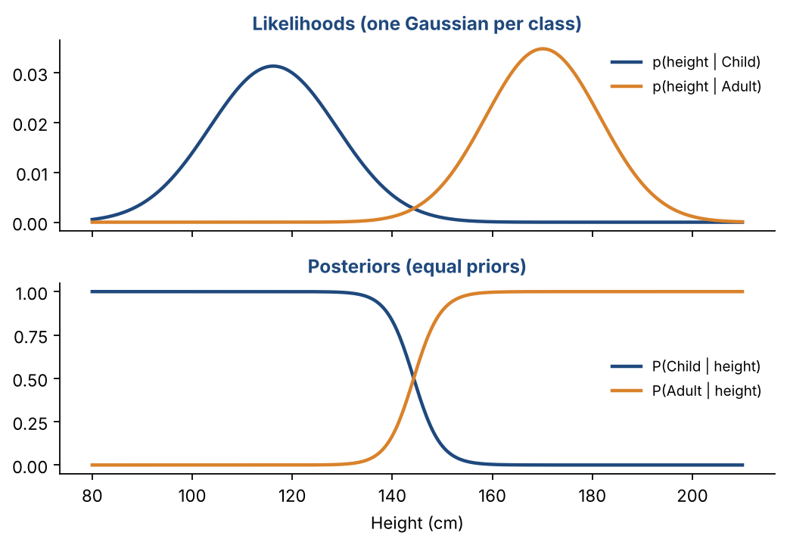
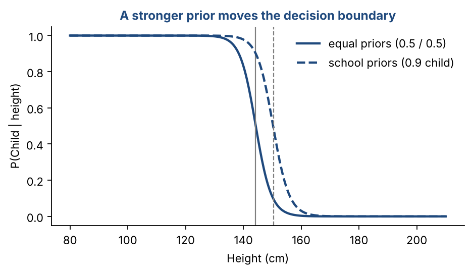
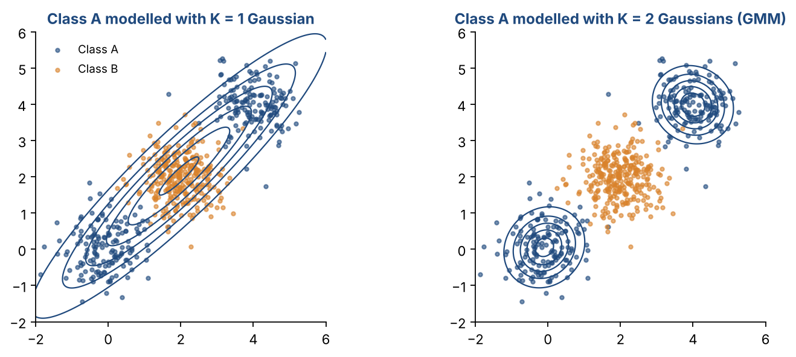

# Chapter 10 — Probabilistic Models for Classification II: Bayes Classifier, Naive Bayes & Gaussian Mixture Models

**Part II — Classic Machine Learning** · [](https://colab.research.google.com/github/winnertechserv/aimlgybs/blob/main/part2_classic_ml/ch10_probabilistic_models_for_classification_ii/ch10_notebook.ipynb)

Companion code for Chapter 10 of *AI-Machine Learning: Get Your Base Strong*. The book explains the ideas; this folder lets you run them.

## Key ideas

- The Bayes classifier picks the class with the highest posterior: likelihood × prior ÷ evidence.
- Priors encode how common each class is. They can change the decision for borderline cases.
- Maximum likelihood estimates parameters. For a Gaussian, that means the sample mean and covariance.
- Use log-likelihoods: products of many small probabilities underflow to zero.
- Naive Bayes assumes independent features (a diagonal covariance). It is simple and fast, but ignores correlations.
- A GMM models multi-clump classes as a weighted sum of Gaussians, trained by the EM algorithm.

## Examples

| # | Program | What it shows |
|---|---|---|
| 1 | [`ex1_bayes_classifier_with_gaussian_densities.py`](ex1_bayes_classifier_with_gaussian_densities.py) | We fit one Gaussian per class (mean and covariance) to the adult/child data, then apply Bayes' rule step by step: likelihood, then evidence, then posterior. |
| 2 | [`ex2_maximum_likelihood_and_naive_bayes.py`](ex2_maximum_likelihood_and_naive_bayes.py) | First we run a grid search: try thousands of candidate means for the child Gaussian and keep the one with the highest log-likelihood. |
| 3 | [`ex3_gaussian_mixture_model_with_em.py`](ex3_gaussian_mixture_model_with_em.py) | Class A has two separate clusters. |

Run any example from this folder:

```bash
cd part2_classic_ml/ch10_probabilistic_models_for_classification_ii
python ex1_bayes_classifier_with_gaussian_densities.py
```

The exact output printed in the book is in [`expected_output/`](expected_output). The notebook [`ch10_notebook.ipynb`](ch10_notebook.ipynb) has all three examples with explanations.

### Example 1: Bayes Classifier with Gaussian Densities

We fit one Gaussian per class (mean and covariance) to the adult/child data, then apply Bayes' rule step by step: likelihood, then evidence, then posterior. The likelihoods for the test person are 3.44×10⁻¹⁷ (child) and 5.31×10⁻⁴ (adult), so adult wins overwhelmingly. The second part shows why priors matter. The borderline person (140 cm, 35 kg) is 'Adult' with equal priors but 'Child' once we use the priors of a primary school.

<details><summary>Expected output</summary>

```text
Child: prior P = 0.50, mean = [116.2   21.85]
Adult: prior P = 0.50, mean = [170.1   68.16]

Test person x = [150.  47.]
  likelihood p(x | Child) = 3.44e-17   posterior P(Child | x) = 6.48e-14
  likelihood p(x | Adult) = 5.31e-04   posterior P(Adult | x) = 1.00e+00
  Decision: Adult

x2 = [140.  35.] with equal priors: P(Child|x) = 0.395, P(Adult|x) = 0.605 -> Adult

x2 = [140.  35.] with school priors: P(Child|x) = 0.855, P(Adult|x) = 0.145 -> Child
```

</details>

### Example 2: Maximum Likelihood and Naive Bayes

First we run a grid search: try thousands of candidate means for the child Gaussian and keep the one with the highest log-likelihood. It lands on the sample mean, which shows that the ML estimate is the sample mean. Then we show why logs are used: the raw likelihood of just 10 points is about 10⁻²⁵. Finally, on the Wine dataset (13 features, 3 classes), naive Bayes uses 26 parameters per class against 104 for a full covariance. It is slightly less accurate here because it ignores correlations.

<details><summary>Expected output</summary>

```text
Grid search best mean : (116.20, 21.85)  log-likelihood -57.67
Sample mean (formula) : (116.20, 21.85)
-> Maximum likelihood estimate of a Gaussian mean = the sample mean.

Product of 10 likelihoods: 9.016e-26  (sum of logs: -57.67)

Parameters per class: Naive Bayes 26, full covariance 104
Test accuracy  Naive Bayes: 0.963   Full-covariance Bayes: 1.000
```

</details>

### Example 3: Gaussian Mixture Model with EM

Class A has two separate clusters. We train a 2-component GMM with EM written out in full. Watch the log-likelihood rise and then stop changing after four iterations, and the learned centres land on the two true clusters at (0, 0) and (4, 4). In the Bayes classifier, a single Gaussian for class A scores 95% while a GMM scores 99%. The final table is the elbow: the log-likelihood jumps from K = 1 to K = 2, then barely improves, so K = 2 is the right choice.

<details><summary>Expected output</summary>

```text
EM iteration  1: log-likelihood =  -1140.64
EM iteration  2: log-likelihood =   -749.70
EM iteration  3: log-likelihood =   -746.14
EM iteration  4: log-likelihood =   -746.14
Converged (change < 0.001).
Learned centres: [[-0.1, 0.06], [4.0, 3.99]]  weights: [0.5, 0.5]
Class A modelled with K = 1 component(s): test accuracy 0.950
Class A modelled with K = 2 component(s): test accuracy 0.990

K   total log-likelihood
1     -1012.4
2      -746.1
3      -745.5
4      -743.0
5      -741.8
```

</details>

## Figures from this chapter

**Figure 10.1.** Bayes classifier using height alone. Top: how well each height fits each class. Bottom: Bayes rule turns these into class probabilities that add up to 1.



**Figure 10.2.** When children are much more common, the boundary (grey lines, where the probability is 0.5) moves to the right, so more borderline people are called children.



**Figure 10.3.** Example 3: one Gaussian cannot describe class A, which has two clumps; its single wide bell even covers class B. A two-component GMM fits each clump.



The code that draws these figures is in [`figures/src`](../../figures/src).

---

[← Chapter 9](../../part2_classic_ml/ch09_probabilistic_models_for_classification_i) · [All chapters](../../README.md#chapters) · [Chapter 11 →](../../part2_classic_ml/ch11_support_vector_machines_i)
