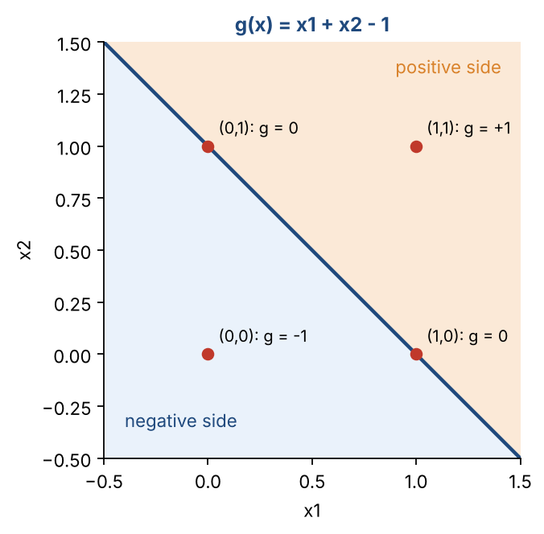
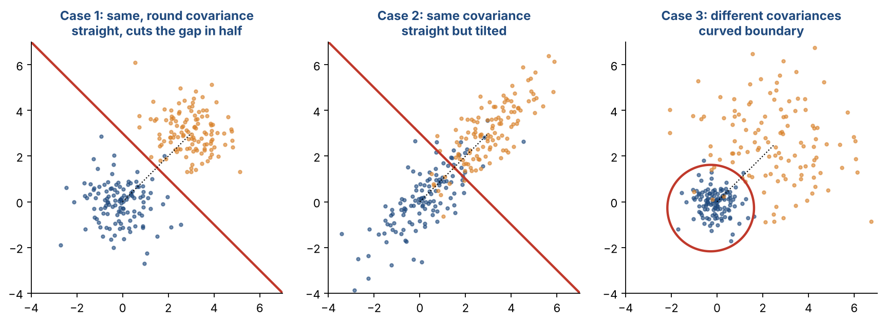
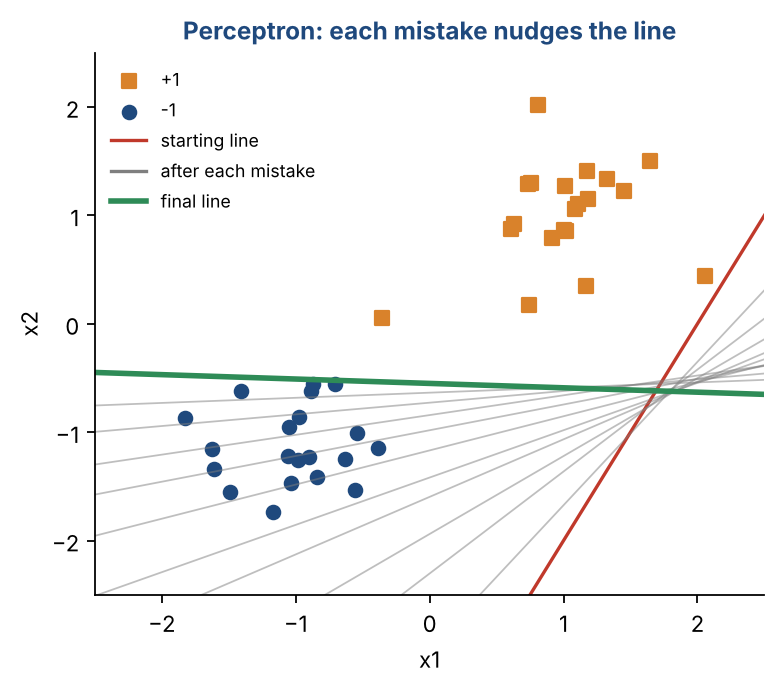
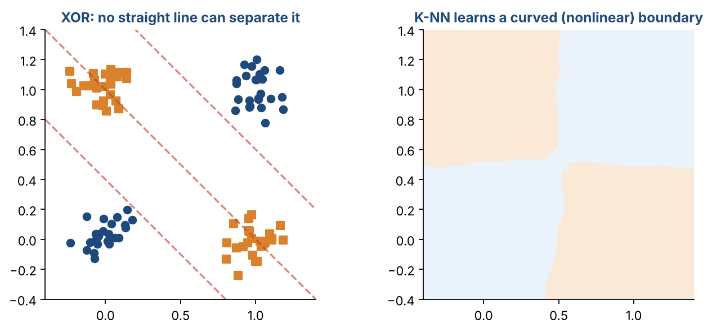

# Chapter 11 — Support Vector Machines I: Discriminant Functions, Decision Boundaries & the Perceptron

**Part II — Classic Machine Learning** · [](https://colab.research.google.com/github/winnertechserv/aimlgybs/blob/main/part2_classic_ml/ch11_support_vector_machines_i/ch11_notebook.ipynb)

Companion code for Chapter 11 of *AI-Machine Learning: Get Your Base Strong*. The book explains the ideas; this folder lets you run them.

## Key ideas

- Every classifier carves the input space into class regions. The border between them is the decision boundary.
- Non-discriminative methods (K-NN, Bayes) model each class. Discriminative methods (perceptron, SVM) learn the boundary.
- In a Gaussian Bayes classifier, shared covariances give linear boundaries and different covariances give curved ones.
- A linear boundary is g(x) = wᵀx + w₀ = 0, and the sign of g(x) gives the class.
- The perceptron nudges its weights on every mistake and converges if the data is linearly separable.
- The perceptron fails on non-separable data, and the line it finds is not the best one. SVMs fix both problems.

## Examples

| # | Program | What it shows |
|---|---|---|
| 1 | [`ex1_discriminant_functions_and_bayes_decision_bou.py`](ex1_discriminant_functions_and_bayes_decision_bou.py) | The first part evaluates g(x) = x₁ + x₂ − 1 at a few example points and reports which side each one is on. |
| 2 | [`ex2_the_perceptron_learning_algorithm.py`](ex2_the_perceptron_learning_algorithm.py) | The perceptron algorithm, line by line. |
| 3 | [`ex3_where_the_perceptron_fails.py`](ex3_where_the_perceptron_fails.py) | The XOR pattern puts one class on two opposite corners and the other class on the other two. |

Run any example from this folder:

```bash
cd part2_classic_ml/ch11_support_vector_machines_i
python ex1_discriminant_functions_and_bayes_decision_bou.py
```

The exact output printed in the book is in [`expected_output/`](expected_output). The notebook [`ch11_notebook.ipynb`](ch11_notebook.ipynb) has all three examples with explanations.

### Example 1: Discriminant Functions and Bayes Decision Boundaries

The first part evaluates g(x) = x₁ + x₂ − 1 at a few example points and reports which side each one is on. The second part checks the three-case theory. When two classes share a covariance matrix, a linear boundary (LDA) does just as well as a quadratic one (QDA), and the quadratic term W is almost zero. When the covariances differ, one class is tight and the other spread out, so the quadratic boundary wins (93.0% vs 87.5%) and W is clearly non-zero, which means the boundary curves.

<details><summary>Expected output</summary>

```text
g(1, 0) = +0.0  -> on the line
g(0, 1) = +0.0  -> on the line
g(0, 0) = -1.0  -> negative side
g(1, 1) = +1.0  -> positive side
g(0.2, 0.3) = -0.5  -> negative side

Same covariance (Case 2)
  Linear boundary accuracy   : 0.802
  Quadratic boundary accuracy: 0.805
  Size of quadratic term |W| = 0.05  -> boundary is almost straight

Different covariance (Case 3)
  Linear boundary accuracy   : 0.875
  Quadratic boundary accuracy: 0.930
  Size of quadratic term |W| = 3.08  -> boundary is curved
```

</details>

### Example 2: The Perceptron Learning Algorithm

The perceptron algorithm, line by line. We start from a deliberately bad line so that the first epoch has plenty of mistakes (11). The weights are nudged after each one, and by epoch 2 there are no mistakes, so training stops. Then we classify three new points by the sign of g(x). Look at the last line: the closest training point is only 0.032 units from the boundary. The perceptron stopped at the first line that worked, not the safest one. Keep that number in mind for Chapter 12.

<details><summary>Expected output</summary>

```text
Epoch 1: misclassifications = 11
Epoch 2: misclassifications = 0

Learned w = [w0, w1, w2] = [0.9   0.066 1.635]
Boundary: 0.07*x1 + 1.64*x2 + 0.90 = 0
Test [1.5, 1.0]: g(x) = +2.63 -> class +1
Test [-0.5, -1.5]: g(x) = -1.59 -> class -1
Test [0.5, 0.4]: g(x) = +1.59 -> class +1
Closest training point is 0.032 units from the boundary
```

</details>

### Example 3: Where the Perceptron Fails

The XOR pattern puts one class on two opposite corners and the other class on the other two. The perceptron keeps making mistakes epoch after epoch and never converges. Scikit-learn's perceptron scores only 42%, worse than guessing. K-NN, which learns a nonlinear boundary, scores 100%. With overlapping classes the perceptron also never reaches zero errors. These are exactly the gaps that SVMs (and later neural networks) fill.

<details><summary>Expected output</summary>

```text
XOR data - mistakes per epoch (first 10): [3, 5, 4, 4, 4, 5, 5, 4, 4, 7]
After 50 epochs still 8 mistakes -> it never converges.
Perceptron (scikit-learn) accuracy on XOR: 0.42
K-NN (K=5) accuracy on XOR: 1.00

Overlapping data: mistakes in the last 5 epochs [9, 15, 9, 10, 13] - never reaches 0.
```

</details>

## Figures from this chapter

**Figure 11.1.** The sign of g(x) tells you which side of the line a point is on.



**Figure 11.2.** The three covariance cases. The red line is the Bayes decision boundary; the dotted line joins the two class means.



**Figure 11.3.** The perceptron from Example 2 starting from a deliberately bad line. Every grey line is one update (11 in total) until no point is misclassified.



**Figure 11.4.** The XOR pattern from Example 3. Every straight line leaves points on the wrong side, but a nonlinear method separates the classes easily.



The code that draws these figures is in [`figures/src`](../../figures/src).

---

[← Chapter 10](../../part2_classic_ml/ch10_probabilistic_models_for_classification_ii) · [All chapters](../../README.md#chapters) · [Chapter 12 →](../../part2_classic_ml/ch12_support_vector_machines_ii)
