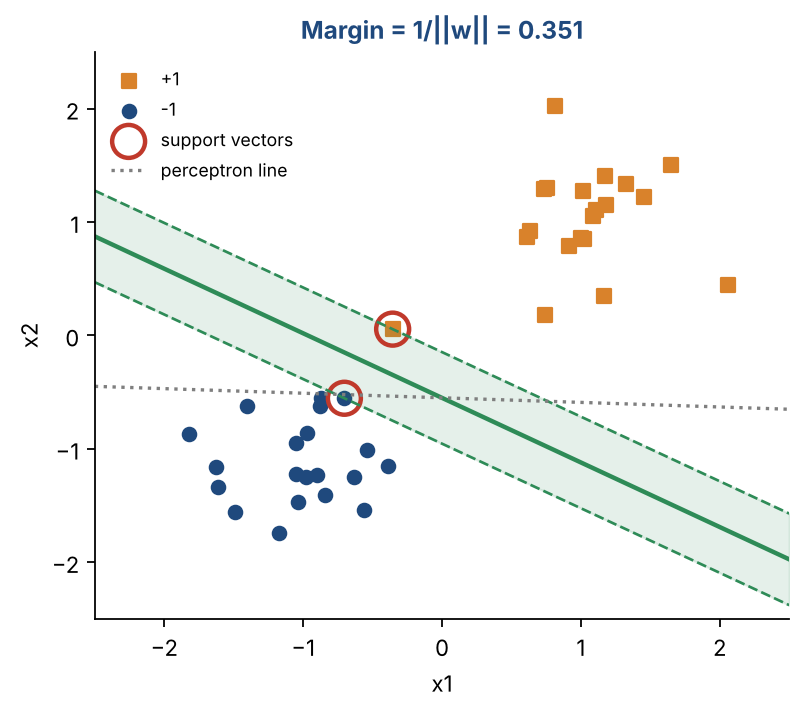
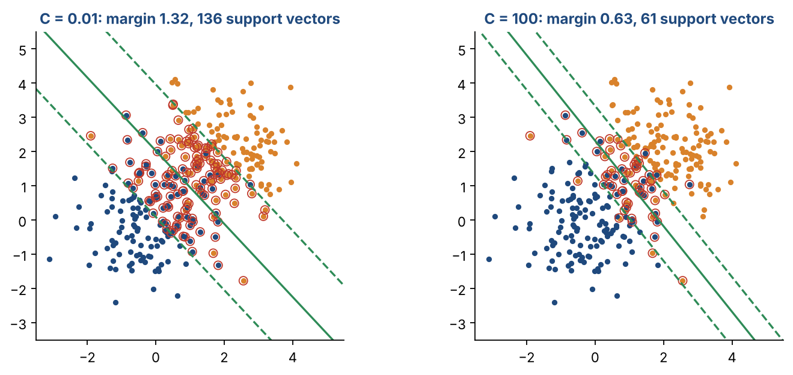
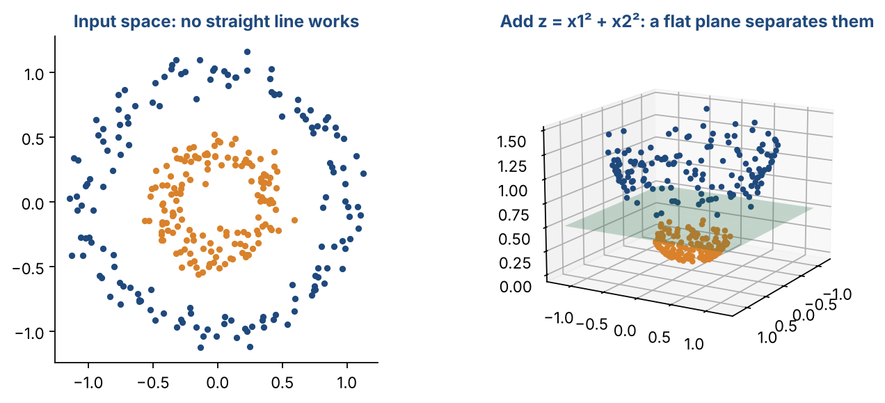
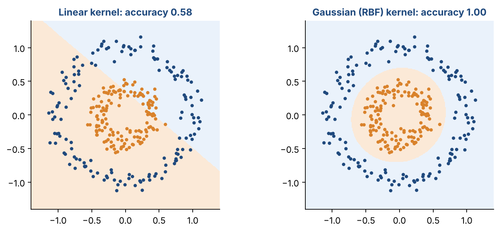

# Chapter 12 — Support Vector Machines II: Maximum Margin, Soft Margin, Kernels & Multiclass SVMs

**Part II — Classic Machine Learning** · [](https://colab.research.google.com/github/winnertechserv/aimlgybs/blob/main/part2_classic_ml/ch12_support_vector_machines_ii/ch12_notebook.ipynb)

Companion code for Chapter 12 of *AI-Machine Learning: Get Your Base Strong*. The book explains the ideas; this folder lets you run them.

## Key ideas

- An SVM picks the separating hyperplane with the largest margin (1/‖w‖) to the nearest points.
- Only the support vectors matter: w = Σ αₙyₙxₙ, and every other point could be removed.
- A soft margin allows some violations, measured by the hinge loss. C trades margin width against training errors.
- Kernels make SVMs nonlinear: map to a higher-dimensional space, then separate with a hyperplane there.
- The kernel trick computes K(x, z) = Φ(x)ᵀΦ(z) without building Φ. Common kernels are linear, polynomial and Gaussian (RBF).
- For C classes, use one-against-the-rest (C SVMs) or one-against-one (C(C−1)/2 SVMs).

## Examples

| # | Program | What it shows |
|---|---|---|
| 1 | [`ex1_the_maximum_margin_hyperplane.py`](ex1_the_maximum_margin_hyperplane.py) | This uses the same data as the perceptron in Chapter 11, now with a linear SVM with a huge C (effectively a hard margin). |
| 2 | [`ex2_soft_margin_and_the_c_parameter.py`](ex2_soft_margin_and_the_c_parameter.py) | Two overlapping classes, so a soft margin is needed. |
| 3 | [`ex3_kernels_and_multiclass_svms.py`](ex3_kernels_and_multiclass_svms.py) | First, the kernel trick in numbers: (x·z + 1)² gives 25, and building the 6-dimensional Φ(x) and Φ(z) explicitly and taking their dot product also gives 25. |

Run any example from this folder:

```bash
cd part2_classic_ml/ch12_support_vector_machines_ii
python ex1_the_maximum_margin_hyperplane.py
```

The exact output printed in the book is in [`expected_output/`](expected_output). The notebook [`ch12_notebook.ipynb`](ch12_notebook.ipynb) has all three examples with explanations.

### Example 1: The Maximum-Margin Hyperplane

This uses the same data as the perceptron in Chapter 11, now with a linear SVM with a huge C (effectively a hard margin). Only 2 of the 40 points become support vectors. Both have y·g(x) = 1.000, which means they sit exactly on the margin. Rebuilding w from those two points alone, as Σ αₙyₙxₙ, gives the same w. The last line is the payoff: the closest point is 0.351 units from the SVM boundary, against only 0.032 for the perceptron's line. That is more than ten times the safety gap.

<details><summary>Expected output</summary>

```text
SVM boundary: 1.411*x1 + 2.475*x2 + 1.364 = 0
Number of support vectors: 2 (out of 40 points)
  support vector [-0.703 -0.554]  y*g(x) = 1.000  alpha*y = -4.059
  support vector [-0.356  0.055]  y*g(x) = 1.000  alpha*y = +4.059

Margin (distance from boundary to nearest point) = 1/||w|| = 0.351
Width of the empty 'street' between the classes  = 2/||w|| = 0.702
w rebuilt from support vectors: [1.411 2.475] (matches w)

Closest point to the PERCEPTRON line: 0.032  vs  SVM: 0.351
```

</details>

### Example 2: Soft Margin and the C Parameter

Two overlapping classes, so a soft margin is needed. As C grows from 0.001 to 100, the margin shrinks from 4.03 to 0.55 and the number of support vectors falls from 178 to 36. The model trusts fewer points and fits the training set harder. Test accuracy stays about the same, which shows that a bigger C is not automatically better. The last lines sort the training points by hinge loss: outside the margin, inside it, or on the wrong side.

<details><summary>Expected output</summary>

```text
    C     margin  support vectors  train acc  test acc  points with xi>1
  0.001     4.03       178          0.911     0.900        16
  0.01      1.52        97          0.917     0.917        15
  0.1       0.91        51          0.928     0.900        13
  1         0.64        39          0.928     0.900        13
  100       0.55        36          0.928     0.908        13

Small C: wide margin, many support vectors, tolerates errors.
Large C: narrow margin, tries hard to classify every training point.
  outside the margin (xi = 0)     : 143 points
  inside the margin (0 < xi < 1)  :  24 points
  wrong side (xi > 1)             :  13 points
```

</details>

### Example 3: Kernels and Multiclass SVMs

First, the kernel trick in numbers: (x·z + 1)² gives 25, and building the 6-dimensional Φ(x) and Φ(z) explicitly and taking their dot product also gives 25. Same answer, less work. Next, two rings of points that no line can separate. A linear SVM manages only 54%, while polynomial and Gaussian kernels both reach 100%. Finally, a 4-class problem: one-against-the-rest trains 4 SVMs, one-against-one trains 6 (= 4×3/2), and both reach similar accuracy.

<details><summary>Expected output</summary>

```text
Kernel (x.z + 1)^2      = 25.0
phi(x) . phi(z) (6-dim) = 25.0   <- same number, less work

Two rings (not linearly separable):
  linear            test accuracy 0.542   support vectors 274
  polynomial (p=2)  test accuracy 1.000   support vectors 16
  Gaussian / RBF    test accuracy 1.000   support vectors 34

4 classes:
  One-against-the-rest: 4 SVMs, test accuracy 0.878
  One-against-one     : 6 SVMs (C(C-1)/2 = 6), test accuracy 0.894
```

</details>

## Figures from this chapter

**Figure 12.1.** The maximum-margin hyperplane from Example 1. The shaded street is as wide as possible; only the two circled support vectors touch it.



**Figure 12.2.** Soft margin: a small C gives a wide street with many support vectors (circled); a large C squeezes the street to make fewer training errors.



**Figure 12.3.** The idea behind kernels: rings that no line can split in 2-D become separable by a flat plane once a third feature is added.



**Figure 12.4.** The same rings classified by a linear SVM and by an RBF-kernel SVM. The kernel lets the SVM draw a circular boundary.



The code that draws these figures is in [`figures/src`](../../figures/src).

---

[← Chapter 11](../../part2_classic_ml/ch11_support_vector_machines_i) · [All chapters](../../README.md#chapters) · [Chapter 13 →](../../part2_classic_ml/ch13_dimensionality_reduction)
