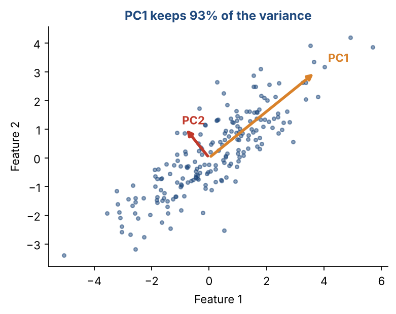
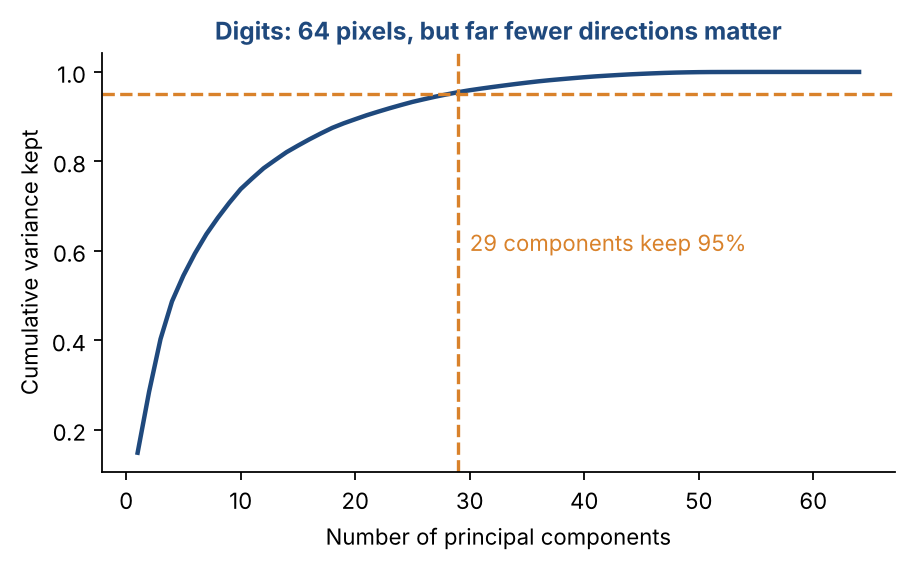
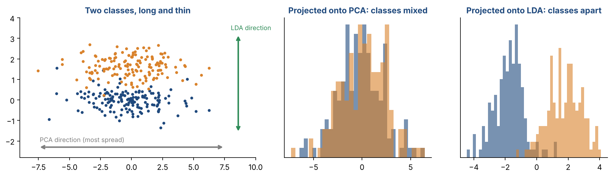

# Chapter 13 — Dimensionality Reduction: PCA & Fisher Discriminant Analysis

**Part II — Classic Machine Learning** · [](https://colab.research.google.com/github/winnertechserv/aimlgybs/blob/main/part2_classic_ml/ch13_dimensionality_reduction/ch13_notebook.ipynb)

Companion code for Chapter 13 of *AI-Machine Learning: Get Your Base Strong*. The book explains the ideas; this folder lets you run them.

## Key ideas

- PCA finds new axes (principal components) ordered by how much variance they capture, and you keep enough to reach about 95%.
- Eigenvalues tell you the variance along each component; eigenvectors give the directions themselves.
- PCA is unsupervised: it never looks at the class labels, so its best direction may be useless for classification.
- FDA (LDA) is supervised and maximizes class separation, which is why its 1-D projection usually classifies better than PCA's.
- Dimensionality reduction is about removing redundancy, not about throwing away data at random.

## Examples

| # | Program | What it shows |
|---|---|---|
| 1 | [`ex1_pca_step_by_step_from_scratch.py`](ex1_pca_step_by_step_from_scratch.py) | This example builds PCA by hand, step by step, exactly as described in the overview. |
| 2 | [`ex2_pca_with_scikit_learn_on_handwritten_digits.py`](ex2_pca_with_scikit_learn_on_handwritten_digits.py) | This is PCA on real data: scikit-learn's handwritten digits, where each image is 8×8 = 64 pixels (the same idea scales to 28×28 MNIST images). |
| 3 | [`ex3_fisher_discriminant_analysis_fda_lda_vs_pca.py`](ex3_fisher_discriminant_analysis_fda_lda_vs_pca.py) | This is the key example that proves WHY FDA beats PCA for classification tasks. |

Run any example from this folder:

```bash
cd part2_classic_ml/ch13_dimensionality_reduction
python ex1_pca_step_by_step_from_scratch.py
```

The exact output printed in the book is in [`expected_output/`](expected_output). The notebook [`ch13_notebook.ipynb`](ch13_notebook.ipynb) has all three examples with explanations.

### Example 1: PCA Step-by-Step from Scratch

This example builds PCA by hand, step by step, exactly as described in the overview. We have 20 days of five weather readings, and one hidden weather pattern drives all of them, so they are strongly correlated. Because the readings are in very different units (Rain runs into hundreds of mm), we first standardize them, as Chapter 6 taught. Then we compute the covariance matrix, find its eigenvalues and eigenvectors, sort them and apply the 95% rule. PC1 alone captures about 97% of the variance, and its weights show all five readings contributing almost equally: the five features really do carry one shared signal. Finally we project the data onto PC1 (aₙ = Qᵀxₙ) and check that the variance of the projected scores equals the PC1 eigenvalue.

<details><summary>Expected output</summary>

```text
Dataset shape: (20, 5)  (20 samples, 5 features)

Step 0: Features standardized (mean 0, std 1)
Step 1: Covariance matrix computed (5x5)
        Correlation of Temperature with the others: [-0.96 -0.96 -0.96 -0.97]

Step 2: Eigenvalues and cumulative variance:
  PC1:  4.8652  |  97.30%  |  cum  97.30% <- 95% crossed
  PC2:  0.0598  |   1.20%  |  cum  98.50%
  PC3:  0.0311  |   0.62%  |  cum  99.12%
  PC4:  0.0266  |   0.53%  |  cum  99.65%
  PC5:  0.0174  |   0.35%  |  cum 100.00%

Step 3: Keep l = 1 principal component(s) (95% rule)
        PC1 weights: {'Temperature': 0.45, 'Humidity': -0.45, 'Pressure': -0.45, 'Rain': -0.45, 'Moisture': -0.45}
Step 4: Original shape (20, 5) -> Projected shape (20, 1)

First 5 projected samples:
  Sample 1: -2.83
  Sample 2: +0.16
  Sample 3: -1.37
  Sample 4: -4.06
  Sample 5: -3.41

Step 5: Variance of PC1 scores: 4.8652  (eigenvalue of PC1: 4.8652)
```

</details>

### Example 2: PCA with scikit-learn on Handwritten Digits

This is PCA on real data: scikit-learn's handwritten digits, where each image is 8×8 = 64 pixels (the same idea scales to 28×28 MNIST images). We use scikit-learn's PCA to find how many components are needed to keep 95% and 99% of the variance. All pixels share one unit (brightness from 0 to 16), so we do not standardize them. Just 29 of the 64 dimensions keep 95% of the variance, matching Figure 13.2, and the images shrink by more than half. The reconstruction error is small next to the average pixel variance, so the 35 dropped directions carried little information. This is the eigenface idea in action: store a few component scores per image instead of every pixel.

<details><summary>Expected output</summary>

```text
Original dataset shape : (1797, 64)
  -> 1797 images, each 8x8 = 64 pixel features

Variance explained by top N components:
  Top   1 PCs -> cumulative variance: 14.89%
  Top   2 PCs -> cumulative variance: 28.51%
  Top   3 PCs -> cumulative variance: 40.30%
  Top   5 PCs -> cumulative variance: 54.50%
  Top  10 PCs -> cumulative variance: 73.82%
  Top  20 PCs -> cumulative variance: 89.43%
  Top  29 PCs -> cumulative variance: 95.48%
  Top  41 PCs -> cumulative variance: 99.01%

95% threshold: keep 29 components
99% threshold: keep 41 components
Reduction: 64 -> 29 dims  (54.7% smaller)

Reduced dataset shape  : (1797, 29)
Reconstruction MSE     : 0.8486  (average pixel variance: 18.77)
(Small MSE = minimal information lost)
```

</details>

### Example 3: Fisher Discriminant Analysis (FDA/LDA) vs PCA

This is the key example that proves WHY FDA beats PCA for classification tasks. We use sklearn's LinearDiscriminantAnalysis (which builds FDA) and compare it to PCA on the same 10-feature, 2-class dataset. Both reduce to 1 dimension. FDA finds a direction that maximizes class separation (the class means are 1.96 apart after projection). PCA finds the direction of maximum variance — but that direction might not be useful for distinguishing classes. The accuracy comparison confirms it: FDA 1D is nearly as good as the full 10D dataset, while PCA 1D loses large accuracy.

<details><summary>Expected output</summary>

```text
=== FDA vs PCA for Classification ===

Dataset: 300 samples, 10 features, 2 classes

Step 1: FDA projection direction maximizes class separation
  Class +1 mean in FDA space: 1.0191
  Class  0 mean in FDA space: -0.9443
  Separation between means  : 1.9633

Step 2: Classification accuracy comparison (5-NN classifier)
  Original 10D data      : 82.2%
  PCA 1D projection      : 73.3%  (max variance, may miss class info)
  FDA 1D projection      : 80.0%  (max separability)

FDA projection weights per feature:
  Feature  1: +0.0033
  Feature  2: -0.1774
  Feature  3: +0.7178
  Feature  4: -0.3141
  Feature  5: +0.6349
  Feature  6: -0.3084
  Feature  7: +0.1813
  Feature  8: -0.4975
  Feature  9: -1.0280
  Feature 10: -0.2835
```

</details>

## Figures from this chapter

**Figure 13.1.** PCA finds the direction of greatest spread (PC1) and the next one at a right angle to it (PC2). Projecting onto PC1 alone keeps most of the information.



**Figure 13.2.** Cumulative variance for the 8x8 digit images: a small number of components carries almost all of the information in 64 pixels.



**Figure 13.3.** PCA ignores labels and keeps the long, wide direction, which mixes the classes. Fisher discriminant analysis (LDA) picks the direction that keeps them apart.



The code that draws these figures is in [`figures/src`](../../figures/src).

---

[← Chapter 12](../../part2_classic_ml/ch12_support_vector_machines_ii) · [All chapters](../../README.md#chapters) · [Chapter 14 →](../../part2_classic_ml/ch14_decision_trees)
