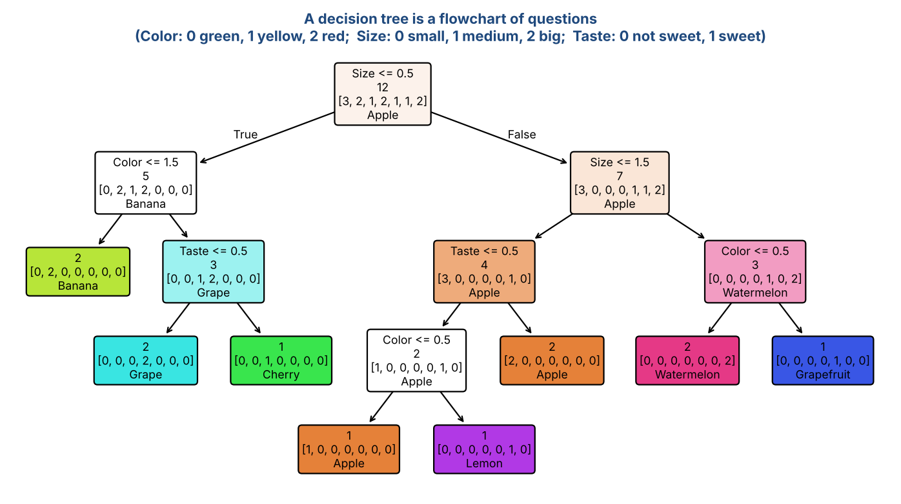
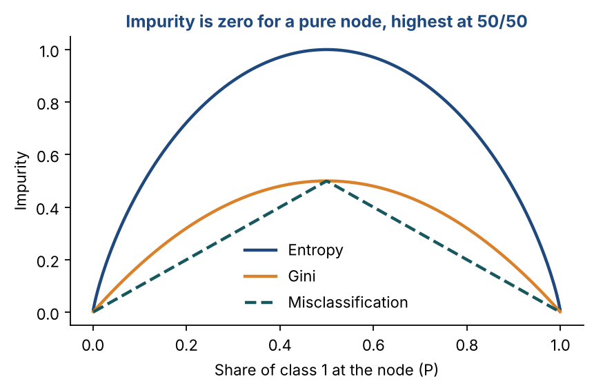
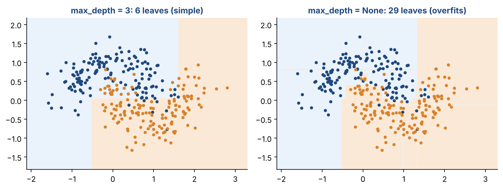

# Chapter 14 — Decision Trees

**Part II — Classic Machine Learning** · [](https://colab.research.google.com/github/winnertechserv/aimlgybs/blob/main/part2_classic_ml/ch14_decision_trees/ch14_notebook.ipynb)

Companion code for Chapter 14 of *AI-Machine Learning: Get Your Base Strong*. The book explains the ideas; this folder lets you run them.

## Key ideas

- A decision tree is a sequence of questions; each split should leave the child nodes purer than the parent.
- Entropy and Gini both measure impurity, and information gain picks the split that reduces it most.
- A tree grown without limits will memorize the training set: stop early using depth or minimum-samples rules.
- Occam's Razor applies — prefer the simpler tree when two trees explain the data equally well.
- Trees are highly interpretable: you can read the decision rules straight off the diagram.

## Examples

| # | Program | What it shows |
|---|---|---|
| 1 | [`ex1_entropy_impurity_information_gain.py`](ex1_entropy_impurity_information_gain.py) | This is the most basic calculation in decision tree construction — manual entropy and information gain computation. |
| 2 | [`ex2_cart_decision_tree_with_scikit_learn_fruit_cl.py`](ex2_cart_decision_tree_with_scikit_learn_fruit_cl.py) | We train a real CART decision tree on a small fruit classification example. |
| 3 | [`ex3_tree_depth_vs_overfitting_occam_s_razor_in_ac.py`](ex3_tree_depth_vs_overfitting_occam_s_razor_in_ac.py) | This example shows Occam's Razor in decision trees — the principle that simpler models are preferred when they explain the data equally well. |

Run any example from this folder:

```bash
cd part2_classic_ml/ch14_decision_trees
python ex1_entropy_impurity_information_gain.py
```

The exact output printed in the book is in [`expected_output/`](expected_output). The notebook [`ch14_notebook.ipynb`](ch14_notebook.ipynb) has all three examples with explanations.

### Example 1: Entropy Impurity & Information Gain

This is the most basic calculation in decision tree construction — manual entropy and information gain computation. We use a small worked example: a node with 10 examples (4 from C1, 4 from C2, 2 from C3) and two competing queries. For each query, we compute entropy of the parent node and both child nodes, then calculate information gain. Query 1 wins (ΔI = 0.3219 > 0.1568) so it gets selected. The bottom section shows entropy for special cases — a pure node has entropy 0 (no uncertainty), while equal class distribution gives maximum entropy.

<details><summary>Expected output</summary>

```text
Parent Node: 4 C1, 4 C2, 2 C3
Entropy i(Nd) = 1.5219

Query 1: Left=[3, 1, 0]  Right=[1, 3, 2]
  i(NdL)=0.8113  i(NdR)=1.4591
  Information Gain = 0.3219

Query 2: Left=[2, 1, 0]  Right=[2, 3, 2]
  i(NdL)=0.9183  i(NdR)=1.5567
  Information Gain = 0.1568

Decision: Query 1 wins (0.3219 > 0.1568) -> SELECT Query 1

--- Entropy for special cases ---
  Pure node [10, 0]  : entropy = 0.0000  (pure, no uncertainty)
  50/50 split [5,5]  : entropy = 1.0000  (maximum, 2 classes)
  Equal [1,1,1]      : entropy = 1.5850  (maximum, 3 classes)
```

</details>

### Example 2: CART Decision Tree with scikit-learn (Fruit Classifier)

We train a real CART decision tree on a small fruit classification example. Each fruit is described by 4 categorical features encoded as integers: Color (0=Green, 1=Yellow, 2=Red), Size (0=Small, 1=Medium, 2=Big), Shape (0=Round, 1=NonRound), Taste (0=NonSweet, 1=Sweet). The export_text output shows the actual tree that CART built — it's a human-readable flowchart you can follow manually. We then test it on three new fruit descriptions to check predictions. Scikit-learn trees need numbers, which is why the categories are encoded as integers first. Figure 14.1 draws this same tree. Notice that it never asks about Shape: color, size and taste are enough to tell these twelve fruits apart.

<details><summary>Expected output</summary>

```text
=== Decision Tree (CART, criterion=entropy) ===

|--- Size <= 0.50
|   |--- Color <= 1.50
|   |   |--- class: Banana
|   |--- Color >  1.50
|   |   |--- Taste <= 0.50
|   |   |   |--- class: Grape
|   |   |--- Taste >  0.50
|   |   |   |--- class: Cherry
|--- Size >  0.50
|   |--- Size <= 1.50
|   |   |--- Taste <= 0.50
|   |   |   |--- Color <= 0.50
|   |   |   |   |--- class: Apple
|   |   |   |--- Color >  0.50
|   |   |   |   |--- class: Lemon
|   |   |--- Taste >  0.50
|   |   |   |--- class: Apple
|   |--- Size >  1.50
|   |   |--- Color <= 0.50
|   |   |   |--- class: Watermelon
|   |   |--- Color >  0.50
|   |   |   |--- class: Grapefruit

Training Accuracy: 100.0%

=== Predictions on New Fruit Descriptions ===
  Red, Small, Round, Sweet                      -> Cherry
  Yellow, Big, Round, NonSweet                  -> Grapefruit
  Green, Big, Round, NonSweet                   -> Watermelon
```

</details>

### Example 3: Tree Depth vs Overfitting (Occam's Razor in Action)

This example shows Occam's Razor in decision trees — the principle that simpler models are preferred when they explain the data equally well. We train the same tree on the Iris dataset with different maximum depths and compare training vs test accuracy. A very deep tree achieves 100% training accuracy (it perfectly memorizes the data) but test accuracy may not improve and can drop. The sweet spot is around depth 2-3 for Iris. We also compare Gini vs Entropy criteria, confirming they produce nearly identical results in practice — the choice rarely matters much.

<details><summary>Expected output</summary>

```text
=== Tree Depth vs Accuracy (Iris Dataset) ===

Max Depth     Train Acc   Test Acc   Leaf Nodes
------------------------------------------------
  1               64.8%      71.1%            2
  2               94.3%      97.8%            3
  3               95.2%     100.0%            5
  4               97.1%     100.0%            7
  5               99.0%     100.0%            9
  No limit       100.0%     100.0%           10

Insight: Deeper trees memorize training data (Occam's Razor says stop early!)

=== Gini vs Entropy Impurity Criterion ===

  criterion='gini': Test=100.0%  Leaves=5
  criterion='entropy': Test=97.8%  Leaves=5

Conclusion: Gini and Entropy usually produce very similar trees in practice.
```

</details>

## Figures from this chapter

**Figure 14.1.** The fruit-classification tree built in Example 2. Each box asks one question about one feature; the leaves give the predicted fruit.



**Figure 14.2.** Three impurity measures for a two-class node. All are zero when the node is pure and largest when the classes are evenly mixed.



**Figure 14.3.** A shallow tree draws a few simple boxes. A fully grown tree carves out tiny regions around single points, which is overfitting; Occam's Razor prefers the simpler tree.



The code that draws these figures is in [`figures/src`](../../figures/src).

---

[← Chapter 13](../../part2_classic_ml/ch13_dimensionality_reduction) · [All chapters](../../README.md#chapters) · [Chapter 15 →](../../part2_classic_ml/ch15_ensemble_methods)
