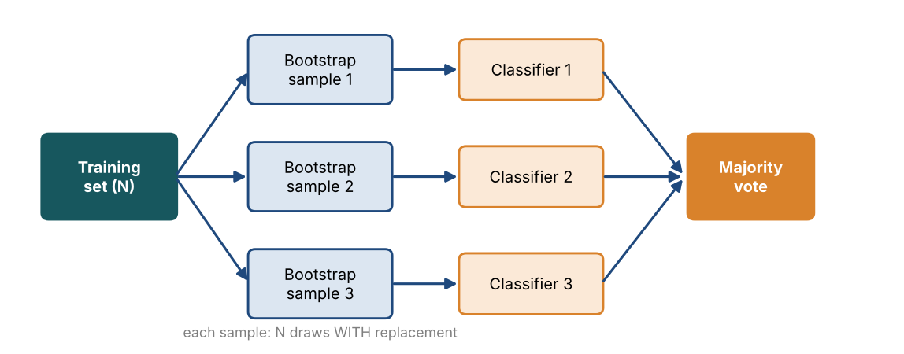
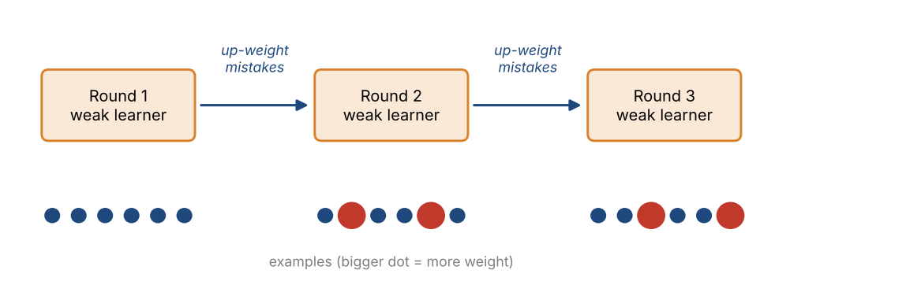
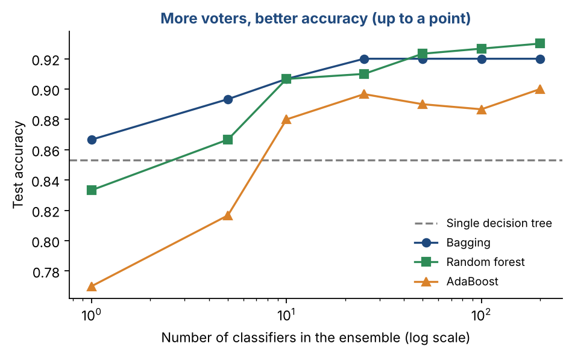

# Chapter 15 — Ensemble Methods

**Part II — Classic Machine Learning** · [](https://colab.research.google.com/github/winnertechserv/aimlgybs/blob/main/part2_classic_ml/ch15_ensemble_methods/ch15_notebook.ipynb)

Companion code for Chapter 15 of *AI-Machine Learning: Get Your Base Strong*. The book explains the ideas; this folder lets you run them.

## Key ideas

- A group of weak models, combined properly, reliably beats any one of them alone.
- Bagging trains many models in parallel on bootstrap samples and averages them, which mainly reduces variance.
- Random Forest adds a second source of randomness by considering only a subset of features at each split.
- Boosting (AdaBoost) works sequentially, giving more weight to the examples the previous models got wrong.
- Random Forest also hands you feature importance scores for free, useful for feature selection.

## Examples

| # | Program | What it shows |
|---|---|---|
| 1 | [`ex1_bagging_weak_classifiers_growing_stronger.py`](ex1_bagging_weak_classifiers_growing_stronger.py) | This example shows the magic of Bagging: taking individually weak decision stumps (depth=2) and combining 50-200 of them into a strong ensemble. |
| 2 | [`ex2_adaboost_progressive_accuracy_improvement.py`](ex2_adaboost_progressive_accuracy_improvement.py) | AdaBoost is sequential Bagging's smarter cousin. |
| 3 | [`ex3_random_forest_feature_importance.py`](ex3_random_forest_feature_importance.py) | One powerful bonus of Random Forest is that it gives you feature importance scores for free. |

Run any example from this folder:

```bash
cd part2_classic_ml/ch15_ensemble_methods
python ex1_bagging_weak_classifiers_growing_stronger.py
```

The exact output printed in the book is in [`expected_output/`](expected_output). The notebook [`ch15_notebook.ipynb`](ch15_notebook.ipynb) has all three examples with explanations.

### Example 1: Bagging — Weak Classifiers Growing Stronger

This example shows the magic of Bagging: taking individually weak decision stumps (depth=2) and combining 50-200 of them into a strong ensemble. A single stump gets 75.3%, but 50 bagged stumps push to 84.7%. The Random Forest takes this further by also randomizing which features each tree considers at each split — it achieves 91.3%. Notice also that a single deep (unlimited) tree gets 84.0% — similar to bagged stumps but with more risk of overfitting. The visual bar chart makes the improvement instantly obvious.

<details><summary>Expected output</summary>

```text
Model                                    Test Acc
--------------------------------------------------
  Single Tree (deep)                     84.0%  |XXXXXXXXXXXXXXXXXXXXXXXXXXXXXXXXX
  Single Stump (depth=2)                 75.3%  |XXXXXXXXXXXXXXXXXXXXXXXXXXXXXX
  Bagging  10 stumps                     81.3%  |XXXXXXXXXXXXXXXXXXXXXXXXXXXXXXXX
  Bagging  50 stumps                     84.7%  |XXXXXXXXXXXXXXXXXXXXXXXXXXXXXXXXX
  Bagging 100 stumps                     82.7%  |XXXXXXXXXXXXXXXXXXXXXXXXXXXXXXXXX
  Bagging 200 stumps                     82.0%  |XXXXXXXXXXXXXXXXXXXXXXXXXXXXXXXX
  Random Forest (100 trees)              91.3%  |XXXXXXXXXXXXXXXXXXXXXXXXXXXXXXXXXXXX

Key insight: Weak classifiers (stumps) become strong when bagged together.
Random Forest adds feature randomness on top of Bagging for even better results.
```

</details>

### Example 2: AdaBoost — Progressive Accuracy Improvement

AdaBoost is sequential Bagging's smarter cousin. Instead of building classifiers in parallel on random subsets, it builds them one after another, always paying extra attention to the examples that were misclassified so far. We track how the ensemble accuracy grows as we add more weak classifiers. A single stump starts at 70%. By round 50 it reaches 85% — a 15 percentage point gain purely from sequentially reweighting examples. The final comparison shows AdaBoost vs Random Forest vs a single tree: the random forest clearly beats the single tree, while AdaBoost with 200 stumps only matches it, because its accuracy dips slightly after round 50. More rounds are not always better.

<details><summary>Expected output</summary>

```text
=== AdaBoost: Accuracy vs Number of Weak Classifiers ===

 Classifiers    Ensemble Acc  vs Baseline
---------------------------------------------
           1           70.0%  (baseline)
           2           70.0%  +0.0%
           5           71.7%  +1.7%
          10           78.3%  +8.3%
          20           80.8%  +10.8%
          50           85.0%  +15.0%
         100           82.5%  +12.5%
         200           83.3%  +13.3%

Baseline (1 stump): 70.0%

=== Final Model Comparison ===

  Single Tree (depth=5)       : 83.3%
  Random Forest 100 trees     : 88.3%
  AdaBoost 200 stumps         : 83.3%
```

</details>

### Example 3: Random Forest Feature Importance

One powerful bonus of Random Forest is that it gives you feature importance scores for free. After training 100 trees, each tree tells us how much each feature contributed to reducing impurity across all its splits. We average this across all trees to get a robust importance ranking. On the Breast Cancer dataset (30 features, 569 samples), the model achieves 97.08% accuracy. The top features (mean concave points, worst concave points, worst area) are clinically meaningful — they measure tumor shape irregularity. The bottom features (symmetry error, texture error) contribute almost nothing and could safely be dropped.

<details><summary>Expected output</summary>

```text
Dataset: Breast Cancer | 569 samples, 30 features
Test Accuracy: 97.08%

Top 10 Most Important Features:
  Rank  Feature                         Importance
--------------------------------------------------
  1     mean concave points                0.1419  XXXXXXXXXXXXXXXXXXXXX
  2     worst concave points               0.1271  XXXXXXXXXXXXXXXXXXX
  3     worst area                         0.1182  XXXXXXXXXXXXXXXXX
  4     mean concavity                     0.0806  XXXXXXXXXXXX
  5     worst radius                       0.0780  XXXXXXXXXXX
  6     worst perimeter                    0.0743  XXXXXXXXXXX
  7     mean perimeter                     0.0601  XXXXXXXXX
  8     mean area                          0.0538  XXXXXXXX
  9     worst concavity                    0.0411  XXXXXX
  10    mean radius                        0.0323  XXXX

Bottom 5 (candidates to drop):
  symmetry error                : 0.0040
  concave points error          : 0.0034
  mean symmetry                 : 0.0033
  texture error                 : 0.0032
  mean fractal dimension        : 0.0031
```

</details>

## Figures from this chapter

**Figure 15.1.** Bagging: train each classifier on a different bootstrap sample, then let them vote.



**Figure 15.2.** Boosting trains learners one after another. Examples the previous learner got wrong (red) get more weight, so the next learner focuses on them.



**Figure 15.3.** Test accuracy on a synthetic 20-feature problem as the ensemble grows. All three ensembles beat a single tree.



The code that draws these figures is in [`figures/src`](../../figures/src).

---

[← Chapter 14](../../part2_classic_ml/ch14_decision_trees) · [All chapters](../../README.md#chapters) · [Chapter 16 →](../../part2_classic_ml/ch16_clustering_techniques)
