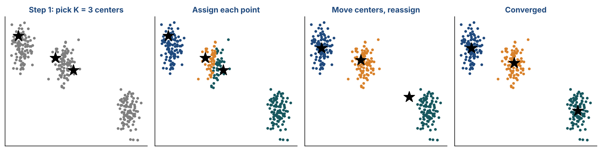
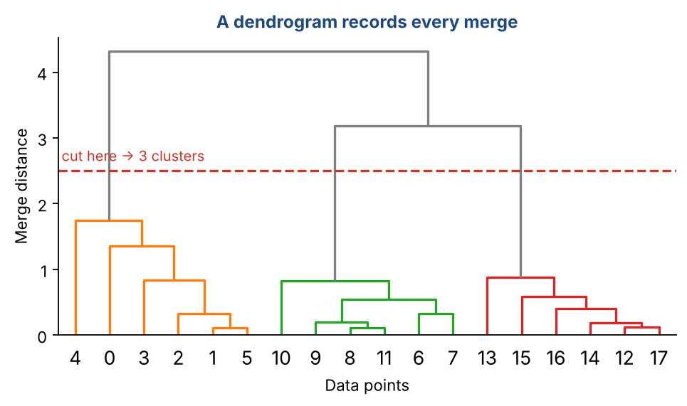
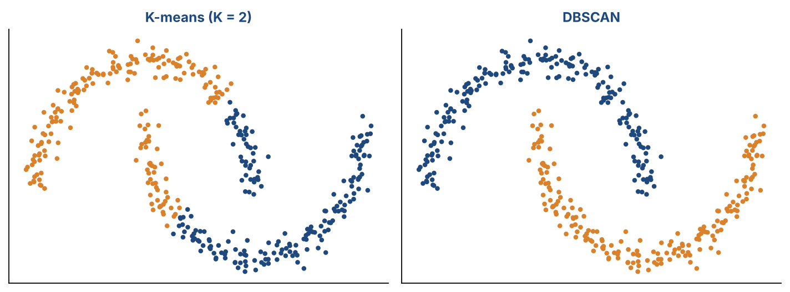

# Chapter 16 — Clustering Techniques

**Part II — Classic Machine Learning** · [](https://colab.research.google.com/github/winnertechserv/aimlgybs/blob/main/part2_classic_ml/ch16_clustering_techniques/ch16_notebook.ipynb)

Companion code for Chapter 16 of *AI-Machine Learning: Get Your Base Strong*. The book explains the ideas; this folder lets you run them.

## Key ideas

- Clustering is unsupervised: there are no labels, only structure waiting to be found.
- K-Means needs K in advance; the elbow method and silhouette score help you choose it, and they usually agree.
- Hierarchical clustering builds a full tree of merges, so you can cut it at whatever number of clusters you want.
- DBSCAN groups by density, so it handles arbitrary shapes and explicitly labels outliers as noise.
- K-Means assumes roughly spherical clusters — on crescents or rings it fails, and that is not a bug but an assumption.

## Examples

| # | Program | What it shows |
|---|---|---|
| 1 | [`ex1_k_means_clustering_elbow_method.py`](ex1_k_means_clustering_elbow_method.py) | We run K-Means on a synthetic 4-cluster dataset and use two methods to find the optimal K. |
| 2 | [`ex2_hierarchical_clustering_linkage_comparison.py`](ex2_hierarchical_clustering_linkage_comparison.py) | Hierarchical clustering does not need you to specify K in advance — it builds a full tree of merges (a dendrogram) and you cut it at any level you want. |
| 3 | [`ex3_dbscan_vs_k_means_arbitrary_shapes_outlier_de.py`](ex3_dbscan_vs_k_means_arbitrary_shapes_outlier_de.py) | This is the definitive example showing K-Means' biggest weakness: it assumes spherical clusters. |

Run any example from this folder:

```bash
cd part2_classic_ml/ch16_clustering_techniques
python ex1_k_means_clustering_elbow_method.py
```

The exact output printed in the book is in [`expected_output/`](expected_output). The notebook [`ch16_notebook.ipynb`](ch16_notebook.ipynb) has all three examples with explanations.

### Example 1: K-Means Clustering + Elbow Method

We run K-Means on a synthetic 4-cluster dataset and use two methods to find the optimal K. The Elbow Method plots distortion (J) vs K — the biggest drop is between K=1 and K=4, after which improvements become marginal. The Silhouette Score (which measures how well-separated clusters are, ranging from -1 to 1) peaks at K=4 with 0.8335, independently confirming the elbow. The final K=4 cluster centers and per-cluster counts are also printed, showing balanced clusters of 75 points each.

<details><summary>Expected output</summary>

```text
Dataset: 300 samples | Ground truth: 4 clusters

=== Elbow Method ===

   K    Distortion J      Change   Silhouette
----------------------------------------------
   1        19780.25           —          N/A
   2         9211.21    -10569.0       0.6030
   3         1919.36     -7291.8       0.7783
   4          362.47     -1556.9       0.8335
   5          329.27       -33.2       0.6976
   6          294.61       -34.7       0.5882
   7          261.56       -33.0       0.4487
   8          232.01       -29.6       0.3322

Elbow at K=4 — biggest drop plateaus after K=4.
Silhouette also peaks at K=4. Both methods agree!

=== K-Means Result (K=4) ===

Cluster Centers:
  Cluster 0: (-2.637, +8.986) | 75 points
  Cluster 1: (-6.842, -6.840) | 75 points
  Cluster 2: (+4.703, +2.028) | 75 points
  Cluster 3: (-8.833, +7.218) | 75 points

Total Distortion J = 362.4724
Silhouette Score   = 0.8335
```

</details>

### Example 2: Hierarchical Clustering & Linkage Comparison

Hierarchical clustering does not need you to specify K in advance — it builds a full tree of merges (a dendrogram) and you cut it at any level you want. We compare all five linkage methods on a 3-cluster dataset. All four linkages perfectly recover the true clusters here (ARI=1.0). The merge history table shows the actual step-by-step merging process: step 1 merges points #16 and #53 (distance 0.0484), step 2 merges #57 and #85, and so on, until all 100 points are in one cluster after 99 merges. This is exactly the AGNES algorithm from the slides.

<details><summary>Expected output</summary>

```text
Dataset: 100 samples | Ground truth: 3 clusters

Linkage                Silhouette     Adj Rand  Notes
---------------------------------------------------------------------------
  single                   0.8470       1.0000  nearest-neighbor chaining
  complete                 0.8470       1.0000  compact clusters
  average                  0.8470       1.0000  balanced choice
  ward                     0.8470       1.0000  minimizes within-cluster variance

=== Merge History (AGNES, Ward linkage, first 8 steps) ===

 Step  Cluster A  Cluster B   Distance   New Size
--------------------------------------------------
    1        #16        #53     0.0484          2
    2        #57        #85     0.0570          2
    3         #7        #32     0.0619          2
    4        #61        #81     0.0814          2
    5        #47        #71     0.0865          2
    6        #97   merged_3     0.1006          3
    7        #51        #90     0.1042          2
    8         #9        #56     0.1512          2
  ...

Total steps: 99  (from 100 singletons -> 1 cluster)
```

</details>

### Example 3: DBSCAN vs K-Means — Arbitrary Shapes + Outlier Detection

This is the definitive example showing K-Means' biggest weakness: it assumes spherical clusters. On crescent-shaped data (Two Moons) or ring-shaped data (Two Circles), K-Means splits the shapes incorrectly. DBSCAN doesn't care about shape — it groups by density. We also show DBSCAN's noise detection: when 10 random outlier points are added to a clean blob dataset, DBSCAN correctly identifies them as noise (label -1) rather than forcing them into any cluster. This is the key practical advantage of DBSCAN over K-Means in real-world messy data.

<details><summary>Expected output</summary>

```text
=== DBSCAN on Blob Data with Outliers ===

Dataset: 150 blob points + 10 random outliers = 160 total

K-Means result (forced to assign every point including outliers):
  Cluster 0: 54 points (includes outliers!)
  Cluster 1: 53 points (includes outliers!)
  Cluster 2: 53 points (includes outliers!)

DBSCAN result (eps=0.35, min_samples=5):
  Clusters found: 3  |  Noise points: 6
  NOISE (outliers): 6 points
  Cluster 0: 51 points
  Cluster 1: 52 points
  Cluster 2: 51 points

=== DBSCAN Parameters Explained ===
  eps         : neighborhood radius
  min_samples : min neighbors to be a 'core point'
  label = -1  : noise/outlier — not assigned to any cluster

K-Means silhouette: 0.8808
DBSCAN silhouette (excl. noise): 0.9189
```

</details>

## Figures from this chapter

**Figure 16.1.** K-means in action: assign every point to its nearest center, move each center to the mean of its points, and repeat until nothing changes.



**Figure 16.2.** A dendrogram from agglomerative clustering. Cutting it at a chosen height gives the clusters, with no need to pick K in advance.



**Figure 16.3.** Two crescent-shaped clusters. K-means can only cut the space into round regions; density-based DBSCAN follows the shapes.



The code that draws these figures is in [`figures/src`](../../figures/src).

---

[← Chapter 15](../../part2_classic_ml/ch15_ensemble_methods) · [All chapters](../../README.md#chapters) · [Chapter 17 →](../../part3_neural_networks/ch17_multilayer_feedforward_neural_networks_i)
