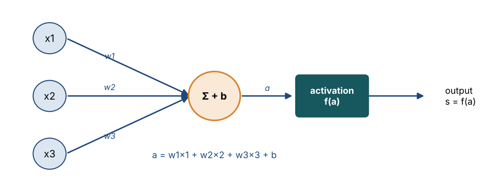
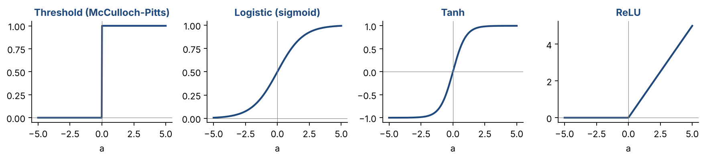
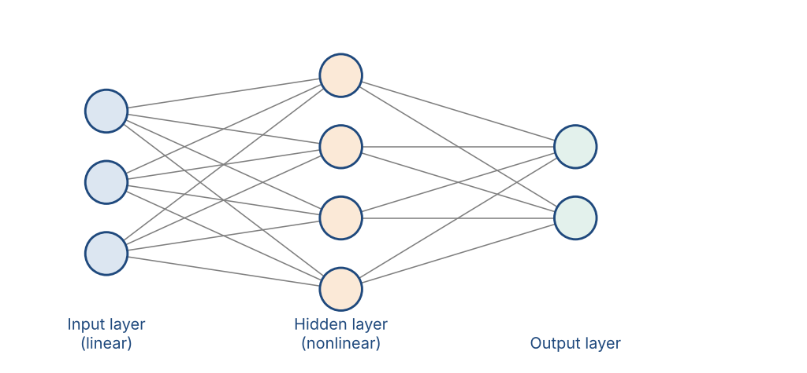

# Chapter 17 — Multilayer Feedforward Neural Networks I

**Part III — Neural Networks & Deep Learning** · [](https://colab.research.google.com/github/winnertechserv/aimlgybs/blob/main/part3_neural_networks/ch17_multilayer_feedforward_neural_networks_i/ch17_notebook.ipynb)

Companion code for Chapter 17 of *AI-Machine Learning: Get Your Base Strong*. The book explains the ideas; this folder lets you run them.

## Key ideas

- A neuron computes a weighted sum of its inputs and then applies a nonlinear activation function.
- The activation choice matters: sigmoid and tanh saturate at the extremes, while ReLU has gradient 1 for all positive inputs.
- Softmax converts output scores into class probabilities that sum to exactly 1.
- A single perceptron can only draw a straight boundary, which is why it fails on XOR.
- Adding one hidden layer solves XOR — nonlinearity in the hidden layer is what buys the extra power.

## Examples

| # | Program | What it shows |
|---|---|---|
| 1 | [`ex1_activation_functions_compared.py`](ex1_activation_functions_compared.py) | Before building a neural network, you need to understand what each activation function does. |
| 2 | [`ex2_perceptron_learning_algorithm_from_scratch.py`](ex2_perceptron_learning_algorithm_from_scratch.py) | We build the perceptron learning rule exactly as described in the overview. |
| 3 | [`ex3_mlffnn_solving_xor_architecture_comparison.py`](ex3_mlffnn_solving_xor_architecture_comparison.py) | XOR is the canonical example showing why we need hidden layers. |

Run any example from this folder:

```bash
cd part3_neural_networks/ch17_multilayer_feedforward_neural_networks_i
python ex1_activation_functions_compared.py
```

The exact output printed in the book is in [`expected_output/`](expected_output). The notebook [`ch17_notebook.ipynb`](ch17_notebook.ipynb) has all three examples with explanations.

### Example 1: Activation Functions Compared

Before building a neural network, you need to understand what each activation function does. This example computes and compares Logistic, Tanh, ReLU, and Softmax over a range of inputs. The key insight is in the derivative table at the bottom: for logistic at a=±4, the gradient is only 0.0177 — nearly zero. In a deep network with 10 sigmoid layers, the gradient shrinks by 0.0177^10 ≈ 10^-17 by the time it reaches the first layer. That's the vanishing gradient problem. ReLU has a derivative of exactly 1 for all positive inputs — no shrinkage.

<details><summary>Expected output</summary>

```text
=== Activation Functions ===

   Input a   Logistic       Tanh       ReLU
                (0,1)     (-1,1)    [0,inf)
--------------------------------------------
      -5.0     0.0067    -0.9999     0.0000
      -4.0     0.0180    -0.9993     0.0000
      -3.0     0.0474    -0.9951     0.0000
      -2.0     0.1192    -0.9640     0.0000
      -1.0     0.2689    -0.7616     0.0000
       0.0     0.5000     0.0000     0.0000
       1.0     0.7311     0.7616     1.0000
       2.0     0.8808     0.9640     2.0000
       3.0     0.9526     0.9951     3.0000
       4.0     0.9820     0.9993     4.0000
       5.0     0.9933     0.9999     5.0000

=== Softmax: 4-class probability output ===

Class         Raw     Prob
  Dog         2.0   0.6461  XXXXXXXXXXXXXXXXXXX
  Cat         1.0   0.2377  XXXXXXX
  Bird        0.1   0.0966  XX
  Fish       -1.5   0.0195  
Sum of probs: 1.0000  (always 1.0)

=== Logistic Derivative (used in backprop) ===

 Input a       f(a)      df/da  Note
-------------------------------------------------------
      -4     0.0180     0.0177  SATURATED (near-zero gradient!)
      -2     0.1192     0.1050  Healthy gradient
       0     0.5000     0.2500  Healthy gradient
       2     0.8808     0.1050  Healthy gradient
       4     0.9820     0.0177  SATURATED (near-zero gradient!)
```

</details>

### Example 2: Perceptron Learning Algorithm from Scratch

We build the perceptron learning rule exactly as described in the overview. The dataset has two linearly separable classes: class +1 at (1,1), (2,1), (1,2) and class -1 at (-1,-1), (-2,-1), (-1,-2). We add a bias term by prepending 1 to each input vector. The algorithm starts with zero weights and updates them only when a misclassification happens. The training trace shows exactly which example caused an update and what the new weights are. This converges in just 2 epochs, and the final verification confirms all 6 examples are classified correctly.

<details><summary>Expected output</summary>

```text
=== Perceptron Learning: Step-by-Step ===

Initial weights: [0. 0. 0.]
Learning rate η: 0.5

 Epoch   Ex   True      w.x   Pred  New weights
-----------------------------------------------------------------
     1    1      1     0.00     -1  [+0.50,+0.50,+0.50]

Converged after epoch 2!

Final weights: [0.5 0.5 0.5]
Decision: 0.50*x1 + 0.50*x2 + 0.50 = 0

Verification:
  (+1,+1) -> w.x=1.50 pred=+1 true=+1 OK
  (+2,+1) -> w.x=2.00 pred=+1 true=+1 OK
  (+1,+2) -> w.x=2.00 pred=+1 true=+1 OK
  (-1,-1) -> w.x=-0.50 pred=-1 true=-1 OK
  (-2,-1) -> w.x=-1.00 pred=-1 true=-1 OK
  (-1,-2) -> w.x=-1.00 pred=-1 true=-1 OK
```

</details>

### Example 3: MLFFNN Solving XOR + Architecture Comparison

XOR is the canonical example showing why we need hidden layers. A single perceptron (no hidden layer) gets only 25% accuracy on XOR — it literally cannot draw a line that separates the two classes. Adding one hidden layer of 4 tanh neurons solves it instantly: 100% accuracy. We then print out all the learned weights to make the network transparent — you can trace how input (0,1) flows through the network and comes out as 1. The final section compares three architecture sizes on a real 3-class problem and shows how adding more parameters doesn't always improve test accuracy (due to overfitting on a small dataset).

<details><summary>Expected output</summary>

```text
=== XOR Problem ===

Perceptron (0 hidden): acc=25%  preds=[1 1 0 1]
MLFFNN (4 hidden)    : acc=100%  preds=[0 1 1 0]

Learned hidden-layer weights (2 inputs -> 4 neurons):
  Neuron 1: x1*-1.584 + x2*-2.045 + bias:+0.086
  Neuron 2: x1*+1.380 + x2*-2.327 + bias:-0.567
  Neuron 3: x1*-2.385 + x2*-1.930 + bias:+0.320
  Neuron 4: x1*-2.277 + x2*+1.388 + bias:-0.451

=== Architecture Comparison (3-class task) ===

Architecture           Test Acc   Total Params
------------------------------------------------
  (10,)                   94.0%            143
  (20, 10)                92.5%            463
  (50, 30, 10)            93.5%           2423
```

</details>

## Figures from this chapter

**Figure 17.1.** One artificial neuron: weight each input, add them up with a bias, then pass the total through an activation function.



**Figure 17.2.** Common activation functions. The threshold jumps; sigmoid and tanh bend smoothly; ReLU is zero for negatives and a straight line for positives.



**Figure 17.3.** A multilayer feedforward network. Every neuron in one layer connects to every neuron in the next, and signals flow only forward.



The code that draws these figures is in [`figures/src`](../../figures/src).

---

[← Chapter 16](../../part2_classic_ml/ch16_clustering_techniques) · [All chapters](../../README.md#chapters) · [Chapter 18 →](../../part3_neural_networks/ch18_mlffnn_ii)
