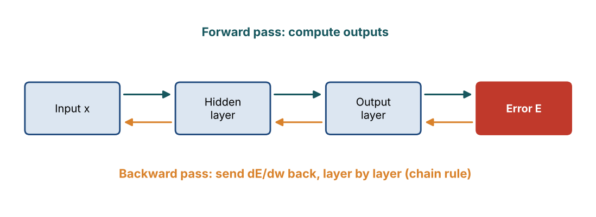
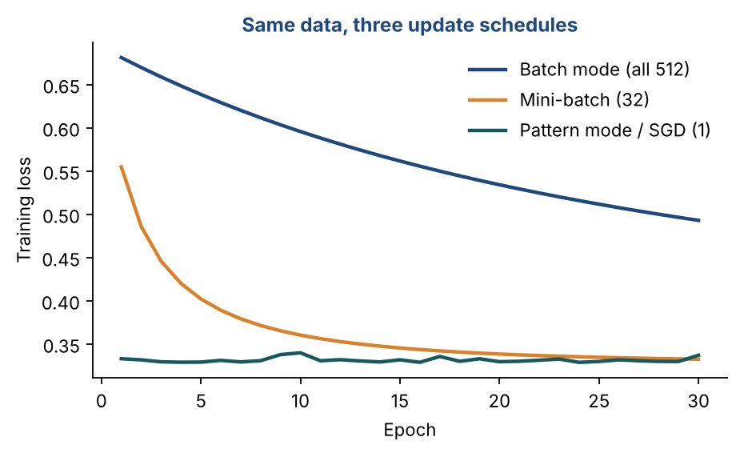
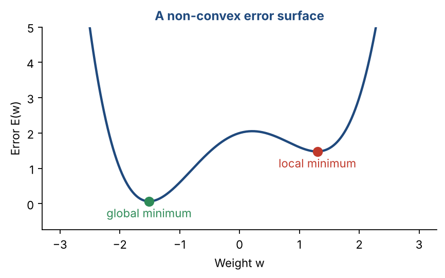

# Chapter 18 — MLFFNN II: Backpropagation & Training

**Part III — Neural Networks & Deep Learning** · [](https://colab.research.google.com/github/winnertechserv/aimlgybs/blob/main/part3_neural_networks/ch18_mlffnn_ii/ch18_notebook.ipynb)

Companion code for Chapter 18 of *AI-Machine Learning: Get Your Base Strong*. The book explains the ideas; this folder lets you run them.

## Key ideas

- The forward pass computes the output; the backward pass computes gradients using the chain rule.
- Local gradients (the deltas) are passed backwards layer by layer, which is what makes training deep networks feasible.
- Pattern, mini-batch and batch modes trade noise against speed; mini-batch is the usual practical choice.
- Early stopping halts training when validation performance stops improving, saving compute and improving generalization.
- Different random initializations converge to different local minima, so run several seeds and keep the best.

## Examples

| # | Program | What it shows |
|---|---|---|
| 1 | [`ex1_backpropagation_manual_forward_backward_pass.py`](ex1_backpropagation_manual_forward_backward_pass.py) | This is the most important code in the entire book. |
| 2 | [`ex2_training_modes_compared_early_stopping.py`](ex2_training_modes_compared_early_stopping.py) | Sklearn's MLPClassifier lets you control the batch size, effectively simulating Pattern Mode (batch=1), Mini-Batch Mode (batch=32, 64, 128), and Batch Mode (batch=full dataset). |
| 3 | [`ex3_local_minima_effect_of_random_initialization.py`](ex3_local_minima_effect_of_random_initialization.py) | One of the most practically important issues in neural network training is that different random initializations lead to different final models — because gradient descent can get stuck in different local minima. |

Run any example from this folder:

```bash
cd part3_neural_networks/ch18_mlffnn_ii
python ex1_backpropagation_manual_forward_backward_pass.py
```

The exact output printed in the book is in [`expected_output/`](expected_output). The notebook [`ch18_notebook.ipynb`](ch18_notebook.ipynb) has all three examples with explanations.

### Example 1: Backpropagation — Manual Forward & Backward Pass

This is the most important code in the entire book. We build backpropagation completely from scratch — no sklearn, no PyTorch, just numpy and math. The network has 2 inputs, 2 hidden tanh neurons, and 1 logistic output neuron. Given one training example (x=[0.5, 0.8], target=1.0), we trace the full forward pass (computing activations step by step), then the full backward pass (computing all gradients using the chain rule). The final check confirms the error decreased after the weight update — proving that one step of gradient descent worked correctly.

<details><summary>Expected output</summary>

```text
=== FORWARD PASS ===
Hidden net inputs a_h : [0.625 0.69 ]
Hidden outputs s_h    : [0.5546 0.598 ]
Output net input a_o  : 1.0909
Network output s_o    : 0.7486
Target                : 1.0
Error E               : 0.031612

=== BACKWARD PASS ===
Output local gradient delta_o: -0.047326
Updated output weights: [[0.413124 0.46415 ]]
Hidden local gradients delta_h: [-0.013108 -0.013681]

Error BEFORE update: 0.031612
Error AFTER  update: 0.029636
Error reduced by   : 0.001976  <- gradient descent worked!
```

</details>

### Example 2: Training Modes Compared + Early Stopping

Sklearn's MLPClassifier lets you control the batch size, effectively simulating Pattern Mode (batch=1), Mini-Batch Mode (batch=32, 64, 128), and Batch Mode (batch=full dataset). The results confirm the theory: Mini-Batch mode converges in far fewer epochs than full-batch, and Adam with mini-batch=32 is the fastest of all (only 45 epochs to converge). The early stopping demo shows that with n_iter_no_change=10 (stop if no improvement for 10 consecutive epochs), training halts at epoch 55 instead of running all 300 — a 5x speedup with comparable accuracy.

<details><summary>Expected output</summary>

```text
=== Training Mode Comparison ===

Mode                         Train    Test   Epochs
----------------------------------------------------
  Batch (full dataset)       96.6%   94.0%      300
  Mini-Batch size=32        100.0%   94.2%      117
  Mini-Batch size=64        100.0%   94.0%      186
  Mini-Batch size=128       100.0%   94.0%      296
  Adam (batch=32)           100.0%   93.8%       45

=== Early Stopping Demo ===

  Early Stopping OFF: epochs= 206 | Test=94.8%
  Early Stopping ON : epochs=  55 | Test=93.8%

Early stopping: fewer epochs, same performance, less compute wasted.
```

</details>

### Example 3: Local Minima — Effect of Random Initialization

One of the most practically important issues in neural network training is that different random initializations lead to different final models — because gradient descent can get stuck in different local minima. This example trains the same MLFFNN 10 times on the same data with 10 different random seeds. The resulting test accuracies vary noticeably (the range between best and worst is printed). This is why frameworks like PyTorch let you set random seeds for reproducibility, and why practitioners run multiple experiments and pick the best model. Pick it the right way: the data is split three ways, the best seed is chosen on the validation set, and the test set is used only once, on the chosen model. Notice that the chosen model scores 96% on validation but 91% on test. Picking the best of ten runs flatters the validation score a little, which is exactly why the final number must come from data that played no part in the choice.

<details><summary>Expected output</summary>

```text
=== Local Minima: Effect of Random Initialization ===

Same network, same data, different random seeds -> different results
Architecture: (3,) | Activation: tanh | Optimizer: SGD
Split: 300 train / 100 validation / 100 test

  Run   Seed   Train Acc    Val Acc  Status
----------------------------------------------------
    1      1       94.0%      96.0%  BEST so far
    2      2       95.0%      93.0%  
    3      3       87.0%      88.0%  
    4      4       95.3%      93.0%  
    5      5       95.7%      93.0%  
    6      6       94.0%      94.0%  
    7      7       94.3%      93.0%  
    8      8       88.0%      89.0%  
    9      9       94.3%      93.0%  
   10     10       95.3%      93.0%  

Best  validation accuracy: 96.0%  (seed 1)
Worst validation accuracy: 88.0%
Range                    : 8.0%

Test accuracy of the chosen model (reported once): 91.0%

Conclusion: run several random initializations, pick the best on VALIDATION data,
and touch the test set only once at the end.
```

</details>

## Figures from this chapter

**Figure 18.1.** Backpropagation: signals go forward to produce an error, then the error gradient flows backward so every weight knows which way to move.



**Figure 18.2.** Training loss per epoch for a simple model. Smaller batches make many more updates per epoch, so the loss falls faster per epoch, though each step is noisier.



**Figure 18.3.** Gradient descent can settle in a local minimum, a dip that is not the lowest point of the error surface.



The code that draws these figures is in [`figures/src`](../../figures/src).

---

[← Chapter 17](../../part3_neural_networks/ch17_multilayer_feedforward_neural_networks_i) · [All chapters](../../README.md#chapters) · [Chapter 19 →](../../part3_neural_networks/ch19_deep_feedforward_neural_networks_i)
