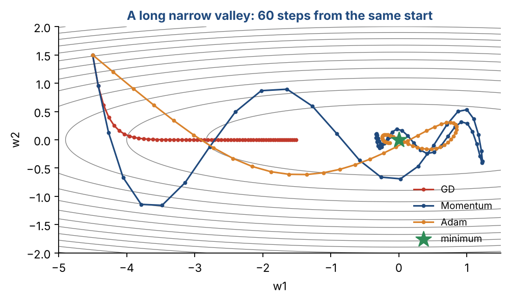
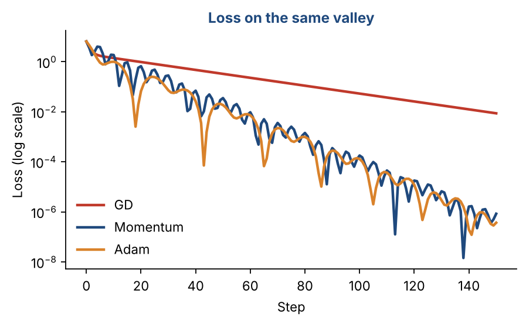

# Chapter 19 — Deep Feedforward Neural Networks I: Optimization Methods

**Part III — Neural Networks & Deep Learning** · [](https://colab.research.google.com/github/winnertechserv/aimlgybs/blob/main/part3_neural_networks/ch19_deep_feedforward_neural_networks_i/ch19_notebook.ipynb)

Companion code for Chapter 19 of *AI-Machine Learning: Get Your Base Strong*. The book explains the ideas; this folder lets you run them.

## Key ideas

- Plain SGD is slow on elongated error surfaces because it takes equally small steps in every direction.
- Momentum accumulates velocity in consistently downhill directions, so it accelerates along the valley floor.
- AdaGrad accumulates all past squared gradients, so its learning rate eventually decays to almost nothing.
- RMSProp fixes this with a moving average that forgets old gradients; Adam combines momentum with RMSProp.
- L1 regularization drives weights to exactly zero (giving feature selection); L2 shrinks them smoothly without zeroing.

## Examples

| # | Program | What it shows |
|---|---|---|
| 1 | [`ex1_sgd_vs_momentum_vs_adam_optimizer_convergence.py`](ex1_sgd_vs_momentum_vs_adam_optimizer_convergence.py) | We minimize a simple 2D quadratic loss E(w) = w1² + 10·w2² starting at w=[5,5]. |
| 2 | [`ex2_l1_vs_l2_regularization_effect_on_weights.py`](ex2_l1_vs_l2_regularization_effect_on_weights.py) | We train a logistic regression model on a 20-feature dataset where only 5 features are truly informative. |
| 3 | [`ex3_adagrad_vs_rmsprop_learning_rate_decay_compar.py`](ex3_adagrad_vs_rmsprop_learning_rate_decay_compar.py) | This example simulates 30 steps of gradient descent and traces the effective learning rate of AdaGrad vs RMSProp for a single weight. |

Run any example from this folder:

```bash
cd part3_neural_networks/ch19_deep_feedforward_neural_networks_i
python ex1_sgd_vs_momentum_vs_adam_optimizer_convergence.py
```

The exact output printed in the book is in [`expected_output/`](expected_output). The notebook [`ch19_notebook.ipynb`](ch19_notebook.ipynb) has all three examples with explanations.

### Example 1: SGD vs Momentum vs Adam — Optimizer Convergence

We minimize a simple 2D quadratic loss E(w) = w1² + 10·w2² starting at w=[5,5]. The '10x' on w2 creates an elongated bowl — a surface where plain SGD struggles because it takes tiny equal steps in both dimensions. Momentum helps by accumulating velocity in consistent directions. Adam adapts the learning rate per weight — giving w2 a larger effective step size since its gradient is large. Tracking the loss at steps 1, 10, 50, 100 shows how quickly each optimizer reaches the minimum [0,0]. Adam gets there fastest in most real-world scenarios.

<details><summary>Expected output</summary>

```text
=== Optimizer Comparison: Minimizing E(w) = w1^2 + 10*w2^2 ===

Starting at w=[5.0, 5.0], optimal = [0.0, 0.0]

Optimizer                 Step 10    Step 50    Step 100  Final w
---------------------------------------------------------------------------
  SGD                      7.2527     0.0514    0.000106  [+0.0103, +0.0000]
  Momentum (a=0.9)        40.9711     1.4421    0.007479  [+0.0218, +0.0265]
  Adam                   176.6696     8.9322    0.016734  [-0.0390, -0.0390]

Observations:
  SGD      : Slow in w2 direction (large gradient dimension)
  Momentum : Accelerates in consistent gradient directions
  Adam     : Per-weight adaptive rates — fastest to optimal
```

</details>

### Example 2: L1 vs L2 Regularization — Effect on Weights

We train a logistic regression model on a 20-feature dataset where only 5 features are truly informative. Without regularization, all 20 weights are non-zero — the model uses noise features. L2 regularization shrinks all weights toward zero proportionally. L1 regularization does something smarter: it pushes weights to exactly zero (sparse solution). With strong L1 (C=0.1), 15 features get zeroed out — the model correctly identifies the informative features! This is the key practical difference: L2 shrinks, L1 selects.

<details><summary>Expected output</summary>

```text
=== L1 vs L2 Regularization ===

Dataset: 20 features, only 5 truly informative

Regularization          Test Acc    ||w||   Zero weights
----------------------------------------------------------
  No Reg (C=1e6)           84.0%    1.883              0
  L2 (C=1.0)               84.7%    1.805              0
  L2 strong (C=0.1)        85.3%    1.404              0
  L1 (C=1.0)               84.7%    2.278             11
  L1 strong (C=0.1)        84.0%    1.432             15

=== No-Reg vs L1-Strong: Per-Feature Weight Comparison ===

     Feature     No Reg    L1 Strong  Status
------------------------------------------------
  Feature  1      0.2175       0.0000  ZEROED OUT
  Feature  2      0.3026       0.0000  ZEROED OUT
  Feature  3      0.6299       0.0000  ZEROED OUT
  Feature  4      0.4659       0.6188  Active
  Feature  5      0.0210       0.0000  ZEROED OUT
  Feature  6      0.1780       0.0000  ZEROED OUT
  Feature  7      0.0852       0.0000  ZEROED OUT
  Feature  8     -0.2010       0.0000  ZEROED OUT
  Feature  9     -0.6982      -0.6070  Active
  Feature 10      0.7098       0.3430  Active
  Feature 11      0.4679       0.0000  ZEROED OUT
  Feature 12     -0.4386       0.0000  ZEROED OUT
  Feature 13     -0.2234       0.0000  ZEROED OUT
  Feature 14     -0.1175       0.0000  ZEROED OUT
  Feature 15     -0.7800      -0.5769  Active
  Feature 16      0.4792       0.0000  ZEROED OUT
  Feature 17      0.0694       0.0000  ZEROED OUT
  Feature 18      0.2065       0.0000  ZEROED OUT
  Feature 19      0.0250       0.0000  ZEROED OUT
  Feature 20     -0.5994      -0.9215  Active
```

</details>

### Example 3: AdaGrad vs RMSProp — Learning Rate Decay Comparison

This example simulates 30 steps of gradient descent and traces the effective learning rate of AdaGrad vs RMSProp for a single weight. The first 10 steps have large gradients (simulating early training); the last 20 have small gradients (simulating late training near convergence). AdaGrad accumulates ALL squared gradients — so by step 11, its effective learning rate has already decayed to 0.00389 and keeps shrinking even as gradients become small. RMSProp only keeps a moving average (ρ=0.9), so when gradients become small, its denominator shrinks too, keeping the learning rate healthy. The Ratio column shows RMSProp learning 11x faster than AdaGrad by step 30.

<details><summary>Expected output</summary>

```text
=== AdaGrad vs RMSProp: Effective Learning Rate Trace ===

Steps 1-10: large gradients | Steps 11-30: small gradients

 Step   Gradient   AdaGrad LR   RMSProp LR  Ratio
-------------------------------------------------------
    1     7.7441     0.012913     0.040835    3.2x
    2     8.5759     0.008654     0.028003    3.2x
    3     8.0138     0.007111     0.023637    3.3x
    4     7.7244     0.006233     0.021283    3.4x
    5     7.1183     0.005697     0.020026    3.5x
    6     8.2295     0.005158     0.018501    3.6x
    7     7.1879     0.004837     0.017829    3.7x
    8     9.4589     0.004398     0.016382    3.7x
    9     9.8183     0.004038     0.015219    3.8x
   10     6.9172     0.003889     0.015137    3.9x
   11     0.4167     0.003889     0.015953    4.1x
   12     0.3116     0.003888     0.016813    4.3x
   13     0.3272     0.003888     0.017720    4.6x
   14     0.4702     0.003887     0.018671    4.8x
   15     0.1284     0.003887     0.019680    5.1x
   16     0.1349     0.003887     0.020744    5.3x
   17     0.1081     0.003887     0.021866    5.6x
   18     0.4330     0.003887     0.023037    5.9x
   19     0.4113     0.003886     0.024271    6.2x
   20     0.4480     0.003885     0.025567    6.6x
   21     0.4914     0.003885     0.026926    6.9x
   22     0.4197     0.003884     0.028363    7.3x
   23     0.2846     0.003884     0.029886    7.7x
   24     0.4122     0.003884     0.031476    8.1x
   25     0.1473     0.003883     0.033175    8.5x
   26     0.3560     0.003883     0.034942    9.0x
   27     0.1573     0.003883     0.036826    9.5x
   28     0.4779     0.003882     0.038752   10.0x
   29     0.3087     0.003882     0.040816   10.5x
   30     0.2659     0.003882     0.042995   11.1x

Key insight:
  AdaGrad LR decays to ~0.0039 and stays there even for tiny gradients.
  RMSProp LR recovers because it forgets old (large) gradients over time.
  By step 30, RMSProp learns 11x faster than AdaGrad on the same data!
```

</details>

## Figures from this chapter

**Figure 19.1.** On a long, narrow valley plain gradient descent creeps along slowly, momentum builds up speed, and Adam takes evenly sized steps in every direction.



**Figure 19.2.** Loss per step on the same valley: plain gradient descent lags far behind momentum and Adam.



The code that draws these figures is in [`figures/src`](../../figures/src).

---

[← Chapter 18](../../part3_neural_networks/ch18_mlffnn_ii) · [All chapters](../../README.md#chapters) · [Chapter 20 →](../../part3_neural_networks/ch20_deep_feedforward_neural_networks_ii)
