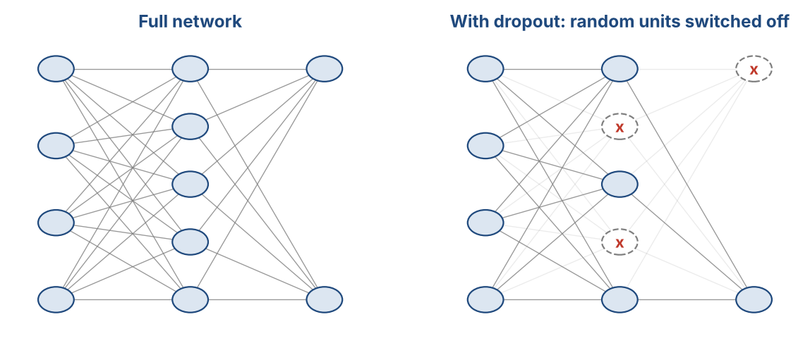
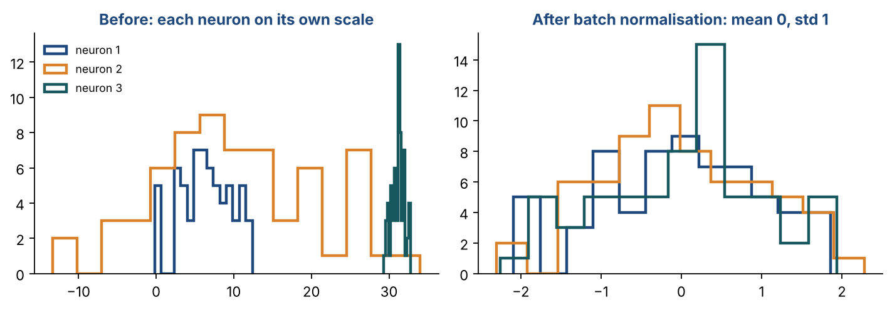

# Chapter 20 — Deep Feedforward Neural Networks II: Dropout, DropConnect & Normalization

**Part III — Neural Networks & Deep Learning** · [](https://colab.research.google.com/github/winnertechserv/aimlgybs/blob/main/part3_neural_networks/ch20_deep_feedforward_neural_networks_ii/ch20_notebook.ipynb)

Companion code for Chapter 20 of *AI-Machine Learning: Get Your Base Strong*. The book explains the ideas; this folder lets you run them.

## Key ideas

- Dropout randomly removes nodes during training, so the network cannot rely on any single neuron.
- With L nodes, dropout implicitly trains an ensemble of up to 2^L thinned networks at no extra cost.
- At test time every node is active, but weights are scaled by the retention probability to approximate that ensemble.
- DropConnect is the same idea applied to individual weights rather than whole nodes.
- Batch normalization normalises each neuron across the mini-batch; layer normalization normalises each example across its features, which is why it works with a batch size of 1.

## Examples

| # | Program | What it shows |
|---|---|---|
| 1 | [`ex1_dropout_step_by_step_manual_demonstration.py`](ex1_dropout_step_by_step_manual_demonstration.py) | We build dropout from scratch to show exactly what happens during training and testing. |
| 2 | [`ex2_batch_normalization_manual_calculation.py`](ex2_batch_normalization_manual_calculation.py) | We compute Batch Normalization step by step on a small hidden layer: 4 neurons, mini-batch of 5 examples. |
| 3 | [`ex3_batch_normalization_vs_layer_normalization_si.py`](ex3_batch_normalization_vs_layer_normalization_si.py) | The final example clarifies the most commonly confused pair: Batch Normalization vs Layer Normalization. |

Run any example from this folder:

```bash
cd part3_neural_networks/ch20_deep_feedforward_neural_networks_ii
python ex1_dropout_step_by_step_manual_demonstration.py
```

The exact output printed in the book is in [`expected_output/`](expected_output). The notebook [`ch20_notebook.ipynb`](ch20_notebook.ipynb) has all three examples with explanations.

### Example 1: Dropout — Step-by-Step Manual Demonstration

We build dropout from scratch to show exactly what happens during training and testing. During training, a random binary mask is applied to the layer — zeroing out randomly chosen nodes for each mini-batch. Each mini-batch gets a different thinned network. With L=6 nodes, there are 2^6=64 possible thinned networks — we're implicitly training an ensemble of 64 models in parallel! At test time, all nodes are active but weights are multiplied by p_keep (the retention probability) to approximate the average of all 64 networks. We also show the key difference from DropConnect: Dropout zeros entire node rows; DropConnect zeros individual weight connections.

<details><summary>Expected output</summary>

```text
=== Dropout: Training Phase ===

Layer outputs BEFORE dropout (4 examples x 6 nodes):
[[ 0.4967 -0.1383  0.6477  1.523  -0.2342 -0.2341]
 [ 1.5792  0.7674 -0.4695  0.5426 -0.4634 -0.4657]
 [ 0.242  -1.9133 -1.7249 -0.5623 -1.0128  0.3142]
 [-0.908  -1.4123  1.4656 -0.2258  0.0675 -1.4247]]

Mini-batch 1: mask = [1 0 1 0 0 1]  dropped nodes: [1, 3, 4]
  Output (example 1): [ 0.4967 -0.      0.6477  0.     -0.     -0.2341]
  Active nodes: 3/6  (thinned network)

Mini-batch 2: mask = [1 1 0 0 1 0]  dropped nodes: [2, 3, 5]
  Output (example 1): [ 0.4967 -0.1383  0.      0.     -0.2342 -0.    ]
  Active nodes: 3/6  (thinned network)

Mini-batch 3: mask = [0 0 0 1 0 1]  dropped nodes: [0, 1, 2, 4]
  Output (example 1): [ 0.     -0.      0.      1.523  -0.     -0.2341]
  Active nodes: 2/6  (thinned network)

=== Test Phase: No Dropout, Scale Weights ===

At test time: all 6 nodes active BUT weights * p_keep=0.5
  Original weight row 1: [ 0.2089 -1.9597 -1.3282]
  Scaled   weight row 1: [ 0.1044 -0.9798 -0.6641]
  This approximates averaging over all 2^6=64 thinned networks

=== Dropout vs DropConnect ===

Original W:
[[ 0.5 -0.3  0.8]
 [ 0.2  0.9 -0.4]
 [-0.6  0.1  0.7]]

Dropout (node 2 dropped — full row 2 zeroed):
[[ 0.5 -0.3  0.8]
 [ 0.   0.  -0. ]
 [-0.6  0.1  0.7]]

DropConnect (individual connections randomly zeroed):
[[ 0.5 -0.   0.8]
 [ 0.2  0.9 -0. ]
 [-0.   0.1  0.7]]

Key: Dropout removes NODES; DropConnect removes individual WEIGHTS.
```

</details>

### Example 2: Batch Normalization — Manual Calculation

We compute Batch Normalization step by step on a small hidden layer: 4 neurons, mini-batch of 5 examples. Step 1 computes the mean and variance per neuron across all 5 examples (column-wise). Step 2 subtracts the mean and divides by standard deviation — producing s_hat with mean=0, std=1 for every neuron. This is verified explicitly. Step 3 applies the learnable γ and β parameters (scale and shift), giving the final output z. The last section proves why BatchNorm is needed: two mini-batches with completely different raw distributions (means 2.04 vs 7.88) both become mean=0, std=1 after normalization — the internal covariate shift is eliminated.

<details><summary>Expected output</summary>

```text
Hidden layer output s (5 examples x 4 neurons):
[[ 2.1 -0.5  3.2  0.8]
 [ 1.8  0.3  3.5  1.2]
 [ 2.5 -0.9  2.8  0.5]
 [ 1.5  0.7  3.   0.9]
 [ 2.3 -0.2  3.4  1.1]]

Step 1: Per-neuron statistics (computed across all 5 examples):
  mean mu   = [ 2.04 -0.12  3.18  0.9 ]
  var  s^2  = [0.1264 0.3216 0.0656 0.06  ]
  std  sigma= [0.3555 0.5671 0.2561 0.2449]

Step 2: Normalized s_hat = (s - mu) / sigma:
[[ 0.1688 -0.6701  0.0781 -0.4082]
 [-0.6751  0.7406  1.2494  1.2247]
 [ 1.2939 -1.3754 -1.4837 -1.633 ]
 [-1.5189  1.446  -0.7028  0.    ]
 [ 0.7313 -0.1411  0.859   0.8165]]
  Verify mean : [-0. -0. -0.  0.]  <- all ~0
  Verify std  : [1. 1. 1. 1.]  <- all ~1

Step 3: z = gamma * s_hat + beta
  gamma=[1.5 0.8 2.  1.2]  beta=[ 0.1  0.  -0.5  0.3]
Final output z:
[[ 0.3531 -0.5361 -0.3438 -0.1899]
 [-0.9126  0.5925  1.9988  1.7697]
 [ 2.0408 -1.1003 -3.4673 -1.6596]
 [-2.1783  1.1568 -1.9056  0.3   ]
 [ 1.197  -0.1129  1.2179  1.2798]]

=== Internal Covariate Shift Demo ===

Mini-batch 1 raw: mean=2.04, std=0.36
Mini-batch 2 raw: mean=7.88, std=1.13
After BN batch 1: mean=-0.00, std=1.00
After BN batch 2: mean=-0.00, std=1.00

Both batches normalized to same distribution -> covariate shift eliminated!
```

</details>

### Example 3: Batch Normalization vs Layer Normalization — Side by Side

The final example clarifies the most commonly confused pair: Batch Normalization vs Layer Normalization. Both normalize to mean=0, std=1 — but they normalize along different axes. BatchNorm normalizes each neuron (column) across the mini-batch — so neuron 1's output across all 3 examples becomes standardized. LayerNorm normalizes each example (row) across its own neurons — so example 1's outputs across all 4 neurons become standardized. The practical implication: BatchNorm needs a large batch to estimate good statistics. LayerNorm works with batch size 1. That's why Transformers use LayerNorm — they process sequences where batch size may be 1.

<details><summary>Expected output</summary>

```text
Hidden layer output H (3 examples x 4 neurons):
[[1. 2. 3. 4.]
 [5. 6. 7. 8.]
 [2. 4. 6. 8.]]

=== Batch Normalization ===
Normalize each COLUMN (neuron) across all 3 examples

Column means: [2.6667 4.     5.3333 6.6667]
Column stds : [1.6997 1.633  1.6997 1.8856]
BN output:
[[-0.9806 -1.2247 -1.3728 -1.4142]
 [ 1.3728  1.2247  0.9806  0.7071]
 [-0.3922  0.      0.3922  0.7071]]
Verify: mean per column = [ 0.  0.  0. -0.]  (all ~0)
        std  per column = [1. 1. 1. 1.]  (all ~1)

=== Layer Normalization ===
Normalize each ROW (example) across its own 4 neurons

Row means: [2.5 6.5 5. ]
Row stds : [1.118  1.118  2.2361]
LN output:
[[-1.3416 -0.4472  0.4472  1.3416]
 [-1.3416 -0.4472  0.4472  1.3416]
 [-1.3416 -0.4472  0.4472  1.3416]]
Verify: mean per row = [0. 0. 0.]  (all ~0)
        std  per row = [1. 1. 1.]  (all ~1)

=== Summary ===
  Batch Norm : normalizes across BATCH (columns) — needs large batch
  Layer Norm : normalizes across FEATURES (rows) — works with batch=1
  Use BatchNorm for CNNs and MLPs; LayerNorm for Transformers/RNNs
```

</details>

## Figures from this chapter

**Figure 20.1.** Dropout: on every training step a different random set of neurons is switched off, so no neuron can rely on any one partner.



**Figure 20.2.** Batch normalisation rescales each neuron's outputs over a mini-batch to mean 0 and standard deviation 1, before the learned scale and shift are applied.



The code that draws these figures is in [`figures/src`](../../figures/src).

---

[← Chapter 19](../../part3_neural_networks/ch19_deep_feedforward_neural_networks_i) · [All chapters](../../README.md#chapters) · [Chapter 21 →](../../part3_neural_networks/ch21_convolutional_neural_networks_i)
