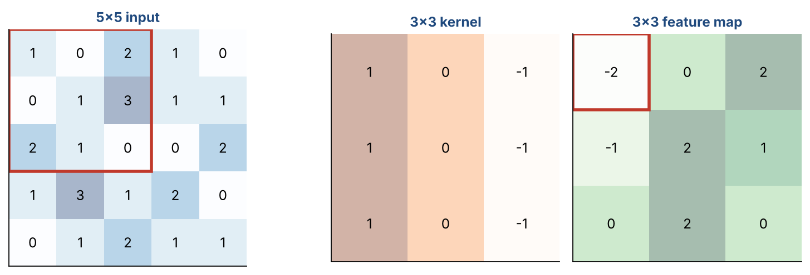
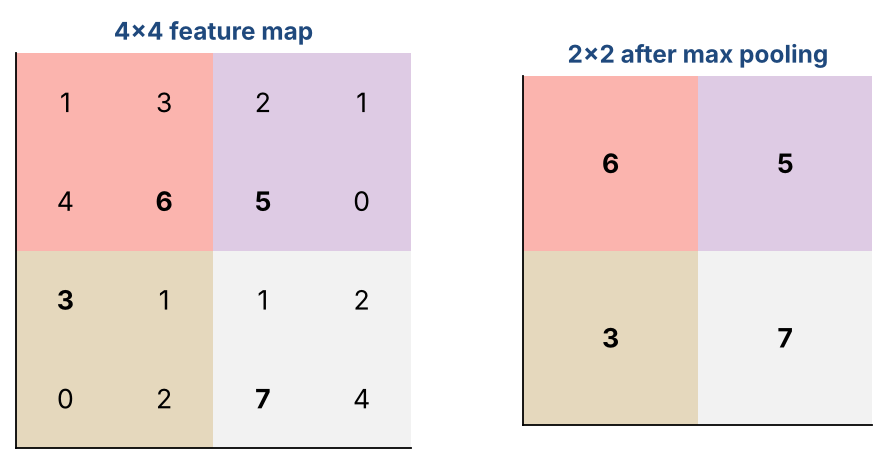
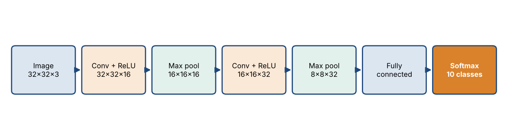

# Chapter 21 — Convolutional Neural Networks I: Convolution, Pooling & CNN Structure

**Part III — Neural Networks & Deep Learning** · [](https://colab.research.google.com/github/winnertechserv/aimlgybs/blob/main/part3_neural_networks/ch21_convolutional_neural_networks_i/ch21_notebook.ipynb)

Companion code for Chapter 21 of *AI-Machine Learning: Get Your Base Strong*. The book explains the ideas; this folder lets you run them.

## Key ideas

- Convolution slides a small kernel across the input and computes a dot product at each position.
- Sparse connectivity plus weight sharing gives a CNN far fewer parameters than an equivalent fully connected layer.
- Pooling downsamples a feature map and has no learnable parameters at all.
- Feature-map size follows W2 = (W1 - F + 2P)/S + 1, so filter size, stride and padding fully determine the output shape.
- Convolution and pooling together give the network translation invariance.

## Examples

| # | Program | What it shows |
|---|---|---|
| 1 | [`ex1_1d_convolution_from_scratch.py`](ex1_1d_convolution_from_scratch.py) | This works through a small 1-D convolution by hand. |
| 2 | [`ex2_2d_convolution_max_mean_pooling.py`](ex2_2d_convolution_max_mean_pooling.py) | Here we build 2-D convolution and both pooling types from scratch, using a small 4x4 image and a 2x2 kernel. |
| 3 | [`ex3_feature_map_size_mlffnn_vs_cnn_parameters.py`](ex3_feature_map_size_mlffnn_vs_cnn_parameters.py) | This applies the feature-map size formula to several configurations (including padding) and then drives home why CNNs are efficient: a fully-connected layer on 16 pixels needs 64 weights, while the equivalent convolution needs just the shared kernel weights - a ~94% reduction. |

Run any example from this folder:

```bash
cd part3_neural_networks/ch21_convolutional_neural_networks_i
python ex1_1d_convolution_from_scratch.py
```

The exact output printed in the book is in [`expected_output/`](expected_output). The notebook [`ch21_notebook.ipynb`](ch21_notebook.ipynb) has all three examples with explanations.

### Example 1: 1D Convolution from Scratch

This works through a small 1-D convolution by hand. We slide a length-4 kernel across a 10-element signal with stride 2, doing the shift-and-multiply (dot product) at each stop. The output is the feature map [-0.6, 3.2, 2.8, -0.5], and we confirm the output-size formula. Note there is no bias and no activation - that is the raw convolution.

<details><summary>Expected output</summary>

```text
Input data  : [2, 8, 6, 4, 7, 3, 5, 2, 1, 4]
Kernel      : [0.2, -0.5, 0.7, -0.3]
Stride      : 2 | Kernel size: 4

Step-by-step (shift-and-multiply):
  pos 0: 0.2*2 + -0.5*8 + 0.7*6 + -0.3*4 = -0.6
  pos 2: 0.2*6 + -0.5*4 + 0.7*7 + -0.3*3 = 3.2
  pos 4: 0.2*7 + -0.5*3 + 0.7*5 + -0.3*2 = 2.8
  pos 6: 0.2*5 + -0.5*2 + 0.7*1 + -0.3*4 = -0.5

Feature map extracted: [-0.6, 3.2, 2.8, -0.5]
Expected by hand     : [-0.6, 3.2, 2.8, -0.5]

Output size formula: (W1 - F)/S + 1 = (10 - 4)/2 + 1 = 4
Note: convolution layer has NO bias and NO activation in this raw operation.
```

</details>

### Example 2: 2D Convolution + Max/Mean Pooling

Here we build 2-D convolution and both pooling types from scratch, using a small 4x4 image and a 2x2 kernel. You can check every output value, and the max-pooled and mean-pooled values, by hand. This shows how a feature map is built and then downsampled - and that pooling has no learnable parameters.

<details><summary>Expected output</summary>

```text
Input image (4x4):
[[5 9 3 1]
 [7 2 6 4]
 [1 8 5 2]
 [3 0 7 9]]

2x2 Kernel:
[[ 0.2 -0.5]
 [ 0.7 -0.3]]

Feature map after 2D convolution (stride=1, 3x3):
[[ 0.8 -0.1  3.1]
 [-1.3  1.5  2.1]
 [-1.7 -3.   2.2]]

--- Pooling demo on a 4x4 feature map ---
Features before pooling:
[[ 0.8 -0.1  3.1 -1.6]
 [-1.3  1.5  2.1 -0.6]
 [-1.7 -3.   2.2  0.4]
 [ 2.6  0.8 -1.5  2.8]]

Max pooling (2x2, stride 2):
[[1.5 3.1]
 [2.6 2.8]]
Expected: [[1.5, 3.1], [2.6, 2.8]]

Mean pooling (2x2, stride 2):
[[ 0.225  0.75 ]
 [-0.325  0.975]]
Expected: [[0.225, 0.75], [-0.325, 0.975]]

Pooling kernels have NO learnable parameters.
```

</details>

### Example 3: Feature-Map Size & MLFFNN vs CNN Parameters

This applies the feature-map size formula to several configurations (including padding) and then drives home why CNNs are efficient: a fully-connected layer on 16 pixels needs 64 weights, while the equivalent convolution needs just the shared kernel weights - a ~94% reduction. The LeNet-5 example shows ~5 million dense weights collapsing to ~156 with weight sharing.

<details><summary>Expected output</summary>

```text
=== Feature-Map Size Formula: W2 = (W1 - F + 2P)/S + 1 ===

   Input  Filter  Stride   Pad   Output
----------------------------------------
4x4     2x2         2     0 2x2
4x4     2x2         1     0 3x3
32x32    3x3         2     0 15x15
32x32    4x4         3     0 10x10
4x4     2x2         2     2 4x4

=== MLFFNN vs CNN: Parameter Count (16-pixel input, 4 hidden units) ===

MLFFNN (fully connected):
  Connections = 16 inputs x 4 hidden = 64 weights

CNN (convolution, 2x2 kernel, stride 2):
  4 hidden nodes each use the SAME 2x2 kernel (weight sharing)
  Unique weights = 4 (one shared kernel) + 1 bias = 5

Parameter reduction: 64 -> 4 (93.8% fewer weights)

=== Real example: LeNet-5 first conv layer ===
Input 32x32x1, Conv layer CL1: 6 kernels of 5x5, stride 1
  Output feature maps: 28x28x6
  Learnable parameters: 6 x (5x5 + 1 bias) = 156
  A fully-connected layer for the same output would need ~4,816,896 weights
  CNN uses 156 -- that's the power of weight sharing + sparse connections!
```

</details>

## Figures from this chapter

**Figure 21.1.** Convolution: the kernel sits on the red 3x3 patch, multiplies matching cells and adds them up to give one output value (-2). Then it slides one step and repeats.



**Figure 21.2.** Max pooling with a 2x2 window and stride 2: each coloured block is replaced by its largest value (in bold).



**Figure 21.3.** A typical small CNN. With 'same' padding the convolutions keep the width and height, while each pooling layer halves them; the depth grows as more filters are added.



The code that draws these figures is in [`figures/src`](../../figures/src).

---

[← Chapter 20](../../part3_neural_networks/ch20_deep_feedforward_neural_networks_ii) · [All chapters](../../README.md#chapters) · [Chapter 22 →](../../part3_neural_networks/ch22_convolutional_neural_networks_ii)
