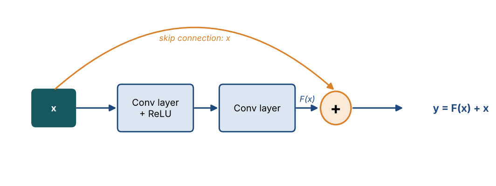
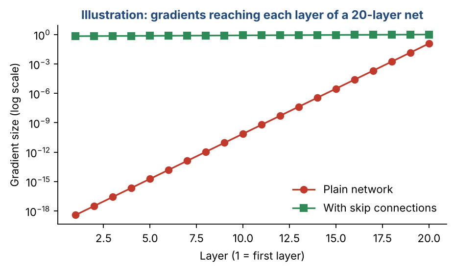
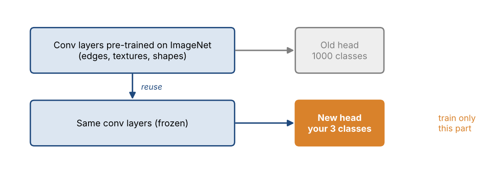

# Chapter 22 — Convolutional Neural Networks II: ResNet, Training, Transfer Learning & Applications

**Part III — Neural Networks & Deep Learning** · [](https://colab.research.google.com/github/winnertechserv/aimlgybs/blob/main/part3_neural_networks/ch22_convolutional_neural_networks_ii/ch22_notebook.ipynb)

Companion code for Chapter 22 of *AI-Machine Learning: Get Your Base Strong*. The book explains the ideas; this folder lets you run them.

## Key ideas

- Stacking many plain layers causes gradients to vanish or explode during backpropagation.
- Residual (skip) connections add the input to the output, giving gradients a direct path and enabling networks 50 to 152 layers deep.
- In backpropagation, max pooling sends the gradient only to the winning element, while mean pooling shares it equally.
- Transfer learning reuses a representation already learned on a large dataset, which is invaluable when labeled data is scarce.
- CNNs extend well beyond classification: U-Net segments images, YOLO and Faster R-CNN detect objects, and 1-D and 3-D CNNs handle signals and video.

## Examples

| # | Program | What it shows |
|---|---|---|
| 1 | [`ex1_residual_connections_vs_vanishing_gradients.py`](ex1_residual_connections_vs_vanishing_gradients.py) | This simulates backpropagation through a 20-layer network. |
| 2 | [`ex2_backpropagation_through_pooling_layers.py`](ex2_backpropagation_through_pooling_layers.py) | Pooling layers have no learnable weights, but gradients still must flow back through them. |
| 3 | [`ex3_transfer_learning_few_shot.py`](ex3_transfer_learning_few_shot.py) | This shows transfer learning. |

Run any example from this folder:

```bash
cd part3_neural_networks/ch22_convolutional_neural_networks_ii
python ex1_residual_connections_vs_vanishing_gradients.py
```

The exact output printed in the book is in [`expected_output/`](expected_output). The notebook [`ch22_notebook.ipynb`](ch22_notebook.ipynb) has all three examples with explanations.

### Example 1: Residual Connections vs Vanishing Gradients

This simulates backpropagation through a 20-layer network. In a plain network the gradient is multiplied by a small factor at each layer and vanishes to ~1e-19 by the first layer. With residual (skip) connections the gradient has a '+1' highway and stays healthy. This is exactly why ResNet can train networks 50-152 layers deep.

<details><summary>Expected output</summary>

```text
=== Gradient Flow Through a 20-Layer Network ===

Plain network: grad_(L-1) = grad_L * w * sigmoid'(a)
Residual net : grad_(L-1) = grad_L * (1 + w * sigmoid'(a))  <- the +1 is the skip

 Layer     Plain grad    Residual grad
----------------------------------------
    20       1.66e-01         1.17e+00
    16       1.93e-05         1.81e+00
    12       1.55e-09         2.72e+00
     8       4.56e-13         4.55e+00
     4       3.73e-17         6.67e+00
     1       1.04e-19         9.95e+00

After backprop through all 20 layers:
  Plain network gradient   : 1.04e-19  (vanished to near-zero!)
  Residual network gradient: 9.95e+00  (healthy, training continues)

Ratio: residual gradient is 9.58e+19x larger
This is why ResNet can train 50, 101, even 152 layers deep.
```

</details>

### Example 2: Backpropagation Through Pooling Layers

Pooling layers have no learnable weights, but gradients still must flow back through them. This example shows the fixed routing weights: max pooling sends the whole gradient only to the element that 'won' the max (a 0/1 mask), while mean pooling spreads the gradient equally (1/F^2) across the region. This is the rule used when training a CNN.

<details><summary>Expected output</summary>

```text
=== Backpropagation Through Pooling Layers ===

Forward: pooling reduces a region to one value.
Backward: the upstream gradient must be routed back to the input region.

Input region (2x2):
[[ 0.8 -0.1]
 [-1.3  1.5]]
Upstream gradient arriving at this pooled node: 2.0

--- Max Pooling ---
Forward output (max): 1.5
Backward weights (1 only at the max location, 0 elsewhere):
[[0 0]
 [0 1]]
Gradient routed to input region:
[[0. 0.]
 [0. 2.]]
Only the neuron that 'won' the max receives the gradient.

--- Mean Pooling ---
Forward output (mean): 0.225
Backward weights (1/F^2 = 1/4 = 0.25 at every location):
[[0.25 0.25]
 [0.25 0.25]]
Gradient routed to input region:
[[0.5 0.5]
 [0.5 0.5]]
Every neuron in the region shares the gradient equally.

=== Summary ===
Max pooling : gradient goes ONLY to the max element (sparse, 0/1 weights)
Mean pooling: gradient is SPREAD evenly (each gets 1/F^2)
Pooling layers have no learnable weights - these routing weights are fixed.
```

</details>

### Example 3: Transfer Learning (Few-Shot)

This shows transfer learning. We pretrain a deep model on a large set of digit classes, then tackle two brand-new classes with only 10 labeled images. Reusing the pretrained features and training a tiny classifier on top beats training a fresh model from scratch. This mirrors how a VGGNet pretrained on ImageNet is reused for medical images with little labeled data.

<details><summary>Expected output</summary>

```text
=== Transfer Learning: Reusing a Pretrained Representation ===

Source domain : digits [0, 1, 2, 3, 4, 5, 6, 7]
                1443 labeled images -> pretrain a deep CNN-like model
                pretrained source accuracy: 100.0%

Target domain : NEW digits 8 and 9
                only 10 labeled images (5 per class - few-shot!)

Test set: 344 unseen images of digits 8 and 9

Results:
  Train from scratch (raw pixels, 10 imgs) : 70.3%
  Transfer learning (pretrained features)  : 77.0%

Improvement from transfer learning: +6.7 pp

With only 10 labeled images, training a deep model from scratch fails to
generalize. The pretrained model already learned reusable stroke/edge
features, so a tiny classifier on top of them generalizes far better.
This is exactly how a VGGNet pretrained on ImageNet is reused for
medical images with only a few labeled examples.
```

</details>

## Figures from this chapter

**Figure 22.1.** A residual block. The input skips round the two layers and is added back, so the block only has to learn the change F(x).



**Figure 22.2.** Illustration of the vanishing gradient. If each layer shrinks the gradient (here by a factor of 0.12), early layers get almost nothing; the skip path keeps it close to 1.



**Figure 22.3.** Transfer learning: keep the feature-extracting layers learned on a big dataset and train only a small new head for your task.



The code that draws these figures is in [`figures/src`](../../figures/src).

---

[← Chapter 21](../../part3_neural_networks/ch21_convolutional_neural_networks_i) · [All chapters](../../README.md#chapters) · [Chapter 23 →](../../part3_neural_networks/ch23_recurrent_neural_networks_i)
