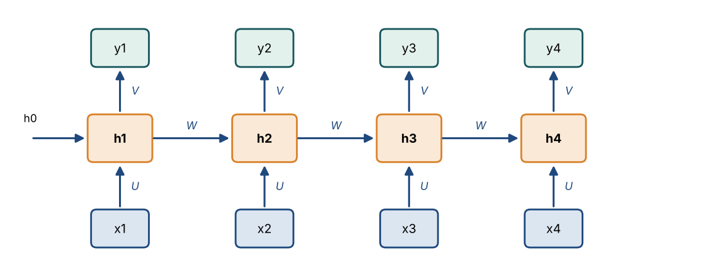
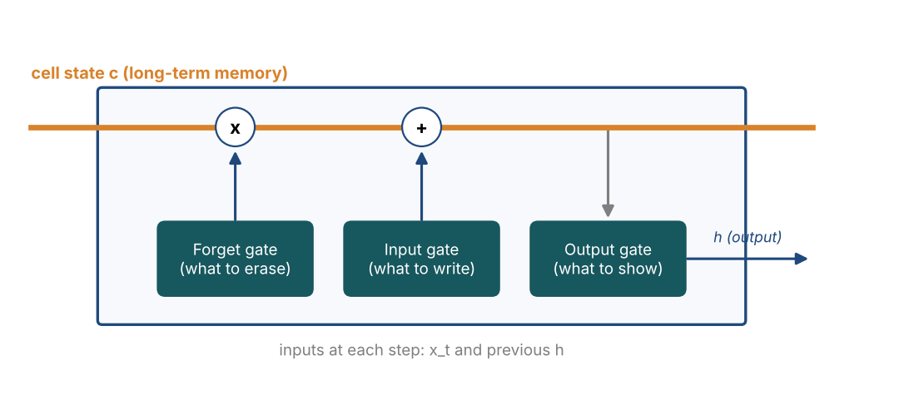

# Chapter 23 — Recurrent Neural Networks I: RNNs, LSTM, GRU & BPTT

**Part III — Neural Networks & Deep Learning** · [](https://colab.research.google.com/github/winnertechserv/aimlgybs/blob/main/part3_neural_networks/ch23_recurrent_neural_networks_i/ch23_notebook.ipynb)

Companion code for Chapter 23 of *AI-Machine Learning: Get Your Base Strong*. The book explains the ideas; this folder lets you run them.

## Key ideas

- RNNs process a sequence one element at a time, carrying a hidden state that acts as memory of everything seen so far.
- The same weight matrices U, W and V are reused at every timestep, so model size does not grow with sequence length.
- Unfolding the network across time turns training into ordinary backpropagation, known as BPTT.
- Plain RNNs cannot learn long-range dependencies because gradients shrink with every step back through time.
- The LSTM's additive cell state, controlled by forget, input and output gates, preserves those gradients; the GRU is a lighter alternative.

## Examples

| # | Program | What it shows |
|---|---|---|
| 1 | [`ex1_vanilla_rnn_forward_pass_from_scratch.py`](ex1_vanilla_rnn_forward_pass_from_scratch.py) | This builds a vanilla RNN with the three weight matrices U, W, V and runs a length-4 sequence through it. |
| 2 | [`ex2_lstm_cell_from_scratch.py`](ex2_lstm_cell_from_scratch.py) | This computes one full timestep of an LSTM cell: the forget, input, and output gates (sigmoid), the candidate state (tanh), the additive cell-state update, and the hidden-state read-out. |
| 3 | [`ex3_rnn_vs_lstm_gradient_flow.py`](ex3_rnn_vs_lstm_gradient_flow.py) | This traces the gradient backward through 30 timesteps. |

Run any example from this folder:

```bash
cd part3_neural_networks/ch23_recurrent_neural_networks_i
python ex1_vanilla_rnn_forward_pass_from_scratch.py
```

The exact output printed in the book is in [`expected_output/`](expected_output). The notebook [`ch23_notebook.ipynb`](ch23_notebook.ipynb) has all three examples with explanations.

### Example 1: Vanilla RNN Forward Pass from Scratch

This builds a vanilla RNN with the three weight matrices U, W, V and runs a length-4 sequence through it. You can watch the hidden state h_t evolve at each timestep - it depends on the current input and the previous hidden state, which is the network's memory. The same weights are reused at every timestep (weight sharing in time).

<details><summary>Expected output</summary>

```text
=== Vanilla RNN Forward Pass (from scratch) ===

Architecture: input -> hidden (recurrent) -> output
  h_t = tanh(U x_t + W h_(t-1) + b_h)
  y_t = V h_t + b_o

U (input->hidden) : (4, 3)
W (recurrent)     : (4, 4)
V (hidden->output): (2, 4)

Processing a sequence of length T=4:

Initial hidden state h_0: [0. 0. 0. 0.]

t=1: x_t=[ 1.   0.5 -0.5]
     h_1 = [0.6591 0.2498 0.5387 0.6386]
     y_1 = [-0.335  -0.5169]

t=2: x_t=[ 0.2 -1.   0.3]
     h_2 = [ 0.1868 -0.6933  0.6564 -0.8292]
     y_2 = [-0.2714  0.0137]

t=3: x_t=[-0.5  0.8  1. ]
     h_3 = [ 0.0163 -0.443  -0.7587  0.2783]
     y_3 = [0.0875 0.4345]

t=4: x_t=[ 0.9  0.1 -0.2]
     h_4 = [0.2472 0.0487 0.1787 0.2374]
     y_4 = [-0.1291 -0.167 ]

Key insight: h_t depends on x_t AND h_(t-1), so the hidden state
carries 'memory' of ALL previous inputs in the sequence.
The SAME weights U, W, V are reused at every timestep (weight sharing in time).
```

</details>

### Example 2: LSTM Cell from Scratch

This computes one full timestep of an LSTM cell: the forget, input, and output gates (sigmoid), the candidate state (tanh), the additive cell-state update, and the hidden-state read-out. The additive cell-state update is what lets gradients survive over long sequences. The parameter count confirms an LSTM has ~4x the weights of a vanilla RNN layer.

<details><summary>Expected output</summary>

```text
=== LSTM Cell - One Timestep, All Gates ===

An LSTM has 3 gates + a cell state, designed to avoid vanishing gradients:
  Forget gate f_t : what to erase from cell state
  Input gate  i_t : what new info to write
  Output gate o_t : what to read out as the hidden state
  Cell state  s_t : the long-term memory conveyor belt

Current input  x_t   : [ 0.5 -0.3  0.8]
Previous hidden h_(t-1): [ 0.1  -0.2   0.05  0.15]
Previous cell   s_(t-1): [ 0.2  0.1 -0.1  0.3]

Step 1 - Gate activations (sigmoid -> values in 0..1):
  Input gate  i_t = [0.373 0.531 0.469 0.576]
  Forget gate f_t = [0.433 0.658 0.505 0.515]
  Output gate o_t = [0.478 0.442 0.336 0.448]
  Candidate ~s_t  = [ 0.317  0.312 -0.061  0.537]  (tanh, -1..1)

Step 2 - Cell state update (selective forget + selective write):
  s_t = f_t (*) s_(t-1) + i_t (*) ~s_t
      = [ 0.087  0.066 -0.051  0.155] + [ 0.118  0.166 -0.029  0.309]
      = [ 0.2049  0.2314 -0.0794  0.464 ]

Step 3 - Hidden state (selective read):
  h_t = o_t (*) tanh(s_t) = [ 0.0965  0.1005 -0.0266  0.194 ]

Why no vanishing gradient? The cell state s_t updates ADDITIVELY
(f_t * s_(t-1) + ...), so gradients flow back through time without
being repeatedly multiplied down to zero - unlike a vanilla RNN.

Parameter count: LSTM has 4 weight sets (i,f,o,candidate)
  = 4x the parameters of a vanilla RNN hidden layer
  Vanilla RNN: U(4x3) + W(4x4) = 28 weights
  LSTM       : 4 x (28) = 112 weights
```

</details>

### Example 3: RNN vs LSTM Gradient Flow

This traces the gradient backward through 30 timesteps. In a vanilla sigmoid RNN each step multiplies the gradient by a factor below 1, so it vanishes to ~1e-21. In an LSTM the cell-state highway keeps the gradient near its original size. This is the concrete reason LSTMs learn long-range dependencies that plain RNNs cannot.

<details><summary>Expected output</summary>

```text
=== Why Vanilla RNNs Forget: Gradient Flow Over Time ===

During BPTT (Backprop Through Time), the gradient at the first timestep
depends on a product of factors across ALL timesteps.

Vanilla RNN (recurrent weight W=0.8, sigmoid neurons):
  Gradient reaching t=1 after 30 steps: 1.074e-21
  (each step multiplies by W*sigmoid' = 0.2 < 1, so it vanishes)

LSTM (cell-state highway, forget gate f_t ~ 0.95):
  Gradient reaching t=1 after 30 steps: 2.146e-01
  (cell state path multiplies by ~f_t=0.95, close to 1, so it survives)

 Timestep back     RNN gradient    LSTM gradient
------------------------------------------------
             1        2.000e-01        9.500e-01
             5        3.200e-04        7.738e-01
            10        1.024e-07        5.987e-01
            15        3.277e-11        4.633e-01
            20        1.049e-14        3.585e-01
            25        3.355e-18        2.774e-01
            30        1.074e-21        2.146e-01

After 30 timesteps:
  RNN  gradient: 1.074e-21  -> vanished, early inputs forgotten
  LSTM gradient: 2.146e-01  -> preserved, long-range memory works

This is why LSTMs handle long sequences (long sentences, long audio)
while vanilla RNNs struggle to learn long-range dependencies.
```

</details>

## Figures from this chapter

**Figure 23.1.** An RNN unrolled over four time steps. The same weights U, W and V are reused at every step, and the hidden state h carries memory forward.



**Figure 23.2.** A simplified LSTM cell. Three gates decide what to erase from, add to, and read out of the cell state, which carries information across many steps.



The code that draws these figures is in [`figures/src`](../../figures/src).

---

[← Chapter 22](../../part3_neural_networks/ch22_convolutional_neural_networks_ii) · [All chapters](../../README.md#chapters) · [Chapter 24 →](../../part3_neural_networks/ch24_recurrent_neural_networks_ii)
