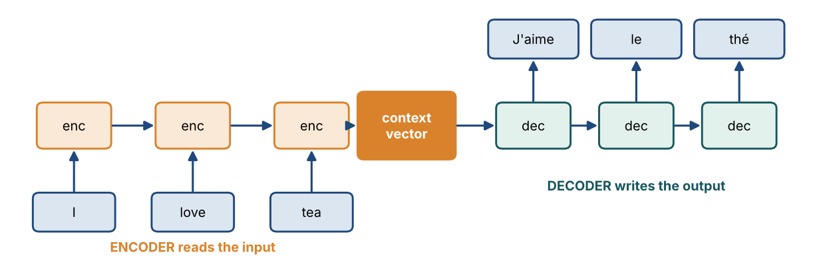
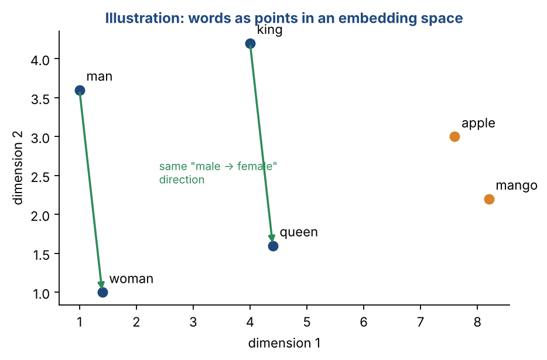

# Chapter 24 — Recurrent Neural Networks II: Embeddings, Seq2Seq & Evaluation Metrics

**Part III — Neural Networks & Deep Learning** · [](https://colab.research.google.com/github/winnertechserv/aimlgybs/blob/main/part3_neural_networks/ch24_recurrent_neural_networks_ii/ch24_notebook.ipynb)

Companion code for Chapter 24 of *AI-Machine Learning: Get Your Base Strong*. The book explains the ideas; this folder lets you run them.

## Key ideas

- The encoder-decoder paradigm maps one sequence to another: one network reads, another writes.
- Word embeddings turn words into dense vectors where words used in similar contexts sit close together.
- Count-based methods use global co-occurrence statistics; Word2Vec learns by prediction; GloVe combines both ideas.
- Negative sampling makes Skip-Gram affordable by replacing a huge softmax with a few cheap binary decisions.
- Generated text is scored against references: BLEU for precision, METEOR for recall and synonyms, ROUGE for summaries, CIDEr for captions.

## Examples

| # | Program | What it shows |
|---|---|---|
| 1 | [`ex1_count_based_word_embedding_co_occurrence_to_s.py`](ex1_count_based_word_embedding_co_occurrence_to_s.py) | This builds word vectors the count-based way: build a co-occurrence matrix from a tiny corpus, convert it to Positive PMI, then apply SVD to get compact 2-D vectors. |
| 2 | [`ex2_word2vec_skip_gram_embeddings.py`](ex2_word2vec_skip_gram_embeddings.py) | This trains a Skip-Gram model with plain SGD on a small corpus with three semantic groups (royalty, animals, fruits). |
| 3 | [`ex3_bleu_score_from_scratch.py`](ex3_bleu_score_from_scratch.py) | This builds the BLEU metric used to score generated text against a reference: n-gram precision combined with a brevity penalty. |

Run any example from this folder:

```bash
cd part3_neural_networks/ch24_recurrent_neural_networks_ii
python ex1_count_based_word_embedding_co_occurrence_to_s.py
```

The exact output printed in the book is in [`expected_output/`](expected_output). The notebook [`ch24_notebook.ipynb`](ch24_notebook.ipynb) has all three examples with explanations.

### Example 1: Count-Based Word Embedding (Co-occurrence to SVD)

This builds word vectors the count-based way: build a co-occurrence matrix from a tiny corpus, convert it to Positive PMI, then apply SVD to get compact 2-D vectors. The cosine similarities confirm that words used in similar contexts ('cat' and 'dog') end up with similar vectors. This captures global co-occurrence statistics.

<details><summary>Expected output</summary>

```text
=== Count-Based Word Embedding: Co-occurrence -> PPMI -> SVD ===

Corpus: the cat sat on the mat . the dog sat on the rug . the cat ran . the dog ran . the cat and the dog play 

Vocabulary (11 words): ['.', 'and', 'cat', 'dog', 'mat', 'on', 'play', 'ran', 'rug', 'sat', 'the']

Co-occurrence counts computed (window=1).
PPMI matrix computed (negative values clipped to 0).

SVD applied. Keeping top r=2 dimensions.
PPMI matrix size: (11, 11) -> Word embeddings: (11, 2)

2-D word embeddings (first 6 words):
       .: [-1.482, -0.853]
     and: [-1.012, +0.447]
     cat: [-1.537, -1.275]
     dog: [-1.982, -2.284]
     mat: [-0.855, +0.152]
      on: [-1.257, -1.370]

Cosine similarity between word pairs:
  sim(cat, dog) = +0.987
  sim(sat, ran) = +0.994
  sim(cat, mat) = +0.646

'cat' and 'dog' appear in similar contexts -> similar vectors.
Count-based methods capture GLOBAL co-occurrence statistics.
```

</details>

### Example 2: Word2Vec Skip-Gram Embeddings

This trains a Skip-Gram model with plain SGD on a small corpus with three semantic groups (royalty, animals, fruits). After training, the nearest-neighbor words by cosine similarity cluster by meaning - the model learned semantics purely from context, with no labels. This is the prediction-based alternative to the count method.

<details><summary>Expected output</summary>

```text
=== Word2Vec Skip-Gram: Learning Embeddings by Prediction ===

Skip-Gram predicts CONTEXT words from a CENTER word.
Words used in similar contexts end up with similar vectors.

Vocabulary (18 words): ['animal', 'apple', 'banana', 'cat', 'crown', 'cute', 'dog', 'fruit', 'furry', 'juicy', 'king', 'palace', 'pet', 'queen', 'royal', 'sweet', 'tasty', 'throne']

Generated 84 (center, context) training pairs.

Training complete (300 epochs of SGD).

Nearest neighbors by cosine similarity (learned embeddings):
    king -> crown(0.64), palace(0.64), throne(0.30)
     dog -> animal(0.65), cute(0.31), furry(0.30)
   apple -> sweet(0.67), tasty(0.33), juicy(0.30)

Words from the same semantic group (royalty / animals / fruits)
cluster together - the model learned meaning from context alone.
```

</details>

### Example 3: BLEU Score from Scratch

This builds the BLEU metric used to score generated text against a reference: n-gram precision combined with a brevity penalty. A perfect match scores 1.0; a too-short output is penalized heavily; a reworded sentence scores partially. The summary contrasts BLEU with METEOR, ROUGE, and CIDEr.

<details><summary>Expected output</summary>

```text
=== BLEU Score from Scratch (Machine Translation / Captioning metric) ===

BLEU = precision-based n-gram matching between generated & reference text,
multiplied by a brevity penalty for too-short outputs.

--- Example 1: Perfect match (BLEU-4) ---
  Candidate: 'the cat is on the mat'
  Reference: 'the cat is on the mat'
    1-gram precision: 1.0000
    2-gram precision: 1.0000
    3-gram precision: 1.0000
    4-gram precision: 1.0000
    geo-mean=1.0000  brevity-penalty=1.0000 (c=6, r=6)
    => BLEU-4 = 1.0000

--- Example 2: Partially correct (BLEU-2) ---
  Candidate: 'the cat sat on mat'
  Reference: 'the cat is on the mat'
    1-gram precision: 0.8000
    2-gram precision: 0.2500
    geo-mean=0.4472  brevity-penalty=0.8187 (c=5, r=6)
    => BLEU-2 = 0.3661

--- Example 3: Too short - brevity penalty (BLEU-2) ---
  Candidate: 'the cat'
  Reference: 'the cat is on the mat'
    1-gram precision: 1.0000
    2-gram precision: 1.0000
    geo-mean=1.0000  brevity-penalty=0.1353 (c=2, r=6)
    => BLEU-2 = 0.1353

--- Example 4: Good but reworded (BLEU-2) ---
  Candidate: 'the cat is on the mat'
  Reference: 'a cat sits on the mat'
    1-gram precision: 0.6667
    2-gram precision: 0.4000
    geo-mean=0.5164  brevity-penalty=1.0000 (c=6, r=6)
    => BLEU-2 = 0.5164

==========================================================
BLEU ranges 0..1. Perfect match = 1.0. Missing higher-order
n-grams or too-short output sharply lowers the score.
BLEU = precision-focused; METEOR adds recall + synonyms;
ROUGE = recall-focused (summaries); CIDEr weights rare n-grams.
```

</details>

## Figures from this chapter

**Figure 24.1.** An encoder-decoder for translation. The encoder squeezes the sentence into a context vector, and the decoder generates the translation word by word.



**Figure 24.2.** An illustration of word embeddings. Similar words sit close together, and consistent relationships such as man to woman and king to queen point in the same direction.



The code that draws these figures is in [`figures/src`](../../figures/src).

---

[← Chapter 23](../../part3_neural_networks/ch23_recurrent_neural_networks_i) · [All chapters](../../README.md#chapters) · [Chapter 25 →](../../part4_transformers_genai/ch25_transformer_i)
