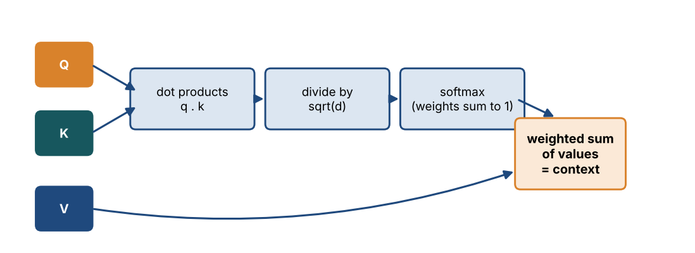
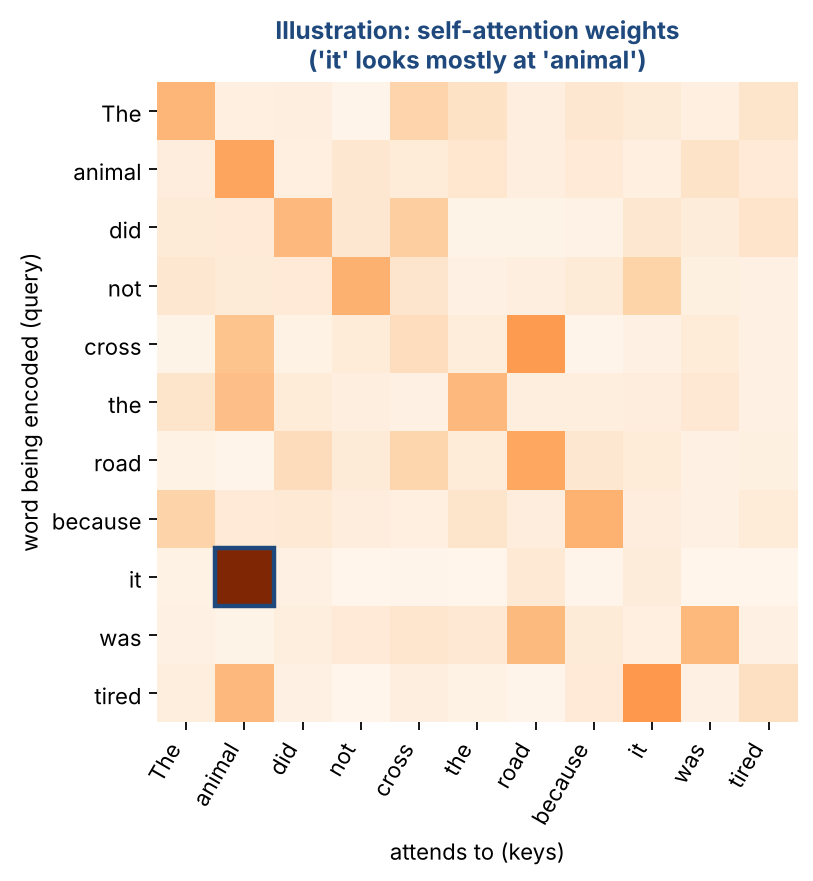
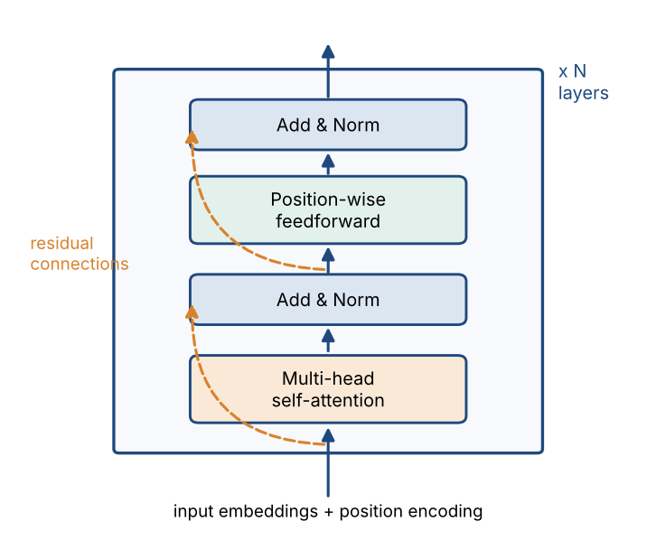

# Chapter 25 — Transformer I: Attention, Multi-Head Attention & the Encoder-Decoder

**Part IV — Transformers & Generative AI** · [](https://colab.research.google.com/github/winnertechserv/aimlgybs/blob/main/part4_transformers_genai/ch25_transformer_i/ch25_notebook.ipynb)

Companion code for Chapter 25 of *AI-Machine Learning: Get Your Base Strong*. The book explains the ideas; this folder lets you run them.

## Key ideas

- Attention replaces recurrence, so every position in a sequence can be processed in parallel.
- Query, Key and Value are three roles: the query is matched against the keys, and the resulting weights combine the values.
- Dividing by the square root of d keeps softmax out of its saturated region, so gradients stay usable.
- Multiple heads let the model capture several different kinds of relationship at once; W_o then mixes them back together.
- An encoder layer is self-attention plus a position-wise feedforward network, with the feedforward weights shared across all positions.

## Examples

| # | Program | What it shows |
|---|---|---|
| 1 | [`ex1_scaled_dot_product_attention_from_scratch.py`](ex1_scaled_dot_product_attention_from_scratch.py) | This builds the core attention computation exactly as defined in the overview. |
| 2 | [`ex2_self_attention_with_multi_head_attention.py`](ex2_self_attention_with_multi_head_attention.py) | Here queries, keys and values are all generated from the SAME sequence using W_Q, W_K and W_V - that is what makes it self-attention. |
| 3 | [`ex3_masked_self_attention_and_the_pwffnn.py`](ex3_masked_self_attention_and_the_pwffnn.py) | The decoder must not look at future words, so a causal mask sets those attention scores to exactly zero - you can see the upper triangle vanish while every row still sums to 1. |

Run any example from this folder:

```bash
cd part4_transformers_genai/ch25_transformer_i
python ex1_scaled_dot_product_attention_from_scratch.py
```

The exact output printed in the book is in [`expected_output/`](expected_output). The notebook [`ch25_notebook.ipynb`](ch25_notebook.ipynb) has all three examples with explanations.

### Example 1: Scaled Dot-Product Attention from Scratch

This builds the core attention computation exactly as defined in the overview. We build Query, Key and Value vectors, compute the scaled dot products alpha_tm = <q_t,k_m>/sqrt(d), apply softmax to get attention scores, and form the context vector as the weighted sum of Value vectors. The final section shows concretely why the 1/sqrt(d) scaling matters: without it, large dot products saturate the softmax and gradients vanish.

<details><summary>Expected output</summary>

```text
=== Scaled Dot-Product Attention ===

Terminology borrowed from regression: Query, Key, Value

Query q_t          : [-1.05 -1.42 -1.71  1.95]
Key matrix K  (5x4):
[[ 1.76  0.4   0.98  2.24]
 [ 1.87 -0.98  0.95 -0.15]
 [-0.1   0.41  0.14  1.45]
 [ 0.76  0.12  0.44  0.33]
 [ 1.49 -0.21  0.31 -0.85]]
Value matrix V (5x4):
[[-2.55  0.65  0.86 -0.74]
 [ 2.27 -1.45  0.05 -0.19]
 [ 1.53  1.47  0.15  0.38]
 [-0.89 -1.98 -0.35  0.16]
 [ 1.23  1.2  -0.39 -0.3 ]]

Step 1: scaled dot product  alpha_tm = <q_t, k_m> / sqrt(d)
  alpha_t1 = [1.76 0.4  0.98 2.24] . q / sqrt(4) = +0.1381
  alpha_t2 = [ 1.87 -0.98  0.95 -0.15] . q / sqrt(4) = -1.2445
  alpha_t3 = [-0.1   0.41  0.14  1.45] . q / sqrt(4) = +1.0554
  alpha_t4 = [0.76 0.12 0.44 0.33] . q / sqrt(4) = -0.5387
  alpha_t5 = [ 1.49 -0.21  0.31 -0.85] . q / sqrt(4) = -1.7269

Step 2: attention scores  a_tm = softmax(alpha_tm)
  a_t1 = 0.2264  #########
  a_t2 = 0.0568  ##
  a_t3 = 0.5666  ######################
  a_t4 = 0.1151  ####
  a_t5 = 0.0351  #
  Sum of attention scores = 1.0000  (softmax always sums to 1)

Step 3: context vector  c_t = sum_m a_tm * v_m
  c_t = [0.3593 0.712  0.2286 0.0449]

Interpretation:
  Key 3 receives the highest attention (0.5666),
  so the context vector is pulled most towards Value vector 3.

Why divide by sqrt(d)? Without scaling, large dot products push softmax
into a saturated region where gradients vanish during training.

=== Effect of the 1/sqrt(d) scaling ===
  Unscaled logits [10.  8.  6.  4.  2.] -> softmax [8.647e-01 1.170e-01 1.580e-02 2.100e-03 3.000e-04]
  Scaled by sqrt(4)            -> softmax [0.6364 0.2341 0.0861 0.0317 0.0117]
  Scaling keeps the distribution smoother (non-saturated gradients).
```

</details>

### Example 2: Self-Attention with Multi-Head Attention

Here queries, keys and values are all generated from the SAME sequence using W_Q, W_K and W_V - that is what makes it self-attention. We first run single-head attention, then multi-head attention with h=4 heads. Notice each head produces a different attention pattern for the same token, and that concatenating h heads of dimension l = d/h reconstructs a d-dimensional vector, which W_o then transforms into the output.

<details><summary>Expected output</summary>

```text
=== Self-Attention: Single-Head vs Multi-Head ===

Sequence X: T=4 tokens, model dimension d=8
Heads h=4  ->  per-head dimension l = d/h = 2

--- Single-Head Attention ---
Transformation matrices W_Q, W_K, W_V each of size l x d = 2x8
Attention score matrix (row t = how token t attends to every token):
[[0.277 0.261 0.216 0.246]
 [0.508 0.234 0.075 0.183]
 [0.131 0.269 0.354 0.246]
 [0.365 0.242 0.162 0.231]]
Row sums: [1. 1. 1. 1.]  (each row sums to 1)
Context matrix C~ shape: (4, 2)  (l x T transposed -> T x l)

--- Multi-Head Attention ---
Each head learns a DIFFERENT attention pattern for token 1:
  Head 1: [0.32  0.325 0.126 0.229]
  Head 2: [0.3   0.289 0.201 0.21 ]
  Head 3: [0.275 0.202 0.25  0.274]
  Head 4: [0.481 0.154 0.169 0.196]

Concatenated context: 4 heads x 2 dims = 8 = d
  c_t = concat(c_1t, ..., c_4t)  ->  shape (4, 8)
Output z_t = W_o c_t                ->  shape (4, 8)

Output sequence Z (first 2 tokens):
[[ 0.329  -0.1075 -0.7072 -0.875  -0.1073  0.6758 -0.3755  0.8112]
 [ 0.3192 -0.1041 -0.6228 -0.6986 -0.1996  0.6909 -0.3069  0.6396]]

Why multiple heads? Each head uses its own W_Q/W_K/W_V, so different
heads can capture different relationships (syntax, coreference, etc.)
in parallel. Their outputs are concatenated and mixed by W_o.
```

</details>

### Example 3: Masked Self-Attention and the PWFFNN

The decoder must not look at future words, so a causal mask sets those attention scores to exactly zero - you can see the upper triangle vanish while every row still sums to 1. The second half builds the Position-Wise Feedforward Network and shows weight sharing: T separate MLFFNNs would need T times the parameters, but sharing the weight matrices across positions cuts that by 80% for T=5.

<details><summary>Expected output</summary>

```text
=== Masked Self-Attention in the Decoder ===

In the decoder, the output word at time t may depend ONLY on words
y_1 ... y_t (already generated). Future words must be hidden -> masking.

Causal mask (True = blocked / future position):
[[0 1 1 1 1]
 [0 0 1 1 1]
 [0 0 0 1 1]
 [0 0 0 0 1]
 [0 0 0 0 0]]

Attention scores WITHOUT mask (token 2 can see the future - wrong!):
[[0.209 0.19  0.231 0.197 0.173]
 [0.192 0.202 0.197 0.207 0.202]
 [0.208 0.206 0.192 0.182 0.212]
 [0.205 0.204 0.195 0.189 0.207]
 [0.21  0.188 0.224 0.184 0.194]]

Attention scores WITH causal mask (upper triangle is exactly 0):
[[1.    0.    0.    0.    0.   ]
 [0.487 0.513 0.    0.    0.   ]
 [0.343 0.34  0.317 0.    0.   ]
 [0.258 0.258 0.246 0.238 0.   ]
 [0.21  0.188 0.224 0.184 0.194]]

Row sums with mask: [1. 1. 1. 1. 1.] (still valid distributions)
Token 1 attends only to itself; token 5 can attend to all 5 positions.

=== Position-Wise Feedforward Neural Network (PWFFNN) ===

There are T=5 MLFFNNs (one per position), but the weight matrices
W_FF1 (6, 12) and W_FF2 (12, 6) are SHARED across all positions.
Parameters if NOT shared : 5 x (144) = 720
Parameters WITH sharing  : 144
Reduction                : 80% fewer parameters

Input to PWFFNN  (position 1): [ 0.1146  0.1699  0.0613  0.422  -0.5214  0.3122]
Output of PWFFNN (position 1): [-0.2092  0.0133 -0.1183 -0.2155 -0.0143  0.0524]
Output sequence shape: (5, 6)  (same length and dimension as input)

Same input at any position -> same output? True  (confirms shared weights)
```

</details>

## Figures from this chapter

**Figure 25.1.** Scaled dot-product attention: score each key against the query, scale, turn the scores into weights with softmax, then take the weighted sum of the values.



**Figure 25.2.** An illustration of self-attention weights. Each row shows how much one word draws on every other word; the word 'it' puts most of its weight on 'animal'.



**Figure 25.3.** One Transformer encoder layer: self-attention then a feedforward network, each wrapped in a residual connection and layer normalisation. The layer is stacked N times.



The code that draws these figures is in [`figures/src`](../../figures/src).

---

[← Chapter 24](../../part3_neural_networks/ch24_recurrent_neural_networks_ii) · [All chapters](../../README.md#chapters) · [Chapter 26 →](../../part4_transformers_genai/ch26_transformer_ii)
