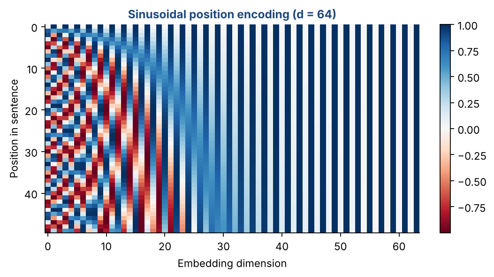
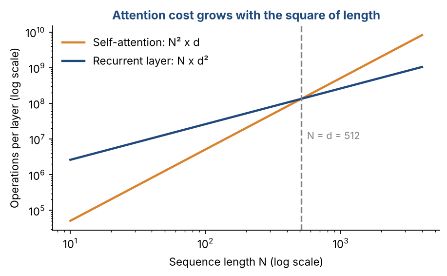
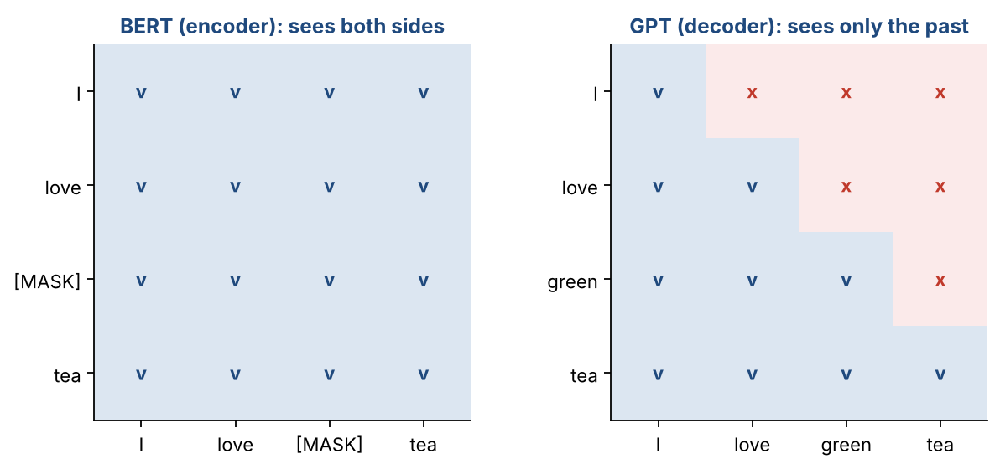

# Chapter 26 — Transformer II: Position Encoding, Complexity & Pre-Training (BERT, GPT)

**Part IV — Transformers & Generative AI** · [](https://colab.research.google.com/github/winnertechserv/aimlgybs/blob/main/part4_transformers_genai/ch26_transformer_ii/ch26_notebook.ipynb)

Companion code for Chapter 26 of *AI-Machine Learning: Get Your Base Strong*. The book explains the ideas; this folder lets you run them.

## Key ideas

- Attention has no built-in notion of order, so position information must be added explicitly to the embeddings.
- Sinusoidal position encodings stay bounded and generalize to sequences longer than any seen during training.
- Parameter count grows with the square of the model dimension d and linearly with the number of layers N.
- Pre-training on huge unlabeled corpora followed by fine-tuning on a small labeled set is the dominant modern recipe.
- BERT pre-trains the encoder with masked language modeling; GPT pre-trains the decoder to predict the next word.

## Examples

| # | Program | What it shows |
|---|---|---|
| 1 | [`ex1_sinusoidal_position_encoding.py`](ex1_sinusoidal_position_encoding.py) | This builds the position encoding matrix using the exact formula, with sin for even indices and cos for odd indices. |
| 2 | [`ex2_transformer_parameter_count_calculator.py`](ex2_transformer_parameter_count_calculator.py) | This turns the complexity formulas into working code: 3ldhN for each MHA group, 3d^2N for the W_o matrices, 4d^2N for the PWFFNN sub-layers and dV for the decoder's linear layer. |
| 3 | [`ex3_bert_masked_lm_vs_gpt_autoregressive_pre_trai.py`](ex3_bert_masked_lm_vs_gpt_autoregressive_pre_trai.py) | This contrasts the two pre-training objectives directly. |

Run any example from this folder:

```bash
cd part4_transformers_genai/ch26_transformer_ii
python ex1_sinusoidal_position_encoding.py
```

The exact output printed in the book is in [`expected_output/`](expected_output). The notebook [`ch26_notebook.ipynb`](ch26_notebook.ipynb) has all three examples with explanations.

### Example 1: Sinusoidal Position Encoding

This builds the position encoding matrix using the exact formula, with sin for even indices and cos for odd indices. The output shows that every position gets a distinct vector, that the same word embedding becomes different at different positions, and that the dot product between position vectors decays with distance - which is how the model infers relative order.

<details><summary>Expected output</summary>

```text
=== Sinusoidal Position Encoding ===

Why needed? Attention has NO notion of order. Consider:
  "The food was good, not bad at all"
  "The food was bad, not good at all"
Same words, opposite meaning -> position information is essential.

Position encoding matrix p_t for T=6 positions, d=8:
[[ 0.      1.      0.      1.      0.      1.      0.      1.    ]
 [ 0.8415  0.5403  0.0998  0.995   0.01    1.      0.001   1.    ]
 [ 0.9093 -0.4161  0.1987  0.9801  0.02    0.9998  0.002   1.    ]
 [ 0.1411 -0.99    0.2955  0.9553  0.03    0.9996  0.003   1.    ]
 [-0.7568 -0.6536  0.3894  0.9211  0.04    0.9992  0.004   1.    ]
 [-0.9589  0.2837  0.4794  0.8776  0.05    0.9988  0.005   1.    ]]

Every position gets a DIFFERENT vector:
  p_0 = [0. 1. 0. 1. 0. 1. 0. 1.]
  p_1 = [0.8415 0.5403 0.0998 0.995  0.01   1.     0.001  1.    ]
  p_2 = [ 0.9093 -0.4161  0.1987  0.9801  0.02    0.9998  0.002   1.    ]

Combine with word embedding:  x_hat_t = x_t + p_t
  word embedding x  (same word at any position): [ 1.764  0.4    0.979  2.241  1.868 -0.977  0.95  -0.151]
  x_hat at position 0 = [1.764 1.4   0.979 3.241 1.868 0.023 0.95  0.849]
  x_hat at position 3 = [ 1.905 -0.59   1.275  3.196  1.898  0.023  0.953  0.849]
  -> the SAME word gets different embeddings at different positions.

=== Property: similarity decays with distance ===
Dot product between position 0 and position t:
  p_0 . p_0 = +4.0000
  p_0 . p_1 = +3.5353
  p_0 . p_2 = +2.5637
  p_0 . p_3 = +1.9649
  p_0 . p_4 = +2.2666
  p_0 . p_5 = +3.1600
Nearby positions have higher similarity -> the model can infer relative order.

=== Why sinusoidal (not learned integers)? ===
  * Values stay bounded in [-1, 1] regardless of sequence length
  * Generalizes to sequences longer than those seen in training
  * Relative position is expressible as a linear function of p_t
```

</details>

### Example 2: Transformer Parameter-Count Calculator

This turns the complexity formulas into working code: 3ldhN for each MHA group, 3d^2N for the W_o matrices, 4d^2N for the PWFFNN sub-layers and dV for the decoder's linear layer. Applying it to the original base configuration (d=512, h=8, N=6) gives about 44 million parameters, and the comparison table shows that doubling d roughly quadruples the count while doubling N only doubles it.

<details><summary>Expected output</summary>

```text
=== Complexity of the Transformer Model ===

Parameter counts:
  Encoder self-attention MHA in N layers : 3*l*d*h*N
  Decoder self-attention MHA in N layers : 3*l*d*h*N
  Cross-attention MHA in N layers        : 3*l*d*h*N
  W_o matrices in 3 MHA sub-layers       : 3*d^2*N
  Two weight matrices in 2 PWFFNN        : 4*d^2*N
  Linear layer in decoder                : d*V

Configuration: d=512, h=8 heads (l=64), N=6 layers, vocab V=37000
  Encoder self-attention MHA :    4,718,592
  Decoder self-attention MHA :    4,718,592
  Cross-attention MHA        :    4,718,592
  W_o matrices               :    4,718,592
  PWFFNN weight matrices     :    6,291,456
  Decoder linear layer       :   18,944,000
  TOTAL                        44,109,824

=== How parameters scale with each hyperparameter ===

Config                                     Parameters
------------------------------------------------------
  small  (d=256, h=4,  N=2)                 4,657,152
  base   (d=512, h=8,  N=6)                44,109,824
  large  (d=1024,h=16, N=6)               138,551,296
  deep   (d=512, h=8,  N=12)               69,275,648

Observations:
  * Doubling d roughly QUADRUPLES the parameters (terms are O(d^2)).
  * Doubling N doubles the parameters (linear in depth).
  * Changing h alone does not change the count, since l = d/h keeps l*h = d.

=== Training the Transformer ===
  * Trained end-to-end with error backpropagation, cross-entropy loss.
  * Training data for translation: (source sentence, target sentence) pairs.
  * Desired output at time t: one-hot vector of the t-th target word.
  * Error is backpropagated through decoder then encoder layers, N, N-1, ..., 1.
```

</details>

### Example 3: BERT Masked LM vs GPT Autoregressive Pre-Training

This contrasts the two pre-training objectives directly. BERT masks about 15% of tokens and predicts them using both left and right context; GPT predicts each next word from the preceding words only. The final section computes the cross-entropy loss for a single prediction, showing how a confident wrong answer is penalized far more heavily than an uncertain one.

<details><summary>Expected output</summary>

```text
=== Pre-Training Objectives: BERT vs GPT ===

Both pre-train on huge UNLABELED text, then fine-tune on a small
labeled dataset for a downstream task.

Sentence (9 tokens): the quick brown fox jumps over the lazy dog

--- BERT (encoder pre-training): Masked Language Modeling ---
Randomly mask ~15% of tokens; the model predicts them using BOTH
left and right context (bidirectional).

  Masked positions : [6]
  Model input      : the quick brown fox jumps over [MASK] lazy dog
  Prediction target: ['the']
  Context used     : ALL other tokens (both directions)

  Second BERT objective - Next Sentence Prediction (NSP):
    Input : [CLS] the quick brown fox ... [SEP] it was very fast [SEP]
    Target: IsNext = True/False

--- GPT (decoder pre-training): Autoregressive Language Modeling ---
Predict the NEXT word using only the PRECEDING words (unidirectional).

   t  Input (context)                               Predict
  ------------------------------------------------------------------
   1  the                                           -> quick
   2  the quick                                     -> brown
   3  the quick brown                               -> fox
   4  the quick brown fox                           -> jumps
   5  the quick brown fox jumps                     -> over
  ...

=== Cross-Entropy Loss for One Prediction ===

Vocabulary      : ['fox', 'dog', 'cat', 'car', 'tree']
Model logits    : [ 3.2  1.1  0.8 -0.5  0.2]
Softmax probs   : [0.7766 0.0951 0.0705 0.0192 0.0387]
True next word  : 'fox' (one-hot target)
Cross-entropy loss = -log(p_correct) = -log(0.7766) = 0.2528

If the model were confident and WRONG (p_correct = 0.01):
  loss = -log(0.01) = 4.6052   (heavily penalized)
If the model were perfect (p_correct = 1.0):
  loss = -log(1.00) = -0.0000

=== Summary ===
  BERT : encoder-only,  bidirectional, Masked LM + NSP
  GPT  : decoder-only,  autoregressive (masked self-attention)
  T5   : encoder-decoder, text-to-text transfer
  ViLBERT: encoder pre-training for visual-linguistic (image+text) data
```

</details>

## Figures from this chapter

**Figure 26.1.** Every row is the position vector for one word position. Early dimensions change quickly from row to row, later ones slowly, so every position gets a unique pattern.



**Figure 26.2.** Cost per layer with d = 512. Self-attention is cheaper than a recurrent layer for sentences shorter than d, but its cost grows with the square of the length.



**Figure 26.3.** Which words each position may look at (v = allowed). BERT sees the whole sentence and fills in masked words; GPT sees only earlier words and predicts the next one.



The code that draws these figures is in [`figures/src`](../../figures/src).

---

[← Chapter 25](../../part4_transformers_genai/ch25_transformer_i) · [All chapters](../../README.md#chapters) · [Chapter 27 →](../../part4_transformers_genai/ch27_transformer_iii)
