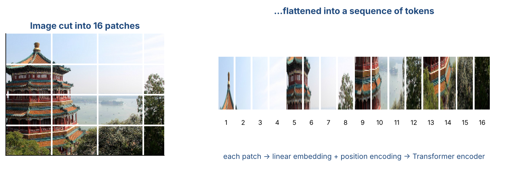
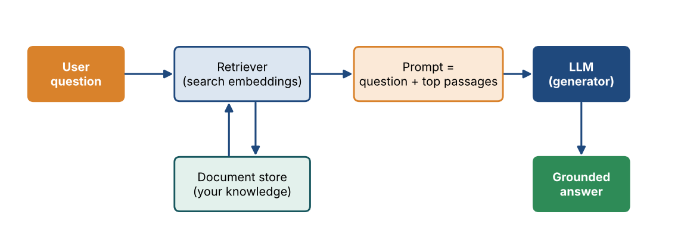

# Chapter 27 — Transformer III: Vision Transformers, VQA, Large Language Models & RAG

**Part IV — Transformers & Generative AI** · [](https://colab.research.google.com/github/winnertechserv/aimlgybs/blob/main/part4_transformers_genai/ch27_transformer_iii/ch27_notebook.ipynb)

Companion code for Chapter 27 of *AI-Machine Learning: Get Your Base Strong*. The book explains the ideas; this folder lets you run them.

## Key ideas

- Cut an image into fixed-size patches and it becomes a sequence, which is all a Transformer needs (the Vision Transformer).
- Visual question answering combines an image encoder, a question encoder, a fusion step and an answer generator.
- Large language models are simply pre-trained language models scaled to billions of parameters.
- A foundation model is pre-trained once and fine-tuned many times for different downstream tasks.
- Retrieval Augmented Generation retrieves supporting documents and places them in the prompt, which grounds answers and reduces hallucination.

## Examples

| # | Program | What it shows |
|---|---|---|
| 1 | [`ex1_vision_transformer_patch_embedding.py`](ex1_vision_transformer_patch_embedding.py) | This performs the four steps that turn an image into a sequence: split into patches, flatten and linearly project them, prepend the learnable [CLS] token whose final output is used for classification, and add position embeddings. |
| 2 | [`ex2_clip_contrastive_image_caption_matching.py`](ex2_clip_contrastive_image_caption_matching.py) | This builds CLIP's training objective: encode images and captions into the same space, compute the cosine similarity of every pair, then maximize the N correct pairs and minimize the N^2 - N incorrect ones. |
| 3 | [`ex3_retrieval_augmented_generation_pipeline.py`](ex3_retrieval_augmented_generation_pipeline.py) | This runs the three RAG stages end to end: RETRIEVE the most similar documents from a document store by cosine similarity, AUGMENT the prompt by inserting them as context, and GENERATE an answer grounded in that context. |

Run any example from this folder:

```bash
cd part4_transformers_genai/ch27_transformer_iii
python ex1_vision_transformer_patch_embedding.py
```

The exact output printed in the book is in [`expected_output/`](expected_output). The notebook [`ch27_notebook.ipynb`](ch27_notebook.ipynb) has all three examples with explanations.

### Example 1: Vision Transformer Patch Embedding

This performs the four steps that turn an image into a sequence: split into patches, flatten and linearly project them, prepend the learnable [CLS] token whose final output is used for classification, and add position embeddings. The table at the end shows the trade-off in patch size - smaller patches give more tokens and finer detail at higher computational cost.

<details><summary>Expected output</summary>

```text
=== Vision Transformer (ViT): 'An image is worth 16x16 words' ===

Idea: split the image into fixed-size patches, flatten each patch,
linearly project it -> now the image IS a sequence, so a Transformer
encoder can process it exactly like a sentence.

Input image : 32x32x3
Patch size  : 8x8
Number of patches N = (H/P) x (W/P) = 4 x 4 = 16
Flattened patch dimension = P*P*C = 8*8*3 = 192

Step 1 - patch matrix shape: (16, 192)  (N x patch_dim)
Step 2 - after linear projection E (192, 16): (16, 16)  (N x d)
Step 3 - prepend [CLS] token: (17, 16)  (N+1 x d)
Step 4 - add position embeddings: (17, 16)

Final sequence fed to the Transformer encoder: 17 tokens of dim 16
  token 0      = [CLS]  (its final output is used for classification)
  tokens 1..16 = image patches

First 6 dims of [CLS] token : [-0.0059  0.0408 -0.0926  0.0464  0.0997 -0.0908]
First 6 dims of patch 1     : [-0.3084 -0.2176 -0.3752  0.4417 -0.5824 -0.4827]

=== Sequence length vs patch size ===

 Patch size   #Patches   Patch dim  Note
--------------------------------------------------------------
      4x4           64          48  more tokens = finer detail, slower
      8x8           16         192  balanced
     16x16           4         768  fewer tokens = faster, coarser

ViT for image captioning: ViT encoder represents the image, then a
Transformer decoder generates the caption word by word.
```

</details>

### Example 2: CLIP Contrastive Image-Caption Matching

This builds CLIP's training objective: encode images and captions into the same space, compute the cosine similarity of every pair, then maximize the N correct pairs and minimize the N^2 - N incorrect ones. The similarity matrix shows a strong diagonal, retrieval is 100% accurate, and the contrastive loss is computed in both directions.

<details><summary>Expected output</summary>

```text
=== CLIP: Contrastive Language-Image Pre-training ===

Training objective:
  1. Encode all images and all captions into the SAME m-dim space
  2. Compute cosine similarity of every (image, caption) pair
  3. MAXIMIZE similarity of the N correct pairs
     MINIMIZE similarity of the N^2 - N incorrect pairs

Similarity matrix S (rows = images, cols = captions):

            cap1      cap2      cap3      cap4      
  image1   +0.946  +0.577  -0.661  -0.390  
  image2   +0.660  +0.829  -0.059  +0.030  
  image3   -0.541  -0.233  +0.979  +0.742  
  image4   -0.394  -0.387  +0.703  +0.951  

Diagonal (correct pairs)  : [0.946 0.829 0.979 0.951]
Off-diagonal (wrong pairs): mean +0.004
Number of wrong pairs = N^2 - N = 12

Image -> caption retrieval (pick argmax per row):
  image1 -> 'a dog on a beach'   [correct]
  image2 -> 'a plate of pasta'   [correct]
  image3 -> 'a red sports car'   [correct]
  image4 -> 'two children playing'   [correct]
Retrieval accuracy: 100%

Contrastive loss (temperature tau=0.07):
  image->text loss = 0.0382
  text->image loss = 0.0281
  total = (sum)/2  = 0.0332

CLIP is used in DALL-E 2: the CLIP text encoder maps the caption into
representation space, then a diffusion prior maps it to a CLIP image
encoding, and reverse diffusion generates the final image.
```

</details>

### Example 3: Retrieval Augmented Generation Pipeline

This runs the three RAG stages end to end: RETRIEVE the most similar documents from a document store by cosine similarity, AUGMENT the prompt by inserting them as context, and GENERATE an answer grounded in that context. It shows why RAG reduces hallucination - the answer is traceable to a specific retrieved document, and knowledge can be updated by changing the store rather than retraining the model.

<details><summary>Expected output</summary>

```text
=== Retrieval Augmented Generation (RAG) ===

Problem: an LLM's knowledge is frozen at training time and it may
hallucinate. RAG fixes this by RETRIEVING relevant documents from a
document store and putting them into the prompt before generation.

Document store : 6 documents
Vocabulary size: 56 terms
Embedding matrix shape: (6, 56)

User query: 'Which model is pre-trained with masked language modeling?'

Step 1 - RETRIEVE: cosine similarity of query with each document
  0.8367  doc2: BERT is an encoder-only model pre-trained with masked lang...  <-- retrieved
  0.3586  doc3: GPT is a decoder-only autoregressive model pre-trained on ...  <-- retrieved
  0.1734  doc1: The Transformer model was introduced in the paper Attentio...
  0.1260  doc5: K-Means is a partitioning clustering algorithm that minimi...
  0.0000  doc4: ResNet uses residual skip connections to train very deep C...
  0.0000  doc6: LSTM cells use forget, input and output gates to avoid van...

Step 2 - AUGMENT: build the prompt with the top-2 documents
--------------------------------------------------------------------
Context:
  [1] BERT is an encoder-only model pre-trained with masked language modeling.
  [2] GPT is a decoder-only autoregressive model pre-trained on unlabeled text.
Question: Which model is pre-trained with masked language modeling?
Answer using only the context above.
--------------------------------------------------------------------

Step 3 - GENERATE: the LLM answers grounded in the retrieved context
  Answer: BERT is pre-trained with masked language modeling.
          (grounded in retrieved document [1], not invented)

=== Why RAG matters ===
  * Knowledge can be updated by changing the document store,
    with no model retraining required.
  * Answers are traceable to source documents (less hallucination).
  * Retrieval quality sets the ceiling: bad retrieval -> bad answer.
```

</details>

## Figures from this chapter

**Figure 27.1.** The Vision Transformer idea: cut the image into patches and feed them to a Transformer as if each patch were a word.



**Figure 27.2.** Retrieval Augmented Generation: fetch the most relevant passages first, then give them to the LLM with the question so its answer rests on real sources.



The code that draws these figures is in [`figures/src`](../../figures/src).

---

[← Chapter 26](../../part4_transformers_genai/ch26_transformer_ii) · [All chapters](../../README.md#chapters) · [Chapter 28 →](../../part4_transformers_genai/ch28_generative_adversarial_networks_i)
