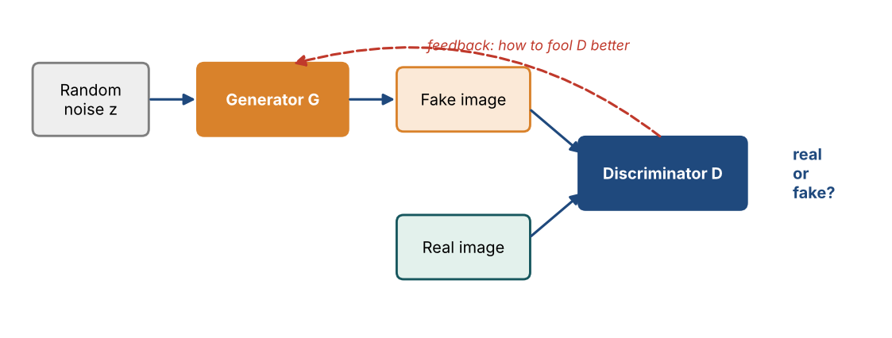
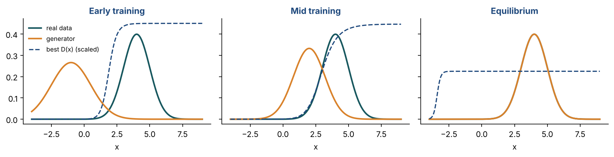
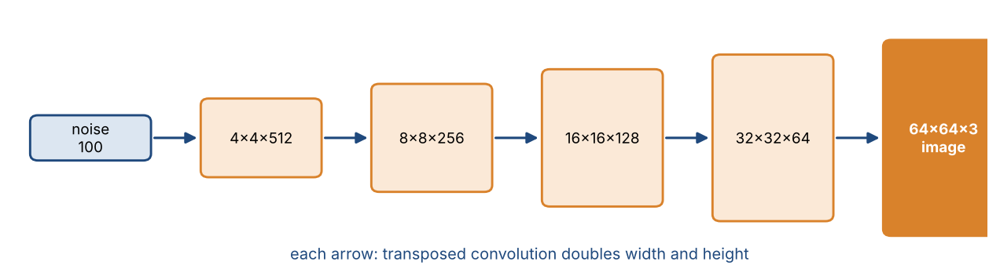

# Chapter 28 — Generative Adversarial Networks I: Adversarial Training, DCGAN & Evaluation

**Part IV — Transformers & Generative AI** · [](https://colab.research.google.com/github/winnertechserv/aimlgybs/blob/main/part4_transformers_genai/ch28_generative_adversarial_networks_i/ch28_notebook.ipynb)

Companion code for Chapter 28 of *AI-Machine Learning: Get Your Base Strong*. The book explains the ideas; this folder lets you run them.

## Key ideas

- A GAN is two networks in competition: the generator makes fakes, the discriminator judges them.
- The generator never sees a real image directly; it improves only through the discriminator's feedback.
- Because the two networks pull in opposite directions, the objective rises and falls during training — that is normal, not a bug.
- Transposed convolution (an FSCL) upsamples, which is how a small noise vector becomes a full-size image.
- Mode collapse destroys diversity; the Inception Score and FID are the standard ways to measure generation quality.

## Examples

| # | Program | What it shows |
|---|---|---|
| 1 | [`ex1_the_gan_minimax_objective.py`](ex1_the_gan_minimax_objective.py) | This computes the GAN objective V(D,G) numerically for several scenarios, showing it is high when the discriminator wins and low when the generator wins, with the theoretical equilibrium at 2*log(0.5) = -1.386. |
| 2 | [`ex2_transposed_convolution_fscl_in_the_dcgan_gene.py`](ex2_transposed_convolution_fscl_in_the_dcgan_gene.py) | This shows why the generator needs a different operation from the discriminator. |
| 3 | [`ex3_mode_collapse_and_the_inception_score.py`](ex3_mode_collapse_and_the_inception_score.py) | The first half shows mode collapse: a healthy GAN covers all ten digit modes while a collapsed one produces only two. |

Run any example from this folder:

```bash
cd part4_transformers_genai/ch28_generative_adversarial_networks_i
python ex1_the_gan_minimax_objective.py
```

The exact output printed in the book is in [`expected_output/`](expected_output). The notebook [`ch28_notebook.ipynb`](ch28_notebook.ipynb) has all three examples with explanations.

### Example 1: The GAN Minimax Objective

This computes the GAN objective V(D,G) numerically for several scenarios, showing it is high when the discriminator wins and low when the generator wins, with the theoretical equilibrium at 2*log(0.5) = -1.386. The second half walks through one mini-batch training step exactly as the algorithm slide describes, verifying that the discriminator's gradient ascent raises V and the generator's gradient descent lowers it.

<details><summary>Expected output</summary>

```text
=== The GAN Minimax Optimization Problem ===

min_thetaG  max_thetaD   E_p(x)[log D(x)] + E_p(z)[log(1 - D(G(z)))]

  Discriminator D: MAXIMIZE it (gradient ASCENT)
  Generator     G: MINIMIZE it (gradient DESCENT)
  Desired D output: 1 for a real image, 0 for a synthetic image

Scenario                                             V(D,G)  Reading
----------------------------------------------------------------------------------------
  Untrained D (outputs ~0.5 for everything)         -1.3863  V = 2*log(0.5) = -1.386
  Strong D (real->0.95, fake->0.05): G is losing    -0.1026  D winning (V high)
  Strong G (D fooled: fake->0.90)                   -2.8134  G winning (V low)
  Equilibrium (D cannot tell: both 0.5)             -1.3863  V = 2*log(0.5) = -1.386

Theoretical equilibrium value: 2*log(0.5) = -1.3863
At equilibrium p(x_synthetic) ~ p(x_real), so D outputs 0.5 everywhere.

=== Mini-Batch Mode Training of a GAN (one step) ===

Step 3.1  Sample M random noise vectors z ~ N(0, sigma^2 I)
          z shape = (6, 4)  (M=6 noise vectors of dim 4)

Step 3.2  Update DISCRIMINATOR by GRADIENT ASCENT
          V before = -0.8927
          V after  = -0.7827   (INCREASED -> ascent worked)

Step 3.3  Update GENERATOR by GRADIENT DESCENT
          V before = -0.7827
          V after  = -1.1394   (DECREASED -> descent worked)

Step 4    Repeat until convergence.

Note the adversarial tension: D pushes V up, G pushes V down.
This is why the objective goes up AND down during GAN training,
unlike ordinary supervised learning where loss decreases steadily.
```

</details>

### Example 2: Transposed Convolution (FSCL) in the DCGAN Generator

This shows why the generator needs a different operation from the discriminator. Ordinary convolution shrinks the 4x4 input to a 3x3 feature map - and you can check each value by hand. We then build the convolution matrix C, check e = Cx, and use C-transpose to upsample back to 4x4. The result confirms that the shape is restored but the values are not the original ones.

<details><summary>Expected output</summary>

```text
=== Transposed Convolution (Up-Convolution / FSCL) ===

The DISCRIMINATOR uses ordinary convolution: image -> smaller feature map.
The GENERATOR must go the other way: small input -> larger image.
It uses Transposed Convolution, also called Fractional-Strided
Convolution (stride S < 1), which is why the layer is named FSCL.

Input image x (4x4):
[[5 9 3 1]
 [7 2 6 4]
 [1 8 5 2]
 [3 0 7 9]]

Kernel K (2x2):
[[ 0.2 -0.5]
 [ 0.7 -0.3]]

Down-convolution output (3x3)  W2 = (W1-F)/S + 1 = (4-2)/1+1 = 3:
[[ 0.8 -0.1  3.1]
 [-1.3  1.5  2.1]
 [-1.7 -3.   2.2]]
  -> W2 < W1 : the feature map SHRANK

Convolution matrix C shape: (9, 16)  (9 outputs x 16 inputs)
Verify  e_bar = C x_bar  matches the direct convolution: True

=== Transposed Convolution: x_tilde_bar = C^T e_bar ===

C^T shape: (16, 9)  (16 outputs x 9 inputs) -> UPSAMPLES 3x3 back to 4x4
Result (4x4):
[[ 0.16 -0.42  0.67 -1.55]
 [ 0.3   0.64  1.87 -1.98]
 [-1.25  1.69  2.96 -1.73]
 [-1.19 -1.59  2.44 -0.66]]

Is the result equal to the original x? False
NO - transposed convolution restores the SHAPE, not the VALUES.
(Note: x_tilde is not the same as x.)

=== Generator in DCGAN ===

A 100-dim noise vector z is progressively upsampled by FSCL layers:
  Unflattened input    -> 4x4x1024
  FSCL 1               -> 8x8x512
  FSCL 2               -> 16x16x256
  FSCL 3               -> 32x32x128
  FSCL 4 / Conv        -> 64x64x3  (generated image)

Each FSCL doubles height and width while reducing depth,
turning random noise z into a full-size synthetic image G(z).
```

</details>

### Example 3: Mode Collapse and the Inception Score

The first half shows mode collapse: a healthy GAN covers all ten digit modes while a collapsed one produces only two. The second half builds the Inception Score using KL divergence and shows that a high score requires BOTH confident per-image predictions AND a diverse marginal distribution - mode collapse destroys the second, blurry generation destroys the first.

<details><summary>Expected output</summary>

```text
=== Evaluating a GAN: Creativity, Inheritance, Diversity ===

A GAN image generator is judged on three aspects:
  Creativity  : generated images are NOT duplicates of real images
  Inheritance : generated images retain key features of real images
  Diversity   : generated images differ from one another

=== Mode Collapse (Mode Diversity Problem) ===

The generator maps ALL noise vectors z to a small subset of outputs.
Example: a GAN trained on handwritten digits generates only a few digits.

  Healthy GAN (good mode coverage):
    digit 0:  112  ##############
    digit 1:  119  ##############
    digit 2:   92  ###########
    digit 3:   98  ############
    digit 4:   95  ###########
    digit 5:   96  ############
    digit 6:  102  ############
    digit 7:   92  ###########
    digit 8:   91  ###########
    digit 9:  103  ############
    distinct modes generated: 10/10

  Mode-collapsed GAN:
    digit 0:    0  
    digit 1:    0  
    digit 2:    0  
    digit 3:  592  ##########################################################################
    digit 4:    0  
    digit 5:    0  
    digit 6:    0  
    digit 7:    0  
    digit 8:  408  ###################################################
    digit 9:    0  
    distinct modes generated: 2/10

The fix: the Least-Squares GAN (LSGAN) replaces the
cross-entropy discriminator loss with sum-of-squared errors and is
shown to avoid mode collapse. The Wasserstein GAN instead changes
the criterion to the Wasserstein (Earth Mover's) distance, which
measures how far apart p(x~) and p(x) are.

=== Inception Score (IS) via KL Divergence ===

Generated images are fed to an Inception network. For each image we get
p(y|x) over class labels. IS = exp( E_x [ KL( p(y|x) || p(y) ) ] )

  Sharp + diverse (good GAN)     IS = 3.3864   marginal p(y) = [0.2 0.2 0.2 0.2 0.2]
  Sharp but mode-collapsed       IS = 1.0000   marginal p(y) = [0.92 0.02 0.02 0.02 0.02]
  Blurry / unrecognizable        IS = 1.0000   marginal p(y) = [0.2 0.2 0.2 0.2 0.2]

  Maximum possible IS for 5 classes = 5

Interpretation:
  High IS needs BOTH  (a) confident per-image class predictions
                 and  (b) a uniform marginal over classes (diversity).
  Mode collapse kills (b), blurry generation kills (a).

The other standard metric is the Frechet Inception Distance (FID),
which compares the feature distributions of real and generated images.
```

</details>

## Figures from this chapter

**Figure 28.1.** A GAN: the generator turns noise into fakes, the discriminator tries to tell fakes from real data, and each one improves by competing with the other.



**Figure 28.2.** Illustration of GAN training in one dimension. As the generator's distribution moves onto the real one, the best possible discriminator falls to 0.5 everywhere: it can no longer tell them apart.



**Figure 28.3.** A DCGAN generator grows a short noise vector into a full image, using transposed convolutions that double the size at each step.



The code that draws these figures is in [`figures/src`](../../figures/src).

---

[← Chapter 27](../../part4_transformers_genai/ch27_transformer_iii) · [All chapters](../../README.md#chapters) · [Chapter 29 →](../../part4_transformers_genai/ch29_generative_adversarial_networks_ii)
