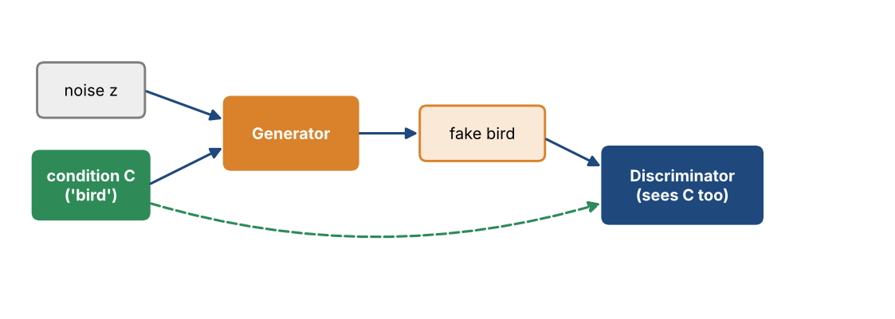
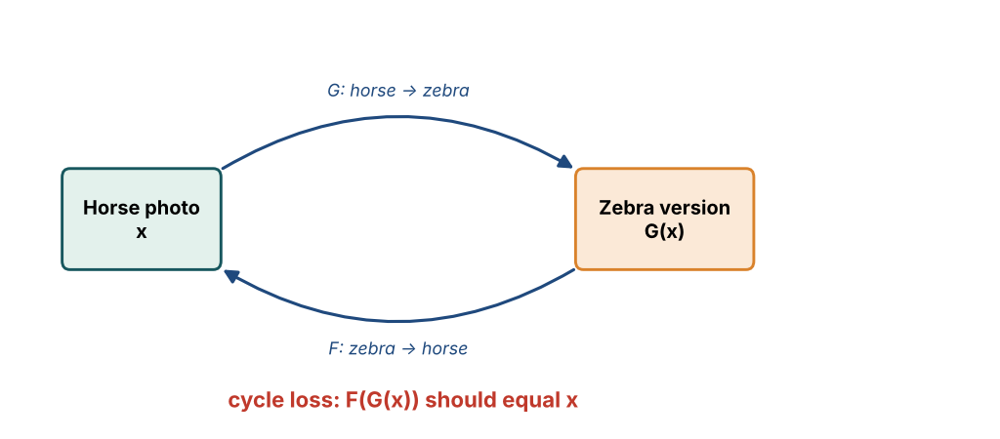

# Chapter 29 — Generative Adversarial Networks II: Conditional GANs, CycleGAN & StyleGAN

**Part IV — Transformers & Generative AI** · [](https://colab.research.google.com/github/winnertechserv/aimlgybs/blob/main/part4_transformers_genai/ch29_generative_adversarial_networks_ii/ch29_notebook.ipynb)

Companion code for Chapter 29 of *AI-Machine Learning: Get Your Base Strong*. The book explains the ideas; this folder lets you run them.

## Key ideas

- Conditioning both networks on extra information C is what gives you control over what is generated.
- In an ACGAN the discriminator does double duty: it judges realness AND predicts the class label.
- pix2pix-style translation needs paired images; CycleGAN removes that requirement using cycle consistency.
- Cycle consistency means translating an image across and back should return the original, which stops the generator ignoring its input.
- StyleGAN controls image style layer by layer using AdaIN, with added noise producing fine stochastic detail.

## Examples

| # | Program | What it shows |
|---|---|---|
| 1 | [`ex1_conditional_gan_inputs_and_acgan_outputs.py`](ex1_conditional_gan_inputs_and_acgan_outputs.py) | This shows exactly how the conditioning information C enters a conditional GAN: the class label is one-hot encoded and concatenated with the noise vector, so the same z with a different label produces a different image. |
| 2 | [`ex2_cyclegan_cycle_consistency_loss.py`](ex2_cyclegan_cycle_consistency_loss.py) | This shows the idea that makes unpaired translation possible. |
| 3 | [`ex3_frechet_inception_distance_from_scratch.py`](ex3_frechet_inception_distance_from_scratch.py) | This builds FID directly from its definition, comparing the mean and covariance of real and generated feature distributions. |

Run any example from this folder:

```bash
cd part4_transformers_genai/ch29_generative_adversarial_networks_ii
python ex1_conditional_gan_inputs_and_acgan_outputs.py
```

The exact output printed in the book is in [`expected_output/`](expected_output). The notebook [`ch29_notebook.ipynb`](ch29_notebook.ipynb) has all three examples with explanations.

### Example 1: Conditional GAN Inputs and ACGAN Outputs

This shows exactly how the conditioning information C enters a conditional GAN: the class label is one-hot encoded and concatenated with the noise vector, so the same z with a different label produces a different image. The second half shows the ACGAN discriminator's two outputs - the probability the image is real and the predicted class label from the auxiliary classifier.

<details><summary>Expected output</summary>

```text
=== Conditional GAN (cGAN) ===

Both G and D are conditioned on additional information C.
C can be a class label, a source-domain image, a sketch, or text.

--- Class-Conditional GAN: C = class label ---

Random noise vector z (6-dim)      : [ 1.76  0.4   0.98  2.24  1.87 -0.98]
Class label            : 2 = 'bird'
One-hot encoding C     : [0. 0. 1. 0. 0.]
Generator input [z ; C]: [ 1.76  0.4   0.98  2.24  1.87 -0.98  0.    0.    1.    0.    0.  ]   (dim 11)

The SAME z with a DIFFERENT label produces a different image:
  label 0 ('cat  ') -> input [ 1.76  0.4   0.98  2.24  1.87 -0.98  1.    0.    0.    0.    0.  ]
  label 3 ('car  ') -> input [ 1.76  0.4   0.98  2.24  1.87 -0.98  0.    0.    0.    1.    0.  ]

Discriminator also receives C, so it must judge:
  'is this a REAL image AND does it match the given label?'

--- Auxiliary Classifier GAN (ACGAN) ---

The discriminator has TWO outputs:
  1. probability the input image is real
  2. the class label of the input image (auxiliary classifier C)

  real 'bird' image     : D_real = 0.93 | class probs = [0.045 0.055 0.811 0.04  0.049]
                          predicted class = 'bird' (correct: bird)
  synthetic 'bird' image: D_real = 0.21 | class probs = [0.092 0.112 0.612 0.083 0.101]
                          predicted class = 'bird' (correct: bird)

ACGAN loss has two parts:
  L_source = log P(real | x)     -> adversarial term
  L_class  = log P(class | x)    -> classification term
  D maximizes L_source + L_class ; G maximizes L_class - L_source

--- Other conditional variants ---
  BigGAN          : class-conditional GAN on ImageNet, built from ResBlocks
  pix2pix (cGAN)  : C = image from the source domain (image-to-image)
  Sketch-to-photo : C = a sketch
  Text-to-image   : C = representation of a text prompt
```

</details>

### Example 2: CycleGAN Cycle-Consistency Loss

This shows the idea that makes unpaired translation possible. An image is translated to the other domain and back; a well-trained pair of generators returns the original almost exactly (loss near 0), while poorly trained ones do not. The full objective combines both adversarial losses with the weighted cycle loss, and the SuperstarGAN FID table from the slide is reproduced at the end.

<details><summary>Expected output</summary>

```text
=== CycleGAN: Unpaired Image-to-Image Translation ===

pix2pix needs PAIRED data (same scene in both domains).
CycleGAN works with UNPAIRED data using two generators and two
discriminators, tied together by the cycle-consistency loss.

  G_AB : domain A -> domain B      D_B : judges domain B images
  G_BA : domain B -> domain A      D_A : judges domain A images

Cycle consistency:  G_BA(G_AB(a)) ~ a    and    G_AB(G_BA(b)) ~ b

Original image a (domain A):
[[0.42 0.72 0.  ]
 [0.3  0.15 0.09]
 [0.19 0.35 0.4 ]]

--- Well-trained CycleGAN (quality = 1.0) ---
Translated to domain B, G_AB(a):
[[0.486 0.726 0.15 ]
 [0.39  0.27  0.222]
 [0.302 0.43  0.47 ]]
Cycled back, G_BA(G_AB(a)):
[[0.42 0.72 0.  ]
 [0.3  0.15 0.09]
 [0.19 0.35 0.4 ]]
Cycle-consistency loss  L1 = mean|a - G_BA(G_AB(a))| = 0.000000

--- Poorly-trained CycleGAN (quality = 0.4) ---
Cycled back:
[[0.347 0.925 0.   ]
 [0.354 0.235 0.115]
 [0.    0.013 0.217]]
Cycle-consistency loss  L1 = 0.127930

Loss comparison: good 0.000000  vs  bad 0.127930
The cycle loss forces the two generators to be near-inverses of each
other, which is what prevents the network from ignoring the input and
producing an arbitrary image in the target domain.

=== Full CycleGAN objective ===

  Adversarial loss  G_AB / D_B      : 0.4120
  Adversarial loss  G_BA / D_A      : 0.3890
  Cycle-consistency loss (both ways): 0.0031
  lambda (cycle weight)             : 10.0
  TOTAL = 0.4120 + 0.3890 + 10.0*0.0031 = 0.8320

=== SuperstarGAN ===
Combines ACGAN's separate classifier with CycleGAN's cycle loss.
Reported FID on 10000 CelebA images (lower is better):
  SuperstarGAN                 FID = 22.7
  StarGAN                      FID = 27.7
  SuperstarGAN without DA      FID = 29.1
  StarGAN + SN + Hinge Loss    FID = 34.0
  StarGAN + DA                 FID = 38.3
  (DA = Data Augmentation, SN = Spectral Normalization)
```

</details>

### Example 3: Frechet Inception Distance from Scratch

This builds FID directly from its definition, comparing the mean and covariance of real and generated feature distributions. The experiments show FID near zero for a perfect match, rising sharply for a shifted mean, and - importantly - also rising when variety is too low, which is how FID detects the mode collapse that the Inception Score can miss.

<details><summary>Expected output</summary>

```text
=== Frechet Inception Distance (FID) ===

FID compares the DISTRIBUTIONS of Inception features for real and
generated images, modeling each as a multivariate Gaussian:

  FID = ||mu_r - mu_g||^2 + Tr( S_r + S_g - 2*(S_r S_g)^(1/2) )

Lower FID = generated distribution closer to the real one.
Unlike Inception Score, FID uses the REAL images as reference.

Feature vectors: 500 images x 16 dims (stand-in for Inception features)

Generated-image distribution                     FID  Quality
------------------------------------------------------------------------
  Generated = real distribution (ideal)        0.415  excellent
  Slight mean shift (+0.3)                     2.065  good
  Large mean shift (+1.5)                     36.850  very poor
  Correct mean, too little variety (0.4x)      6.011  poor
  Correct mean, too much variety (2.0x)       16.342  poor

Observations:
  * Matching the real distribution gives FID near 0.
  * A shifted mean (wrong content) raises FID sharply.
  * Too little variety (mode collapse) ALSO raises FID, because the
    covariance term no longer matches - FID penalizes lost diversity.

=== Inception Score vs FID ===

  Aspect                   Inception Score            FID
  ----------------------------------------------------------------------
  Uses real images?        No                         Yes (reference set)
  Direction                Higher is better           Lower is better
  Detects mode collapse    Partially (marginal)       Yes (covariance term)
  Based on                 KL divergence              Frechet/Wasserstein-2 distance
```

</details>

## Figures from this chapter

**Figure 29.1.** A conditional GAN: both networks also receive the condition C, so you can ask for a particular kind of output.



**Figure 29.2.** CycleGAN uses two generators. Translating a picture there and back should give the original picture, and that cycle loss replaces the need for paired examples.



The code that draws these figures is in [`figures/src`](../../figures/src).

---

[← Chapter 28](../../part4_transformers_genai/ch28_generative_adversarial_networks_i) · [All chapters](../../README.md#chapters) · [Chapter 30 →](../../part4_transformers_genai/ch30_applications_of_generative_ai)
