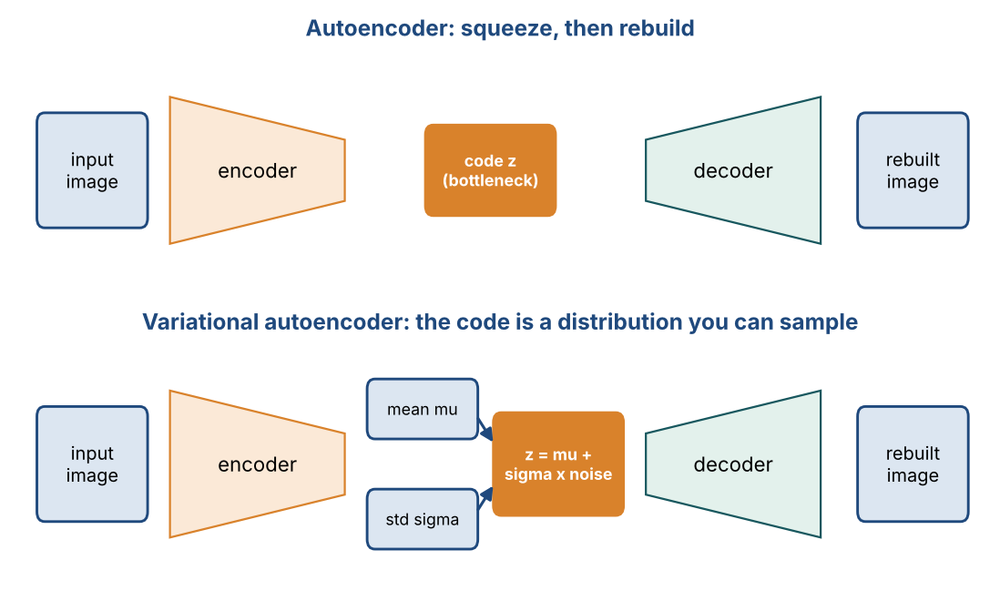
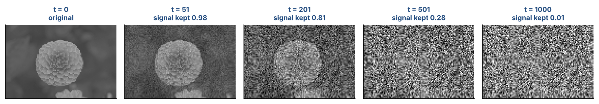

# Chapter 30 — Applications of Generative AI: VAEs, Diffusion Models & LLM Agents

**Part IV — Transformers & Generative AI** · [](https://colab.research.google.com/github/winnertechserv/aimlgybs/blob/main/part4_transformers_genai/ch30_applications_of_generative_ai/ch30_notebook.ipynb)

Companion code for Chapter 30 of *AI-Machine Learning: Get Your Base Strong*. The book explains the ideas; this folder lets you run them.

## Key ideas

- Generative AI creates new content across text, images, video, speech and code, rather than only analyzing data.
- A VAE encodes an input into a distribution, and the reparameterization trick keeps that sampling differentiable.
- The KL term in the VAE loss shapes the latent space so that sampling from it produces realistic outputs.
- Diffusion models systematically destroy structure with noise and then learn to reverse the process step by step.
- Decoding strategy matters: beam search explores several partial sequences and usually beats greedy search.
- Hallucination, bias, privacy and interpretability are genuine risks, especially in healthcare applications.

## Examples

| # | Program | What it shows |
|---|---|---|
| 1 | [`ex1_from_autoencoder_to_variational_autoencoder.py`](ex1_from_autoencoder_to_variational_autoencoder.py) | This contrasts the deterministic AANN, which maps an input to a single bottleneck point, with the VAE, whose encoder outputs a mean and log-variance. |
| 2 | [`ex2_diffusion_forward_and_reverse_processes.py`](ex2_diffusion_forward_and_reverse_processes.py) | This builds the forward diffusion equation step by step, tracking how correlation with the original data decays until x_T is essentially Gaussian noise. |
| 3 | [`ex3_greedy_search_vs_beam_search_decoding.py`](ex3_greedy_search_vs_beam_search_decoding.py) | Decoding strategy is one of the LLM components covered in this chapter. |

Run any example from this folder:

```bash
cd part4_transformers_genai/ch30_applications_of_generative_ai
python ex1_from_autoencoder_to_variational_autoencoder.py
```

The exact output printed in the book is in [`expected_output/`](expected_output). The notebook [`ch30_notebook.ipynb`](ch30_notebook.ipynb) has all three examples with explanations.

### Example 1: From Autoencoder to Variational Autoencoder

This contrasts the deterministic AANN, which maps an input to a single bottleneck point, with the VAE, whose encoder outputs a mean and log-variance. It then shows the reparameterization trick, z = mu + sigma*eps, showing that the same input yields different latent samples each time, and computes both parts of the VAE loss including the KL term that pulls the latent distribution toward N(0,I).

<details><summary>Expected output</summary>

```text
=== From Autoencoder to Variational Autoencoder ===

AANN / deterministic autoencoder: encoder maps x to a SINGLE point
in the bottleneck (dimension-reduction) layer.
VAE: encoder maps x to a DISTRIBUTION (mean + std) in latent space,
and the decoder samples from it -> we can GENERATE new data.

Input image x (8-dim): [ 1.76  0.4   0.98  2.24  1.87 -0.98  0.95 -0.15]

--- Deterministic Autoencoder (AANN) ---
  bottleneck code h : [-0.912   0.3283  0.9376]   (one fixed point)
  reconstruction    : [-0.419  0.456 -0.433  0.344 -0.707 -0.939 -0.034  0.373]
  reconstruction MSE: 2.2784
  Sampling a random h gives arbitrary output - the latent space
  has no structure, so this model is a poor generator.

--- Variational Autoencoder (VAE) ---

Step 1 - encoder outputs a distribution per dimension:
  mu     = [-1.2316 -2.6813  0.6753]
  logvar = [0.3487 1.3959 1.5307]
  sigma  = exp(0.5*logvar) = [1.1905 2.0096 2.1497]

Step 2 - REPARAMETERIZATION TRICK:  z = mu + sigma * epsilon,  eps~N(0,I)
  (sampling directly from N(mu,sigma) is not differentiable;
   moving the randomness into eps makes backpropagation possible)

  draw 1: eps = [-1.173  1.944 -0.414] -> z = [-2.6281  1.2247 -0.2139]
  draw 2: eps = [-0.747  1.923  1.481] -> z = [-2.1214  1.1831  3.8579]
  draw 3: eps = [ 1.868  0.906 -0.861] -> z = [ 0.9917 -0.8605 -1.1761]
  Same input x, different z each time -> the decoder generates variety.

Step 3 - VAE loss = reconstruction loss + KL divergence

  Reconstruction loss (MSE)          : 3.3816
  KL( q(z|x) || N(0,I) )             : 6.4821
  Total loss = recon + beta*KL       : 9.8637

  The KL term pulls the latent distribution toward N(0,I), which
  makes the latent space smooth and continuous - so sampling
  z ~ N(0,I) at test time produces realistic new images.

KL for special cases (per dimension):
  mu=+0.0, logvar=+0.0 -> KL = -0.0000   (perfect match to N(0,1))
  mu=+2.0, logvar=+0.0 -> KL = 2.0000   (mean far from 0)
  mu=+0.0, logvar=+2.0 -> KL = 2.1945   (variance mismatch)
  mu=+0.0, logvar=-2.0 -> KL = 0.5677   (variance mismatch)

--- Denoising Autoencoder ---
  Trained on (noisy image, clean image) pairs; at test time a noisy
  input produces a denoised output. The decoder learns to GENERATE.
```

</details>

### Example 2: Diffusion Forward and Reverse Processes

This builds the forward diffusion equation step by step, tracking how correlation with the original data decays until x_T is essentially Gaussian noise. It also shows the closed-form shortcut using alpha_bar, then runs the reverse process with a deliberately imperfect denoiser, so you can watch the error fall from 0.78 to 0.03 as structure is progressively restored.

<details><summary>Expected output</summary>

```text
=== Diffusion Models: Forward and Reverse Processes ===

Forward diffusion : slowly DESTROY structure by adding noise
Reverse diffusion : learn to RESTORE structure, turning noise into data

Forward step:
  x_t = sqrt(1 - beta_t) * x_(t-1) + sqrt(beta_t) * eps ,  eps ~ N(0, I)
  As T -> infinity, x_T ~ N(0, I)  (pure noise)

Original data x_0 : [ 1.   0.8 -0.6 -1.   0.4]
Noise schedule beta_t from 0.05 to 0.35 over T=12 steps

--- Forward Diffusion Process (adding noise step by step) ---

  t   beta_t  x_t                                         corr with x_0
--------------------------------------------------------------------------
  1    0.050  [ 1.34  0.64 -0.7  -1.21  0.58]                    0.9854
  4    0.132  [ 0.61  0.29 -1.2  -1.05  0.99]                    0.8740
  7    0.214  [-0.48  0.35 -1.27 -1.1   0.9 ]                    0.6743
 10    0.295  [-0.74 -0.46  0.11  0.7   1.18]                   -0.5317
 12    0.350  [-0.    0.03  0.1   0.47  1.21]                   -0.1340

Final x_T mean = +0.362, std = 0.459
The structure of x_0 is essentially destroyed -> x_T is nearly N(0,I).

--- Closed-form shortcut ---

Instead of looping, we can jump directly to step t:
  x_t = sqrt(alpha_bar_t) * x_0 + sqrt(1 - alpha_bar_t) * eps

  t   alpha_bar_t   signal kept   noise added
----------------------------------------------
  1        0.9500        0.9747        0.2236
  4        0.6815        0.8255        0.5644
  7        0.3667        0.6055        0.7958
 10        0.1435        0.3788        0.9255
 12        0.0632        0.2513        0.9679

Signal decays and noise grows monotonically - that is the whole schedule.

--- Reverse Diffusion Process (denoising) ---

A neural network (a U-Net with conv blocks, self-attention, GroupNorm,
GELU/SiLU activations) predicts the noise eps at each step, and we
subtract it to step back from x_t to x_(t-1).

Start from pure noise x_T : [-0.005  0.031  0.099  0.47   1.214]
Stepping backwards, each step removes a little predicted noise:

 step t  x_t                                       err vs x_0
--------------------------------------------------------------
     11  [ 0.426  0.346  0.154  0.365 -0.361]          0.7815
      8  [ 0.36   0.305 -0.247 -0.586  0.323]          0.3960
      5  [ 1.002  1.019 -0.543 -1.231  0.698]          0.1615
      2  [ 0.949  0.914 -0.651 -1.095  0.224]          0.0974
      0  [ 1.022  0.769 -0.687 -0.991  0.398]          0.0301

Recovered x_0             : [ 1.022  0.769 -0.687 -0.991  0.398]
Original  x_0             : [ 1.   0.8 -0.6 -1.   0.4]
Mean absolute error       : 0.0301
The reverse process progressively recovers the structure. It is not
exact because the denoising network is only an approximation - which
is also why real diffusion models use hundreds of small steps.

=== DALL-E 2 text-to-image pipeline ===
  1. CLIP text encoder  : caption -> text representation
  2. Diffusion prior    : text encoding -> CLIP image encoding
  3. Reverse diffusion  : image encoding -> final generated image
```

</details>

### Example 3: Greedy Search vs Beam Search Decoding

Decoding strategy is one of the LLM components covered in this chapter. Using a small language model, greedy search takes the single most likely word at each step and gets trapped. Beam search instead keeps the B best partial sequences and ends up with a far higher overall probability. It is a concrete illustration of why beam search is worth its extra cost.

<details><summary>Expected output</summary>

```text
=== Decoding Strategies in LLMs: Greedy vs Beam Search ===

After the model produces probabilities over the vocabulary at each
step, a DECODING STRATEGY chooses the actual output words.

Toy language model P(next | current):

  current         the      cat      sat      mat    <end>
  <start>        0.60     0.25     0.05     0.05     0.05
  the            0.05     0.45     0.10     0.35     0.05
  cat            0.05     0.05     0.70     0.10     0.10
  sat            0.50     0.05     0.05     0.30     0.10
  mat            0.05     0.05     0.05     0.05     0.80
  <end>          0.00     0.00     0.00     0.00     1.00

--- Greedy Search: always take the single most likely next word ---

  step 1: pick 'the' (p=0.60)   sequence so far: the
  step 2: pick 'cat' (p=0.45)   sequence so far: the cat
  step 3: pick 'sat' (p=0.70)   sequence so far: the cat sat
  step 4: pick 'the' (p=0.50)   sequence so far: the cat sat the
  step 5: pick 'cat' (p=0.45)   sequence so far: the cat sat the cat

  Greedy result : the cat sat the cat
  log-probability: -3.1577   (probability 0.04252)

--- Beam Search: keep the B best partial sequences at every step ---

  After step 1, top 3 beams:
     the                          logP = -0.5108
     cat                          logP = -1.3863
     sat                          logP = -2.9957
  After step 2, top 3 beams:
     the cat                      logP = -1.3093
     the mat                      logP = -1.5606
     cat sat                      logP = -1.7430
  After step 3, top 3 beams:
     the cat sat                  logP = -1.6660
     the mat <end>                logP = -1.7838
     cat sat the                  logP = -2.4361
  After step 4, top 3 beams:
     the mat <end>                logP = -1.7838
     the cat sat the              logP = -2.3592
     the cat sat mat              logP = -2.8700
  After step 5, top 3 beams:
     the mat <end>                logP = -1.7838
     the cat sat mat <end>        logP = -3.0931
     the cat sat the cat          logP = -3.1577

  Beam search result : the mat <end>
  log-probability    : -1.7838   (probability 0.16800)

=== Comparison ===

  Strategy        Sequence                            logP
  --------------------------------------------------------
  Greedy          the cat sat the cat              -3.1577
  Beam (B=3)      the mat <end>                    -1.7838

  Higher log-probability found by: beam search

  Greedy is fast but can be trapped by a locally attractive word.
  Beam search explores B alternatives and usually finds a better
  overall sequence, at B times the computation cost.
```

</details>

## Figures from this chapter

**Figure 30.1.** Top: an autoencoder squeezes an image into a code and rebuilds it. Bottom: a VAE encodes a mean and spread instead, and samples the code, so new codes give new images.



**Figure 30.2.** The forward diffusion process on a real photo (1,000 steps, linear noise schedule). The model learns to run this in reverse, turning pure noise back into an image.



The code that draws these figures is in [`figures/src`](../../figures/src).

---

[← Chapter 29](../../part4_transformers_genai/ch29_generative_adversarial_networks_ii) · [All chapters](../../README.md#chapters) · [Chapter 31 →](../../part5_production_rl/ch31_mlops)
