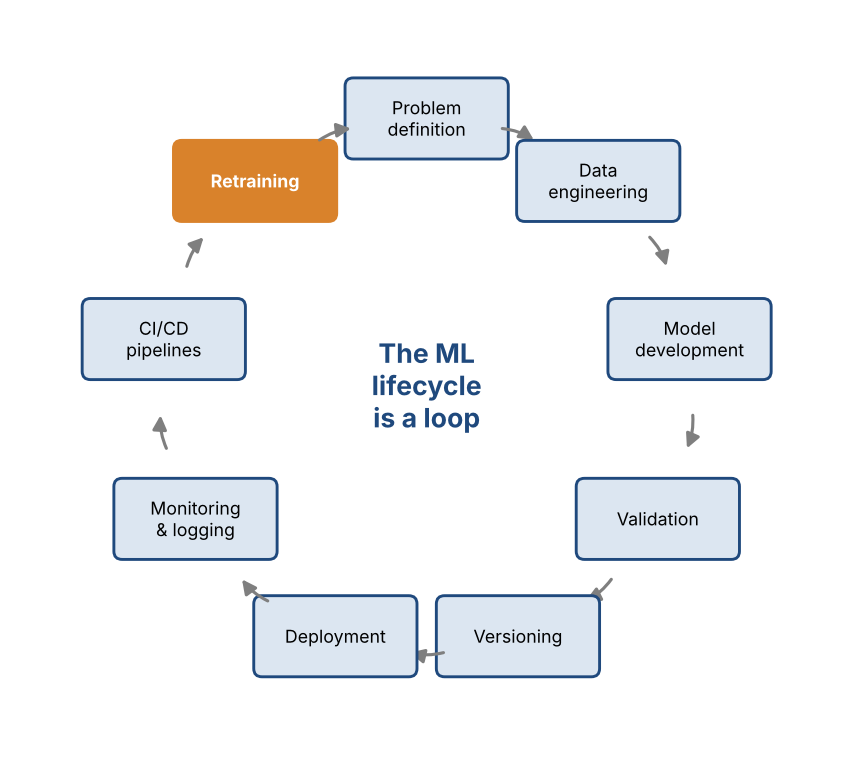
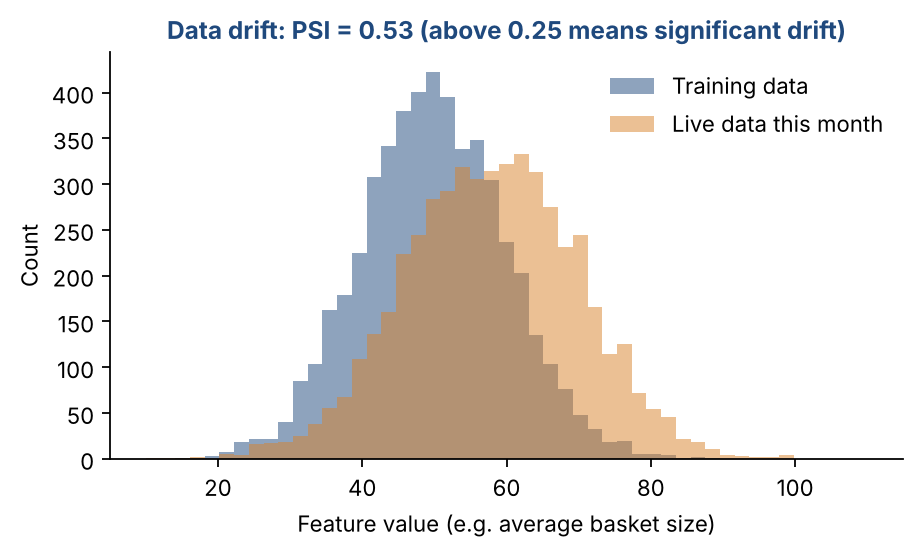

# Chapter 31 — MLOps: The Machine Learning Lifecycle in Production

**Part V — Production & Reinforcement Learning** · [](https://colab.research.google.com/github/winnertechserv/aimlgybs/blob/main/part5_production_rl/ch31_mlops/ch31_notebook.ipynb)

Companion code for Chapter 31 of *AI-Machine Learning: Get Your Base Strong*. The book explains the ideas; this folder lets you run them.

## Key ideas

- MLOps combines machine learning with DevOps to automate the entire model lifecycle.
- A model that works in a notebook is not a product; production brings unpredictable data, traffic and scale.
- Track every experiment and version models, data and code together, or you cannot reproduce or debug anything.
- Monitor continuously for data drift and performance decay, and retrain on a schedule, on drift, or on degradation.
- Versioning plus a registry is what makes a fast, safe rollback possible when a new model misbehaves.

## Examples

| # | Program | What it shows |
|---|---|---|
| 1 | [`ex1_experiment_tracking_what_mlflow_does.py`](ex1_experiment_tracking_what_mlflow_does.py) | This builds a miniature MLflow: every run logs its parameters, metrics and an artifact hash, then all runs are compared side by side exactly as the MLflow UI shows them. |
| 2 | [`ex2_model_registry_with_versioning_and_rollback.py`](ex2_model_registry_with_versioning_and_rollback.py) | This builds the registry concepts described above: register successive versions with their data hash and code commit, promote through Staging to Production, and - when v3 degrades in production - roll back to the last known-good version in one step. |
| 3 | [`ex3_drift_detection_triggering_retraining.py`](ex3_drift_detection_triggering_retraining.py) | This is the monitoring stage in code. |

Run any example from this folder:

```bash
cd part5_production_rl/ch31_mlops
python ex1_experiment_tracking_what_mlflow_does.py
```

The exact output printed in the book is in [`expected_output/`](expected_output). The notebook [`ch31_notebook.ipynb`](ch31_notebook.ipynb) has all three examples with explanations.

### Example 1: Experiment Tracking (What MLflow Does)

This builds a miniature MLflow: every run logs its parameters, metrics and an artifact hash, then all runs are compared side by side exactly as the MLflow UI shows them. Five model configurations are trained and the best is selected from the logs, and the train-test gap column shows how logged metrics let you spot overfitting without rerunning anything.

<details><summary>Expected output</summary>

```text
=== Experiment Tracking (the core of MLflow) ===

Without tracking you cannot answer: which run produced this model?
what data and hyperparameters were used? can we reproduce it?

Dataset: 569 samples, 30 features

Running experiments and logging every run...

  run 5a0a2d82 | logreg         | {'model': 'LogisticRegression', 'C': 0.1}        | test_acc=0.9883
  run 612da96f | logreg         | {'model': 'LogisticRegression', 'C': 1.0}        | test_acc=0.9825
  run a35a4b4f | logreg         | {'model': 'LogisticRegression', 'C': 10.0}       | test_acc=0.9766
  run 526014c4 | random_forest  | {'model': 'RandomForest', 'n_estimators': 50}    | test_acc=0.9708
  run 821b0f28 | random_forest  | {'model': 'RandomForest', 'n_estimators': 200}   | test_acc=0.9649

=== Run Comparison (what the MLflow UI shows) ===

run_id    experiment       train_acc  test_acc  test_f1  artifact
------------------------------------------------------------------------------
5a0a2d82  logreg              0.9774    0.9883   0.9908  85f20695a1bc
612da96f  logreg              0.9874    0.9825    0.986  a4b0a1c69faf
a35a4b4f  logreg              0.9899    0.9766   0.9813  ec4a28574858
526014c4  random_forest          1.0    0.9708   0.9772  b1b0ea773e90
821b0f28  random_forest          1.0    0.9649   0.9725  f2e26ff1c0f0

Best run: 5a0a2d82  ({'model': 'LogisticRegression', 'C': 0.1})
  test accuracy = 0.9883

=== Generalization check from logged metrics ===

  5a0a2d82  train-test gap = -0.0109  [ok]
  612da96f  train-test gap = +0.0049  [ok]
  a35a4b4f  train-test gap = +0.0133  [ok]
  526014c4  train-test gap = +0.0292  [ok]
  821b0f28  train-test gap = +0.0351  [ok]

All runs persisted to mlruns.json (1444 bytes)
This is exactly what MLflow does: log params, metrics and artifacts
for every run so results are comparable, auditable and reproducible.
```

</details>

### Example 2: Model Registry with Versioning and Rollback

This builds the registry concepts described above: register successive versions with their data hash and code commit, promote through Staging to Production, and - when v3 degrades in production - roll back to the last known-good version in one step. The audit trail at the end is exactly what a postmortem or a regulator would ask for.

<details><summary>Expected output</summary>

```text
=== Model Registry: Versioning, Promotion and Rollback ===

A registry answers: which model is in production RIGHT NOW, what data
and code produced it, and how do we roll back if it misbehaves?

--- Registering successive model versions ---

  ver  registered    test_acc  latency_ms  stage       data      commit
  ------------------------------------------------------------------------------
  v1   2026-03-11       0.842          21  None        d1a3f9    a91c4e2
  v2   2026-03-12       0.871          24  None        d1a3f9    b32d81f
  v3   2026-03-13       0.889          26  None        e77b21    c4419aa

--- Promote v2 to Production ---
  ver  registered    test_acc  latency_ms  stage       data      commit
  ------------------------------------------------------------------------------
  v1   2026-03-11       0.842          21  None        d1a3f9    a91c4e2
  v2   2026-03-12       0.871          24  Production  d1a3f9    b32d81f
  v3   2026-03-13       0.889          26  None        e77b21    c4419aa

--- v3 looks better offline: promote to Staging, then Production ---
  ver  registered    test_acc  latency_ms  stage       data      commit
  ------------------------------------------------------------------------------
  v1   2026-03-11       0.842          21  None        d1a3f9    a91c4e2
  v2   2026-03-12       0.871          24  Archived    d1a3f9    b32d81f
  v3   2026-03-13       0.889          26  Production  e77b21    c4419aa

--- INCIDENT: v3 degrades in production (data mismatch) ---
  Live monitoring: accuracy dropped to 0.71, error rate up 3x
  Action: roll back to the last known-good version (v2)

  ver  registered    test_acc  latency_ms  stage       data      commit
  ------------------------------------------------------------------------------
  v1   2026-03-11       0.842          21  None        d1a3f9    a91c4e2
  v2   2026-03-12       0.871          24  Production  d1a3f9    b32d81f
  v3   2026-03-13       0.889          26  Archived    e77b21    c4419aa

--- Audit trail (what regulators / postmortems need) ---
  1. registered v1
  2. registered v2
  3. registered v3
  4. v2 -> Production
  5. v3 -> Staging
  6. v3 -> Production (v2 archived)
  7. v2 -> Production (v3 archived)

=== Why versioning matters ===
  * Compare: a model trained in January differs from one trained in March
  * Roll back quickly to a stable model, minimizing downtime
  * Reproducibility: model + data + code are versioned together
  * Tools: Git (code), DVC / LakeFS (data), MLflow (models/metrics),
           SageMaker Model Registry (cloud model versions)

=== Reproducibility check ===

Re-running v2 with the SAME data hash and code commit should give
the same metrics. If it does not, something untracked has changed.
  original v2 metrics : {'test_acc': 0.871, 'latency_ms': 24}
  re-run metrics      : {'test_acc': 0.871, 'latency_ms': 24}
  reproducible?       : True
```

</details>

### Example 3: Drift Detection Triggering Retraining

This is the monitoring stage in code. It computes the Population Stability Index and a Kolmogorov-Smirnov test across four months of production data, tracks the model's accuracy decay against its deployment baseline, and then applies trigger logic combining drift, performance drop and elapsed time to decide automatically when retraining should fire.

<details><summary>Expected output</summary>

```text
=== Monitoring: Detecting Drift and Triggering Retraining ===

A deployed model silently decays when the world changes. Monitoring
must detect (a) INPUT DATA DRIFT and (b) MODEL PERFORMANCE DROP.

--- Input Data Drift: PSI and Kolmogorov-Smirnov test ---

Production window                  PSI   KS stat    p-value  Verdict
----------------------------------------------------------------------------
  Month 1 (same as training)    0.0039    0.0255   5.34e-01  no significant drift
  Month 2 (slight shift)        0.0249    0.0595   1.68e-03  no significant drift
  Month 3 (moderate shift)      0.1646    0.1715   4.30e-26  MODERATE drift - watch
  Month 4 (major shift)         0.6911    0.3435  5.30e-105  MAJOR drift - retrain

--- Model Performance Drift ---

Baseline test accuracy at deployment: 0.912
Alert threshold: relative drop > 5%

Window        Accuracy      Drop  Action
--------------------------------------------------------
  Month 1        0.909      0.3%  continue monitoring
  Month 2        0.901      1.2%  continue monitoring
  Month 3        0.874      4.2%  continue monitoring
  Month 4        0.812     11.0%  TRIGGER RETRAINING

--- Automated Retraining Trigger Logic ---

  Month 1: PSI=0.02, drop=0.3%, 7d since training -> no action
  Month 3: PSI=0.18, drop=4.2%, 21d since training -> no action
  Month 4: PSI=0.41, drop=11.0%, 35d since training -> RETRAIN
      reason: data drift PSI=0.410
      reason: accuracy drop 11.0%
      reason: scheduled (35 days)

=== Retraining triggers ===
  1. Scheduled intervals   - e.g. retail forecasting retrains weekly
  2. Data / model drift    - ride-sharing model after a big city event
  3. Performance drop      - fraud detection when errors spike

Tools: Prometheus (infrastructure), Evidently AI (data drift & ML
metrics), CloudWatch (cloud apps); Airflow / Kubeflow run the pipeline.
```

</details>

## Figures from this chapter

**Figure 31.1.** The nine stages of the ML lifecycle. Retraining feeds back into the start, which turns deployment into a loop rather than a one-off task.



**Figure 31.2.** Drift: the live data has moved away from the data the model was trained on. The Population Stability Index (PSI) puts a number on how far.



The code that draws these figures is in [`figures/src`](../../figures/src).

---

[← Chapter 30](../../part4_transformers_genai/ch30_applications_of_generative_ai) · [All chapters](../../README.md#chapters) · [Chapter 32 →](../../part5_production_rl/ch32_cloud_deployment)
