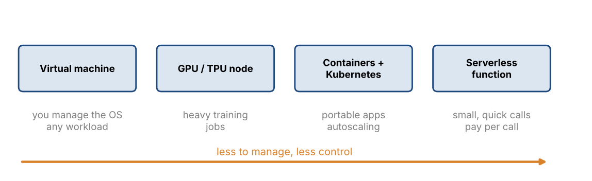
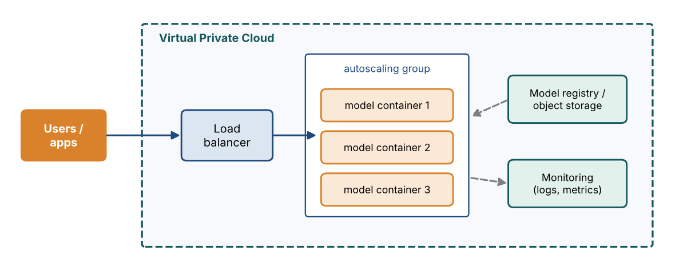
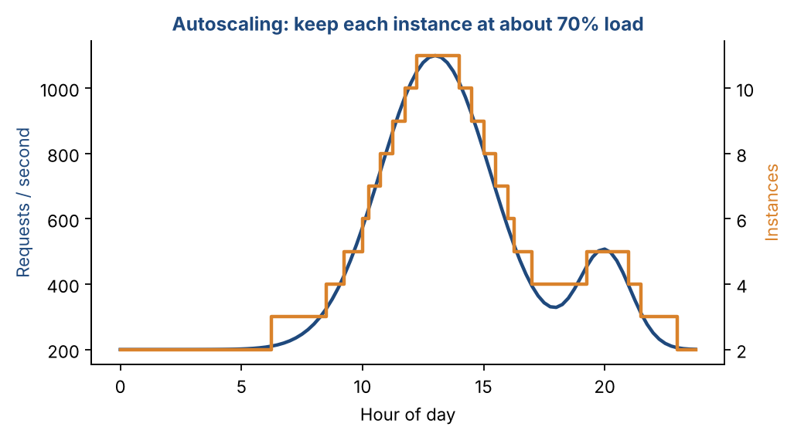

# Chapter 32 — Cloud Deployment: Compute, Containers, Scaling & Serverless

**Part V — Production & Reinforcement Learning** · [](https://colab.research.google.com/github/winnertechserv/aimlgybs/blob/main/part5_production_rl/ch32_cloud_deployment/ch32_notebook.ipynb)

Companion code for Chapter 32 of *AI-Machine Learning: Get Your Base Strong*. The book explains the ideas; this folder lets you run them.

## Key ideas

- Match the compute to the workload: virtual machines for control, GPU and TPU nodes for training, serverless for light inference.
- Object storage suits datasets and artifacts, block storage suits active training, file storage suits distributed jobs.
- Containers bundle code, dependencies and runtime, which eliminates environment drift between laptop, CI and production.
- Horizontal scaling adds machines or pods; vertical scaling grows one machine and is capped by hardware.
- Spot and preemptible instances cut cost by 70 to 90 percent for fault-tolerant work, provided you checkpoint.
- Serverless cannot train large models: execution time, memory and the absence of GPUs are hard limits.

## Examples

| # | Program | What it shows |
|---|---|---|
| 1 | [`ex1_autoscaling_simulation.py`](ex1_autoscaling_simulation.py) | This runs the Kubernetes HPA control loop over a realistic 24-hour traffic curve: monitor utilization, compare with the target, and adjust replica count. |
| 2 | [`ex2_cost_model_on_demand_vs_spot_vs_serverless.py`](ex2_cost_model_on_demand_vs_spot_vs_serverless.py) | This quantifies the cost decisions described above. |
| 3 | [`ex3_batch_vs_streaming_and_container_reproducibil.py`](ex3_batch_vs_streaming_and_container_reproducibil.py) | The first half compares batch and streaming architectures on latency and throughput and simulates a traffic burst, showing how a backlog forms when arrivals exceed capacity - the exact problem autoscaling solves. |

Run any example from this folder:

```bash
cd part5_production_rl/ch32_cloud_deployment
python ex1_autoscaling_simulation.py
```

The exact output printed in the book is in [`expected_output/`](expected_output). The notebook [`ch32_notebook.ipynb`](ch32_notebook.ipynb) has all three examples with explanations.

### Example 1: Autoscaling Simulation

This runs the Kubernetes HPA control loop over a realistic 24-hour traffic curve: monitor utilization, compare with the target, and adjust replica count. The comparison at the end quantifies the trade-off - autoscaling holds latency within SLA at 55% of the cost of permanent over-provisioning, whereas fixed capacity is cheaper but breaches the SLA in 14 of 24 hours.

<details><summary>Expected output</summary>

```text
=== Cloud Autoscaling for ML Inference ===

Scalability = adjust capacity to match demand while keeping latency
stable. The control loop:
  monitor metrics -> evaluate thresholds -> adjust capacity -> stabilize

Config: 100 req/s per replica, target CPU 70%, min=2, max=20 replicas

 hour   req/s  replicas    util   latency  action
--------------------------------------------------------------
    0     120         2     60%      100ms  hold
    3      60         2     30%       57ms  hold
    6     220         4     55%       89ms  scale UP
    9     780        12     65%      114ms  scale UP
   12    1180        17     69%      131ms  scale UP
   15     820        12     68%      126ms  scale DOWN
   18    1320        19     69%      131ms  scale UP
   21     520         8     65%      114ms  scale DOWN

=== Autoscaling vs Fixed Capacity (24 hours) ===

Strategy                            pod-hours      cost  SLA breaches
----------------------------------------------------------------------
  Autoscaling (2-20 replicas)             218$    21.80             0
  Fixed 6 replicas                        144$    14.40            14
  Over-provisioned 20 replicas            480$    48.00             0

Autoscaling saves 55% versus permanent over-provisioning,
while keeping SLA breaches at 0 (fixed capacity: 14).

=== Types of autoscaling ===
  Instance autoscaling : VM level - EC2 Auto Scaling Groups, GCE Instance Groups
  Container autoscaling: pod level - Kubernetes HPA (horizontal) and VPA (vertical)
  Serverless autoscaling: function level - scales to ZERO when idle, pay per call

Horizontal scaling adds machines/pods; vertical scaling grows one machine
(more CPU/RAM/GPU) and is limited by the largest available hardware.
```

</details>

### Example 2: Cost Model - On-Demand vs Spot vs Serverless

This quantifies the cost decisions described above. For a 200 GPU-hour training job, spot instances save about 71% even after accounting for interruptions and checkpointing overhead. For inference, it computes the break-even point between always-on containers and serverless - below roughly 30 million requests a month serverless wins, above it a container does.

<details><summary>Expected output</summary>

```text
=== Choosing Compute: On-Demand vs Spot vs Serverless ===

--- Workload A: TRAINING a deep model (fault-tolerant, batch) ---

  Job size: 200 GPU-hours
  Option                              rate $/h    hours      total
  ----------------------------------------------------------------
  On-demand GPU                           3.06      200     612.00
  Spot / preemptible GPU                  0.77      234     179.01

  Saving with spot: $432.99 (71%)
  Spot requires checkpointing: interrupted work must resume, not restart.
  Suitable for batch training, ETL and hyperparameter tuning;
  NOT suitable for latency-critical production inference.

--- Workload B: INFERENCE endpoint (latency sensitive) ---

    Requests/month   Always-on container   Serverless (FaaS)  Cheaper
  ------------------------------------------------------------------------------
            10,000                $69.12               $0.02  serverless
           100,000                $69.12               $0.23  serverless
         1,000,000                $69.12               $2.28  serverless
        10,000,000                $69.12              $22.83  serverless
        50,000,000                $69.12             $114.17  container

  Break-even point: about 30,271,478 requests/month
  Below it, serverless is cheaper (scale-to-zero when idle).
  Above it, an always-on container is cheaper and avoids cold starts.

=== Choosing the right service ===

  Need                          Recommended
  --------------------------------------------------------------------------
  Large distributed training    GPU/TPU nodes on SageMaker, Vertex AI, Azure ML
  Custom model serving          Containers on GKE / EKS / AKS or ECS-Fargate
  Lightweight inference         Serverless: AWS Lambda, Cloud Functions, Azure Functions
  Feature storage & serving     BigQuery, DynamoDB, Cosmos DB
  Cost-sensitive batch jobs     Spot / preemptible instances with checkpointing

  Serverless limits: execution time caps, limited memory/CPU, no GPU,
  cold-start latency, and statelessness - so it cannot train large models.
```

</details>

### Example 3: Batch vs Streaming, and Container Reproducibility

The first half compares batch and streaming architectures on latency and throughput and simulates a traffic burst, showing how a backlog forms when arrivals exceed capacity - the exact problem autoscaling solves. The second half shows how a Dockerfile pins the whole environment so that three machines that would otherwise drift on Python, numpy and sklearn versions become identical.

<details><summary>Expected output</summary>

```text
=== Batch vs Streaming Architectures ===

Batch     : process large volumes at scheduled intervals (retraining, ETL)
Streaming : process records in real time as they arrive (fraud, IoT)

Workload: 10,000 events arriving at 500/s

  Metric                                       Batch       Streaming
  ------------------------------------------------------------------
  Processing trigger                    every 60 min       per event
  End-to-end latency                       1802.0 s           12 ms
  Throughput                                5,000/s          600/s
  Compute utilization                         bursty      continuous
  Relative cost                                lower          higher

  Latency difference: 150,167x

  Choose BATCH     : scheduled retraining, historical scoring, ETL
  Choose STREAMING : fraud detection, live recommendations, IoT analytics
  Tools for streaming: Pub/Sub, Kinesis, Event Hub
  HYBRID is common: stream for real-time decisions, batch for retraining.

--- Streaming queue behavior during a burst ---

   window  arrivals/s  capacity/s   queue    latency
  ----------------------------------------------------
        1         300         600       0       12ms
        2         350         600       0       12ms
        3         900         600     300      512ms  <-- backlog
        4        1200         600     900     1512ms  <-- backlog
        5        1100         600    1400     2345ms  <-- backlog
        6         400         600    1200     2012ms  <-- backlog
        7         320         600     920     1545ms  <-- backlog
        8         300         600     620     1045ms  <-- backlog

  A sustained burst above capacity builds a backlog and latency grows.
  This is exactly what autoscaling (adding consumers) is meant to fix.

=== Containerization: solving 'works on my machine' ===

Dockerfile (pins the ENTIRE environment):
    FROM python:3.10-slim
    RUN pip install numpy==2.4.4 scikit-learn==1.8.0 pandas==3.0.2
    COPY model.pkl /app/model.pkl
    COPY serve.py  /app/serve.py
    CMD ["python", "/app/serve.py"]

  Image digest: sha256:bcff684785d9ef65
  Same Dockerfile -> same digest -> identical environment everywhere.

  Environment                          python    numpy   sklearn  Matches pinned?
  ------------------------------------------------------------------------------
  Developer laptop (no container)      3.11.2    2.1.0     1.6.0  NO - drift
  CI server (no container)             3.9.16    2.4.4     1.8.0  NO - drift
  Production VM (no container)         3.10.9    2.0.1     1.7.1  NO - drift
  Any machine WITH the container         3.10    2.4.4     1.8.0  yes

  Containers bundle code + dependencies + runtime into one image, so
  CUDA/cuDNN versions, library versions and the OS layer stay identical
  across training, CI, and production.
```

</details>

## Figures from this chapter

**Figure 32.1.** Cloud compute options, from full control (a virtual machine) to almost nothing to manage (serverless).



**Figure 32.2.** A typical model-serving setup: requests pass through a load balancer to an autoscaling group of model containers, all inside a private network.



**Figure 32.3.** Autoscaling over one day. Each instance handles 150 requests per second; the scaler adds or removes instances to keep them near 70% busy, with a minimum of two.



The code that draws these figures is in [`figures/src`](../../figures/src).

---

[← Chapter 31](../../part5_production_rl/ch31_mlops) · [All chapters](../../README.md#chapters) · [Chapter 33 →](../../part5_production_rl/ch33_reinforcement_learning_i)
