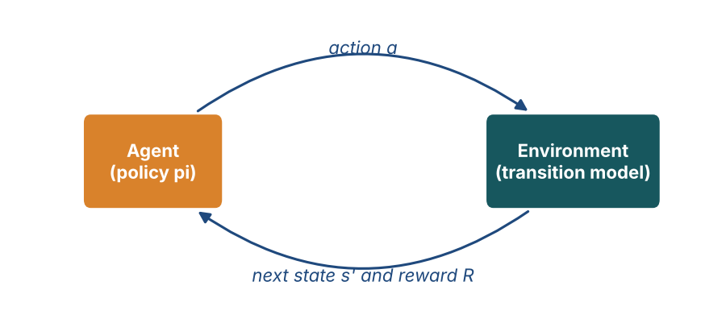
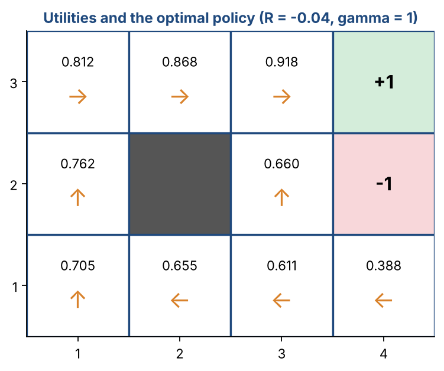
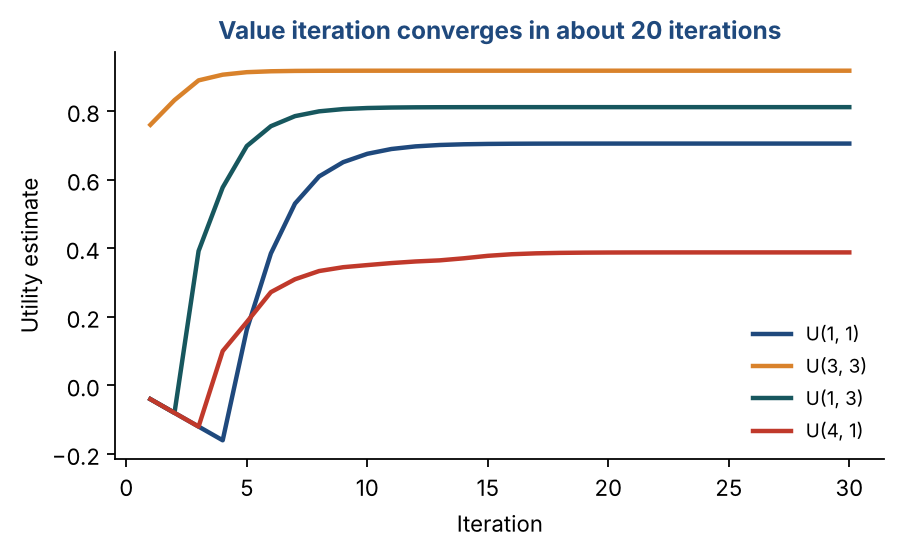

# Chapter 33 — Reinforcement Learning I: MDPs, Bellman Equation & Value Iteration

**Part V — Production & Reinforcement Learning** · [](https://colab.research.google.com/github/winnertechserv/aimlgybs/blob/main/part5_production_rl/ch33_reinforcement_learning_i/ch33_notebook.ipynb)

Companion code for Chapter 33 of *AI-Machine Learning: Get Your Base Strong*. The book explains the ideas; this folder lets you run them.

## Key ideas

- Reinforcement learning learns from delayed reward by trial and error, with no labelled examples anywhere.
- It suits problems that are easy to evaluate but hard to specify, such as playing chess well.
- An MDP is defined by states, actions, a transition model and a reward function, and the Markov property keeps it tractable.
- The discount factor gamma sets how far ahead the agent cares: near 0 is short-sighted, near 1 is patient.
- The Bellman equation links a state's utility to its neighbours', and value iteration solves it by repeated updates.
- Q-learning reaches the same optimal policy without ever knowing the transition probabilities, learning purely from experience.

## Examples

| # | Program | What it shows |
|---|---|---|
| 1 | [`ex1_value_iteration_on_the_4x3_grid_world.py`](ex1_value_iteration_on_the_4x3_grid_world.py) | This solves the classic 4x3 grid world: wall at (2,2), terminal states +1 and -1, step reward -0.04, and actions succeeding with probability 0.8 while slipping sideways with probability 0.1 each. |
| 2 | [`ex2_q_learning_on_the_same_grid_world.py`](ex2_q_learning_on_the_same_grid_world.py) | Value iteration needed the transition model; Q-learning does not. |
| 3 | [`ex3_exploration_vs_exploitation_and_td_0.py`](ex3_exploration_vs_exploitation_and_td_0.py) | The bandit experiment quantifies the central RL dilemma: pure exploitation never finds the best arm, pure exploration never capitalises on what it learns, and a moderate epsilon does best. |

Run any example from this folder:

```bash
cd part5_production_rl/ch33_reinforcement_learning_i
python ex1_value_iteration_on_the_4x3_grid_world.py
```

The exact output printed in the book is in [`expected_output/`](expected_output). The notebook [`ch33_notebook.ipynb`](ch33_notebook.ipynb) has all three examples with explanations.

### Example 1: Value Iteration on the 4x3 Grid World

This solves the classic 4x3 grid world: wall at (2,2), terminal states +1 and -1, step reward -0.04, and actions succeeding with probability 0.8 while slipping sideways with probability 0.1 each. Applying the Bellman update repeatedly converges in 22 iterations to the published utilities - U(1,1)=0.705, U(1,3)=0.812, U(3,3)=0.918 - and the extracted policy routes the agent safely around the wall.

<details><summary>Expected output</summary>

```text
=== Value Iteration on the 4x3 Grid World ===

Grid (column, row), (1,1) is bottom-left:

     3 | . . . +1
     2 | . # . -1        # = wall/forbidden square (2,2)
     1 | S . . .         S = START
       +---------
       1 2 3 4

Stochastic environment: the intended action succeeds with p=0.8,
and moves at right angles with p=0.1 each. Bumping into a wall
leaves the agent in the same square.
Reward: -0.04 for every non-terminal transition. Discount gamma=1.0

Bellman update:  U(s) <- max_a  sum_s' P(s'|s,a) [ R(s,a,s') + gamma*U(s') ]

 iter    U(1,1)    U(1,3)    U(3,3)    U(4,1)   max change
----------------------------------------------------------
    1   -0.0400   -0.0400    0.7600   -0.0400     0.760000
    2   -0.0800   -0.0800    0.8320   -0.0800     0.600000
    3   -0.1200    0.3920    0.8896   -0.1200     0.472000
    4   -0.1600    0.5773    0.9062    0.1002     0.369600
    5    0.1625    0.6980    0.9135    0.1849     0.322496
   10    0.6754    0.8090    0.9178    0.3510     0.043501
   20    0.7053    0.8116    0.9178    0.3876     0.000346
   22    0.7053    0.8116    0.9178    0.3878     0.000084

Converged after 22 iterations (max change < 1e-4)

=== Converged utility values U(s) ===

  row 3 |  0.8116  0.8678  0.9178  1.0000
  row 2 |  0.7616   WALL   0.6603 -1.0000
  row 1 |  0.7053  0.6553  0.6114  0.3878
             col 1   col 2   col 3   col 4

=== Optimal policy (best action in every state) ===

  row 3 |   >     >     >    +1  
  row 2 |   ^     #     ^    -1  
  row 1 |   ^     <     <     <  
           col 1 col 2 col 3 col 4

The policy routes the agent up and around the wall to reach +1 while
avoiding the -1 square, just as expected.

Utility of the START state (1,1): 0.7053
Sanity check: reaching +1 in 5 steps gives 4*(-0.04) + 1 = 0.84,
and the converged utility is lower because of the stochastic slips.
```

</details>

### Example 2: Q-Learning on the Same Grid World

Value iteration needed the transition model; Q-learning does not. The agent learns purely from experience using the temporal-difference update and an epsilon-greedy policy that explores early and exploits later. After 8000 episodes it recovers the SAME optimal policy and approaches the same state values, without ever being told the transition probabilities.

<details><summary>Expected output</summary>

```text
=== Q-Learning: Model-Free Reinforcement Learning ===

Value iteration NEEDS the transition model P(s'|s,a) and reward function.
Q-Learning does NOT: the agent learns purely from experience by
interacting with the environment.

Update rule (temporal-difference):
  Q(s,a) <- Q(s,a) + alpha [ r + gamma*max_a' Q(s',a') - Q(s,a) ]
            \____________________ TD error ____________________/

Training for 8000 episodes with epsilon-greedy exploration
(epsilon decays from 1.0 to 0.05: explore early, exploit later)

  episode   epsilon   Q(1,1) best   avg return
------------------------------------------------
     1600     0.667        0.7664      -0.3023
     3200     0.333        0.7082       0.4222
     4800     0.050        0.7732       0.6987
     6400     0.050        0.7679       0.7361
     8000     0.050        0.7681       0.7194

=== Learned Q-values for the START state (1,1) ===

  Q((1,1), Up   ) = +0.7681  ##############################
  Q((1,1), Down ) = +0.6831  ###########################
  Q((1,1), Left ) = +0.6854  ###########################
  Q((1,1), Right) = +0.6569  ##########################
  -> best action from START: Up

=== Learned policy (from Q-values only, no model used) ===

  row 3 |   >     >     >    +1  
  row 2 |   ^     #     ^    -1  
  row 1 |   ^     <     <     <  
           col 1 col 2 col 3 col 4

=== V(s) = max_a Q(s,a)  compared with value iteration ===

  state     Q-learning   value iteration   difference
  ----------------------------------------------------
  (1, 1)        0.7681            0.7053       0.0628
  (1, 3)        0.8694            0.8116       0.0578
  (3, 3)        0.9498            0.9178       0.0320
  (4, 1)        0.5051            0.3878       0.1173

Q-learning approaches the same values WITHOUT ever being told the
transition probabilities - it learned them implicitly from experience.
```

</details>

### Example 3: Exploration vs Exploitation, and TD(0)

The bandit experiment quantifies the central RL dilemma: pure exploitation never finds the best arm, pure exploration never capitalises on what it learns, and a moderate epsilon does best. A decaying epsilon then identifies the optimal arm reliably. The final section runs TD(0) on a chain, showing values propagating backwards from the goal - the bootstrapping idea behind Q-learning and deep RL.

<details><summary>Expected output</summary>

```text
=== Exploration vs Exploitation ===

The core RL dilemma:
  EXPLOIT : take the action currently believed to be best
  EXPLORE : try other actions to discover something better
Too much exploitation -> stuck on a mediocre action.
Too much exploration  -> wastes reward on known-bad actions.

Bandit with 5 actions. True mean rewards: [0.2  0.55 0.35 0.8  0.45]
Optimal action = arm 4 (mean 0.80)

strategy                      avg reward   % optimal action
------------------------------------------------------------
  Pure exploitation (eps=0)       0.3201               0.0%
  eps = 0.01                      0.6665              60.3%
  eps = 0.10                      0.7558              88.8%
  eps = 0.30                      0.6967              74.8%
  Pure exploration (eps=1)        0.4706              20.0%

  Best strategy here: eps = 0.10
  Pure exploitation can lock onto a suboptimal arm found early;
  pure exploration never capitalises on what it has learned.
  A small epsilon (or a decaying one) balances the two.

--- Decaying epsilon: explore early, exploit later ---

   step   epsilon  best arm est.  running avg
------------------------------------------------
     10     0.316              4       0.4702
    100     0.100              4       0.7647
    500     0.045              4       0.7766
   1000     0.032              4       0.7762
   1500     0.026              4       0.7774

  Final estimates Q: [0.159 0.616 0.322 0.793 0.441]
  True means       : [0.2  0.55 0.35 0.8  0.45]
  Identified best arm: 4 (true best: 4)

=== Temporal-Difference Learning TD(0) ===

TD(0) updates the value of a state from the very next step, without
waiting for the episode to end:
  V(s) <- V(s) + alpha [ r + gamma*V(s') - V(s) ]

Simple chain A -> B -> C -> D -> GOAL (reward +1 at the end)

  episode        A        B        C        D
----------------------------------------------
        1  -0.0100  -0.0100  -0.0100   0.1000
        5  -0.0486  -0.0413   0.0324   0.4095
       10  -0.0852  -0.0320   0.1724   0.6513
       25  -0.0236   0.2165   0.5631   0.9282
       50   0.2881   0.5331   0.7701   0.9948

  Values propagate BACKWARD from the goal: D learns first, then C, B, A.
  This bootstrapping (learning a guess from a guess) is what makes TD
  methods work online, without waiting for the final outcome.

Deep RL replaces the Q-table with a neural network (Deep Q-Network),
which is what allows RL to scale to games, robots and self-driving cars.
```

</details>

## Figures from this chapter

**Figure 33.1.** The agent picks an action from its policy; the environment returns the next state and a reward. The goal is the largest total reward over time.



**Figure 33.2.** The 4x3 grid world solved by value iteration: the utility of every square and the best action from it. Note how the agent near the -1 square heads away from it rather than risk slipping in.



**Figure 33.3.** How the utility estimates of four squares settle as value iteration repeats the Bellman update.



The code that draws these figures is in [`figures/src`](../../figures/src).

---

[← Chapter 32](../../part5_production_rl/ch32_cloud_deployment) · [All chapters](../../README.md#chapters) · [Chapter 34 →](../../part5_production_rl/ch34_reinforcement_learning_ii)
