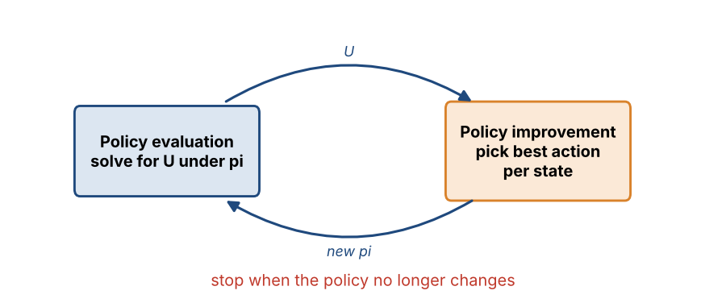
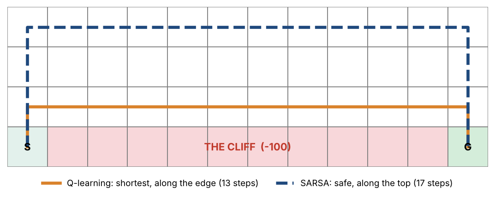
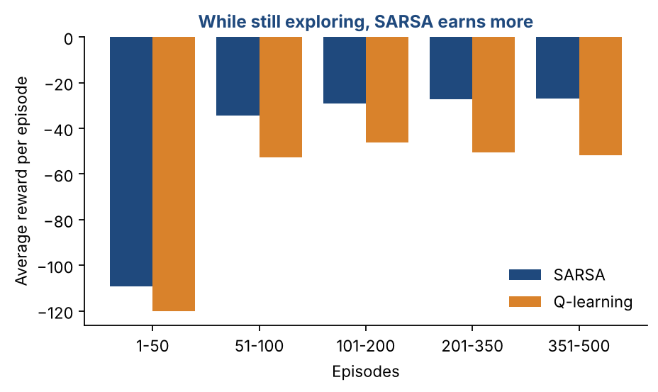
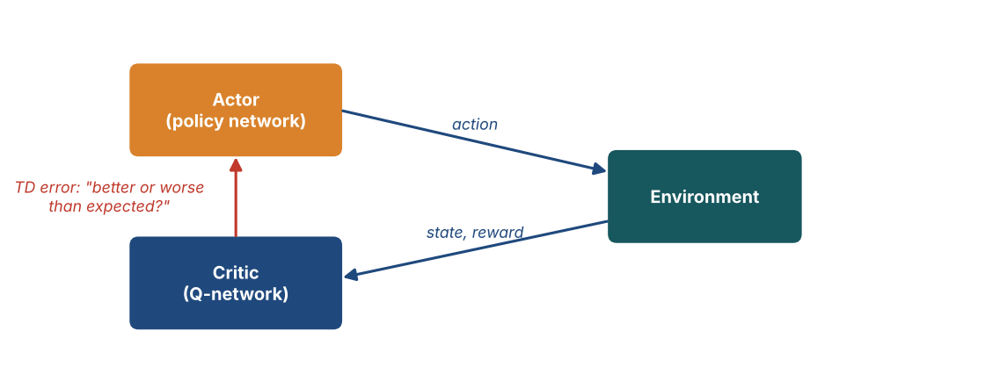
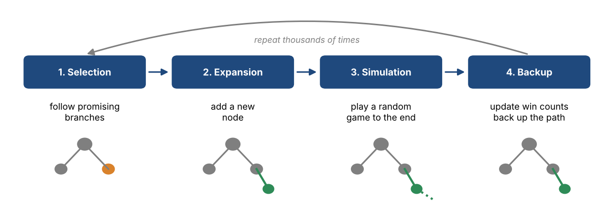

# Chapter 34 — Reinforcement Learning II: Policy Iteration, SARSA, Deep RL & Actor-Critic

**Part V — Production & Reinforcement Learning** · [](https://colab.research.google.com/github/winnertechserv/aimlgybs/blob/main/part5_production_rl/ch34_reinforcement_learning_ii/ch34_notebook.ipynb)

Companion code for Chapter 34 of *AI-Machine Learning: Get Your Base Strong*. The book explains the ideas; this folder lets you run them.

## Key ideas

- Policy iteration alternates evaluating the current policy and improving it, and usually converges in very few rounds.
- Reinforcement learning is needed when the transition model is unknown and labeled examples could never cover the state space.
- Model-based agents plan with a model; model-free agents learn Q-values (Q-learning) or a policy (policy search) directly.
- TD learning updates after every step using the next state's estimate, so it needs no model and no waiting for the episode to end.
- SARSA is on-policy and plays safe near danger; Q-learning is off-policy and learns the optimal path even while exploring.
- When there are too many states for a table, a neural network approximates the values: that is deep RL, and a DQN has one output per action.
- Policy gradients and actor-critic methods improve the policy directly; AlphaGo combines policy and value networks with Monte Carlo Tree Search.

## Examples

| # | Program | What it shows |
|---|---|---|
| 1 | [`ex1_policy_iteration_on_the_4x3_grid_world.py`](ex1_policy_iteration_on_the_4x3_grid_world.py) | This solves the same grid world as Chapter 33, but with policy iteration. |
| 2 | [`ex2_sarsa_vs_q_learning_on_cliff_walking.py`](ex2_sarsa_vs_q_learning_on_cliff_walking.py) | This is the classic example that shows why on-policy and off-policy learning behave differently. |
| 3 | [`ex3_policy_gradient_by_the_finite_difference_meth.py`](ex3_policy_gradient_by_the_finite_difference_meth.py) | This follows the finite-difference recipe exactly. |

Run any example from this folder:

```bash
cd part5_production_rl/ch34_reinforcement_learning_ii
python ex1_policy_iteration_on_the_4x3_grid_world.py
```

The exact output printed in the book is in [`expected_output/`](expected_output). The notebook [`ch34_notebook.ipynb`](ch34_notebook.ipynb) has all three examples with explanations.

### Example 1: Policy Iteration on the 4x3 Grid World

This solves the same grid world as Chapter 33, but with policy iteration. It starts from a bad policy, 'always go up', and repeats two steps: work out the exact value of every state under the current policy by solving a set of linear equations, then switch each state to its best action. After just five rounds the policy stops changing. Look at the last table: the utilities match the value-iteration answers from Chapter 33, so two different methods agree on the same optimal policy.

<details><summary>Expected output</summary>

```text
=== Policy Iteration on the 4x3 Grid World ===

Same world as Chapter 33: wall at (2,2), +1 at (4,3), -1 at (4,2),
step reward -0.04, action succeeds with p=0.8, slips sideways 0.1 each.

Policy iteration alternates two steps until the policy stops changing:
  1. Policy EVALUATION : work out U(s) for the CURRENT policy (no max)
  2. Policy IMPROVEMENT: in each state, switch to the best action

Initial policy (always Up):
    row 3 |  ^   ^   ^  +1 
    row 2 |  ^   #   ^  -1 
    row 1 |  ^   ^   ^   ^ 

Iteration 1: U(1,1)=-1.4662  U(3,3)=-0.2000  actions changed = 6

Iteration 2: U(1,1)=+0.5082  U(3,3)=+0.9178  actions changed = 1

Iteration 3: U(1,1)=+0.6910  U(3,3)=+0.9178  actions changed = 1

Iteration 4: U(1,1)=+0.7053  U(3,3)=+0.9178  actions changed = 1

Iteration 5: U(1,1)=+0.7053  U(3,3)=+0.9178  actions changed = 0
Policy is stable -> it is optimal. Stop.

Final optimal policy:
    row 3 |  >   >   >  +1 
    row 2 |  ^   #   ^  -1 
    row 1 |  ^   <   <   < 

Final utilities compared with VALUE iteration from Chapter 33:
    state     policy iter.  value iter.
    (1, 1)          0.7053       0.7053
    (1, 3)          0.8116       0.8116
    (3, 3)          0.9178       0.9178
    (4, 1)          0.3879       0.3878

Both methods reach the same answer. Policy iteration needed only a
handful of iterations because each one solves the evaluation exactly;
value iteration needed 22 smaller steps to creep to the same values.
```

</details>

### Example 2: SARSA vs Q-Learning on Cliff Walking

This is the classic example that shows why on-policy and off-policy learning behave differently. Both agents learn to cross a grid with a cliff along the bottom, while still exploring randomly 10% of the time. Q-learning finds the shortest route, right along the cliff edge. SARSA finds a longer route along the top. Now check the reward table: SARSA earns about -27 per episode against Q-learning's -52, because Q-learning's random steps keep pushing it off the cliff. Shortest is not the same as safest.

<details><summary>Expected output</summary>

```text
=== SARSA vs Q-Learning: The Cliff-Walking Problem ===

A 4x12 grid. Start S is bottom-left, goal G is bottom-right.
The cells between them on the bottom row are a CLIFF.
Every step costs -1. Stepping into the cliff costs -100 and sends you
back to S. Both agents explore with epsilon-greedy (eps = 0.1).

    . . . . . . . . . . . .
    . . . . . . . . . . . .
    . . . . . . . . . . . .
    S C C C C C C C C C C G      C = cliff

Average reward per episode during training (20 runs averaged):

  episodes         SARSA    Q-learning
  ------------------------------------
    1-50          -109.2        -120.2
   51-100          -34.3         -52.6
  101-200          -29.1         -46.1
  201-350          -27.2         -50.5
  351-500          -26.9         -51.7

SARSA learned path (17 steps):
    * * * * * * * * * * * *
    * . . . . . . . . . . *
    * . . . . . . . . . . *
    S C C C C C C C C C C G

Q-learning learned path (13 steps):
    . . . . . . . . . . . .
    . . . . . . . . . . . .
    * * * * * * * * * * * *
    S C C C C C C C C C C G

What this shows:
  Q-learning learns the SHORTEST path, right along the cliff edge. Its
  update uses max Q(s',a'), the value of the best action, as if it will
  never explore again. That is OFF-policy learning.
  SARSA learns a SAFER path that keeps well away from the edge. Its update uses the
  action it will actually take next, random exploration included, so it
  knows a random step near the edge can cost -100. That is ON-policy.
  So while both are still exploring, SARSA earns MORE reward per episode
  even though Q-learning's final route is shorter.
```

</details>

### Example 3: Policy Gradient by the Finite-Difference Method

This follows the finite-difference recipe exactly. A simple policy starts out preferring the wrong direction in a corridor, so its total reward J is negative. Each iteration it tries a dozen small random changes to its weights, measures how the reward moved, fits a gradient with the regression formula (D^T D)^-1 D^T y, and steps uphill. Without ever learning a value function, J climbs from -0.75 to +0.84. The closing note explains how actor-critic methods speed this up.

<details><summary>Expected output</summary>

```text
=== Policy Gradient: the Finite-Difference Method ===

Value-based methods learn U(s) or Q(s,a) and then pick actions from it.
Policy gradient methods skip that: they adjust the policy's parameters
theta DIRECTLY, in the direction that raises the total reward J.

The finite-difference recipe:
  1. Nudge the weights m times by small random amounts  delta_theta_i
  2. Run a roll-out of H moves with each nudged policy, measure delta_J_i
  3. Stack nudges as rows of D and reward changes into y, then solve
        grad J = (D^T D)^-1 D^T y        (the linear-regression formula)
  4. Gradient ASCENT:  theta <- theta + eta * grad J

Environment: a corridor of 7 cells, start in the middle (cell 3).
Right end = +1, left end = -1, every other step = -0.01, horizon H=20.
Policy: P(move right | s) = sigmoid(theta_0 + theta_1 * position)

 iter   theta_0   theta_1   P(right) at start         J
---------------------------------------------------------
    0    -1.000     0.000               0.269    -0.752
    2    -0.584     0.015               0.358    -0.480
    4     0.643     0.020               0.655     0.515
    6     1.465     0.113               0.812     0.785
    8     1.657     0.136               0.840     0.796
   10     1.878     0.126               0.867     0.831
   12     2.012     0.158               0.882     0.840

What happened:
  The policy began by preferring the WRONG direction (P(right) = 0.27),
  so it usually fell off the left end and J was negative.
  Nobody told it which way to go. Each iteration it just tried small
  random changes, saw which ones earned more reward, fitted a gradient,
  and stepped uphill. P(right) climbed to nearly 0.9 and J turned positive.

=== From here to Actor-Critic ===
  Finite differences need many roll-outs per step, which is slow.
  Actor-critic methods use TWO networks instead:
    the ACTOR  (policy network) chooses actions,
    the CRITIC (Q-network) scores them using the TD error
        delta_t = R_t + gamma*Q(s_t+1, a_t+1) - Q(s_t, a_t).
  The critic's score tells the actor which way to move, one step at a time,
  without waiting for whole roll-outs. AlphaGo and walking robots use this idea.
```

</details>

## Figures from this chapter

**Figure 34.1.** Policy iteration alternates two steps until the policy stops changing.



**Figure 34.2.** The greedy paths learned in Example 2. Q-learning hugs the cliff edge; SARSA, which accounts for its own random exploration, keeps well away.



**Figure 34.3.** Average reward per episode from Example 2 (20 runs). Q-learning keeps falling off the cliff during exploration, so SARSA collects more reward.



**Figure 34.4.** Actor-critic: the actor chooses actions, the critic scores them with the TD error, and that score tells the actor which way to improve.



**Figure 34.5.** The four phases of Monte Carlo Tree Search, repeated many times; the move with the best record at the root is then played.



The code that draws these figures is in [`figures/src`](../../figures/src).

---

[← Chapter 33](../../part5_production_rl/ch33_reinforcement_learning_i) · [All chapters](../../README.md#chapters)
